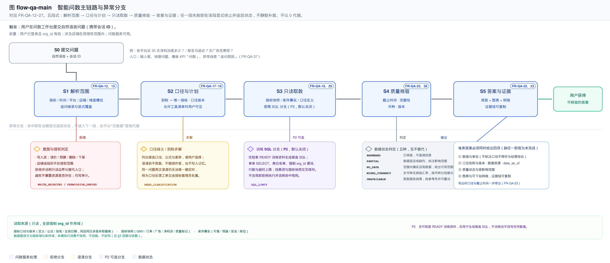
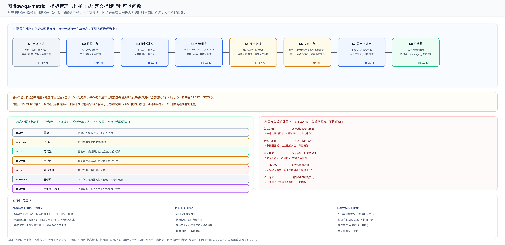
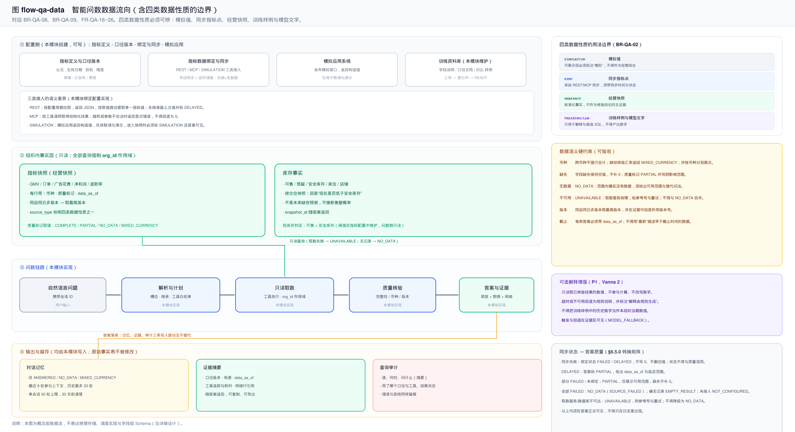
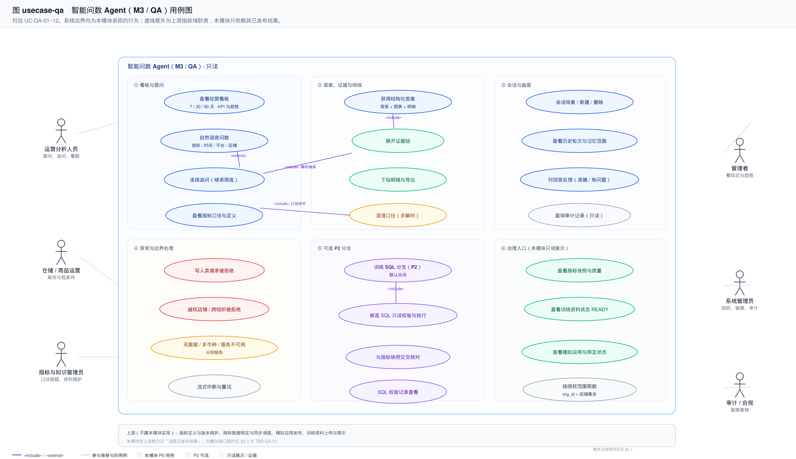
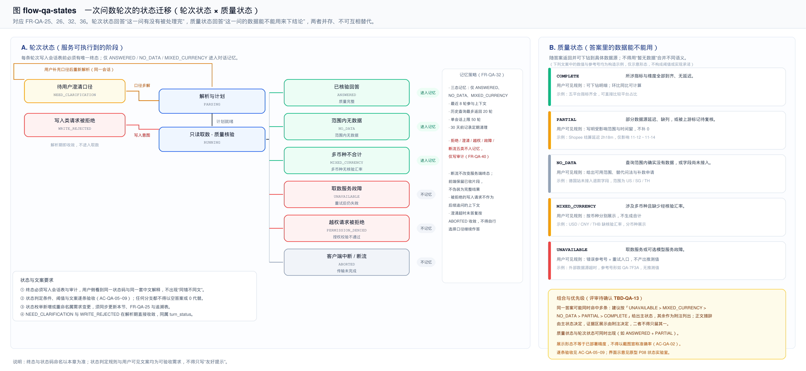
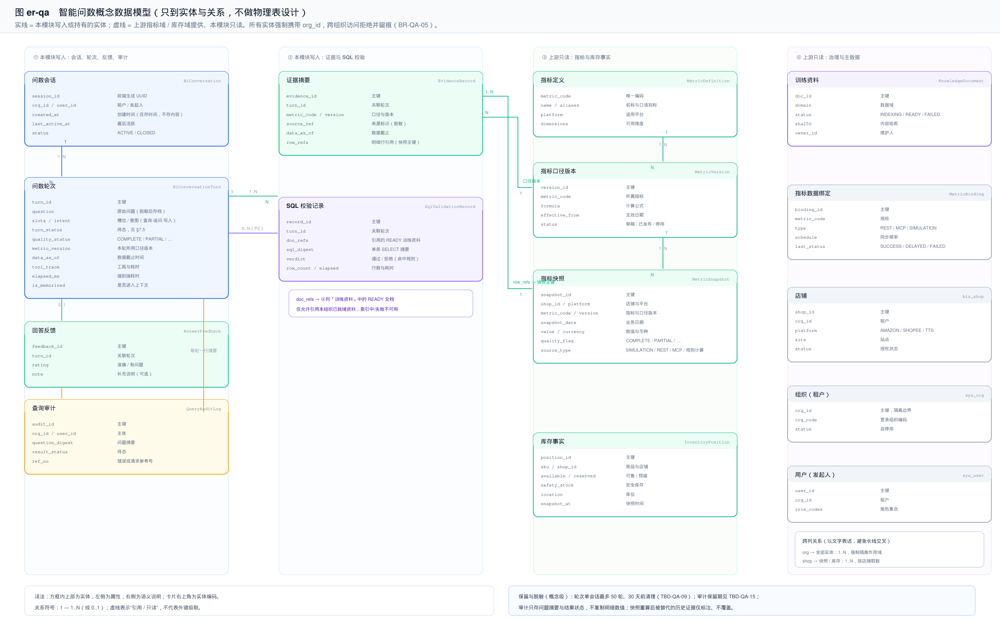
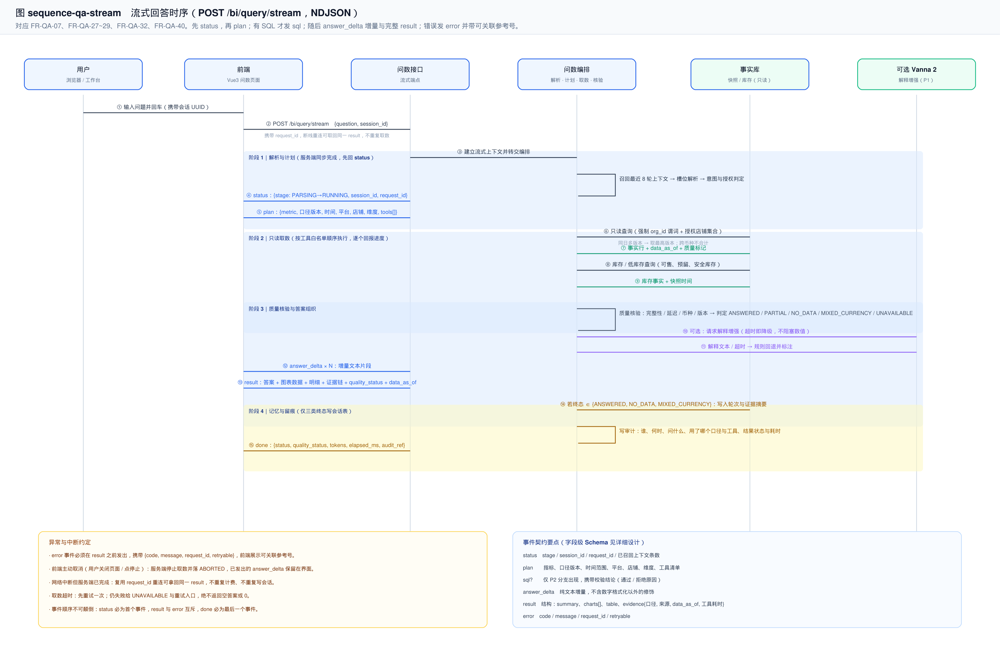
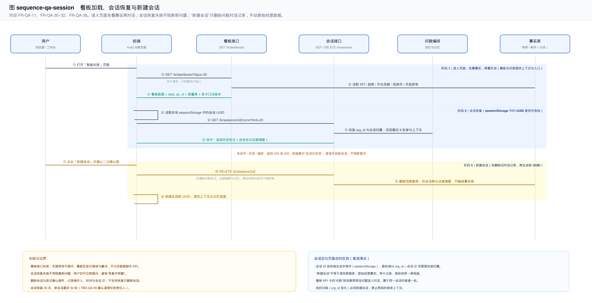

# 智能问数 Agent（M3 / QA）软件需求规格说明书

> 模块级 SRS · 版本 **V2.1** · 文档状态：**基线（陈述性需求，无未决项）** · 可直接作为概要设计与详细设计输入
> 遵循 ISO/IEC/IEEE 29148:2018 与 GB/T 9385-2008；延续平台 V1.0 SRS 的编号体系（`FR-QA-xx` / `BR-QA-xx` / `AC-QA-xx`），只追加、不复用、不重排。

**交付物导航**

| 交付物 | 路径 | 一句话说明 |
| --- | --- | --- |
| 本说明书（源） | `docs/requirements-qa.md` | 规范性正文，唯一规范文本，评审与设计均以此为准 |
| 本说明书（阅读版） | `docs/requirements-qa.html` | 由源文件自动生成的同版本阅读版（含内嵌图），便于分发评审 |
| 追溯表 | `docs/qa-requirements-traceability.csv` | 76 行，BR → 场景 → FR → AC → 章节 → 用例，覆盖 19 条 BR + 44 条 FR + 40 条 AC，无断链 |
| 口径基线 | `docs/qa-baseline-decisions.csv` | 28 项原待确认项的**已定稿基线值**，含基线结论与生效版本 |
| 图表 | `docs/attachments/` | 7 组 `.mmd` / `.svg` / `.png`，及可复现的生成脚本 |

---

## 0 文档信息

### 0.1 编写目的

把 V1.1 对「智能问数」的能力增量（指标统一口径、来源可追溯、结构化答案、质量与截止时间可见、绑定与同步可验证、模拟应用系统）以及**本模块自承担的指标管理与维护**，转写为**可验收、可追溯、粒度单一**的需求条目，作为详细设计、测试用例与验收的唯一输入；同时纠正 V1.0 SRS 中把实现方案（代码文件、函数名、DAO 类）写进需求条目的问题。

### 0.2 适用范围

| 项 | 内容 |
| --- | --- |
| 模块 | M3 智能问数 Agent（代号 QA） |
| 覆盖 | **配置侧**：指标定义与维护、口径版本、别名、绑定与同步、模拟应用、配置留痕；**运行侧**：问数工作台、解析与取数、结构化答案与证据、状态语义、会话与记忆、审计、P2 训练 SQL |
| 不覆盖 | 平台连接授权（数据接入中台）、库存事实生产（库存域）、汇率与折算（财务）、M2 驾驶舱渲染、M4~M7 其他 Agent |
| 读者 | 产品、后端、前端、测试、指标管理员、运维与合规审计 |

### 0.3 依据与参考

| 代号 | 文件 | 用途 |
| --- | --- | --- |
| 材料 A | 《AI 跨境电商平台 V1.0 软件需求规格说明书》第 5 章（第 18–20 页） | 编号与体例基准：11 条 `FR-QA`、2 条 `BR-QA`、2 条 `AC-QA` |
| 材料 B | 《AI 跨境电商平台 V1.1》第 3 章「智能问数 Agent（拓展）」（第 33–45 页） | 目标、业务流程图、数据流向、类图、用例图、时序图、展示效果、实现步骤 |
| 材料 C | 《智能问数 Agent v1.1》发布海报（V1.1 第 34 页） | 核心价值与能力、业务闭环、指标统一口径清单、问数示例（数值为构造示例） |
| 材料 D | 《智能问数 Agent 高保真原型》`智能问数Agent-高保真原型.html` | 9 个页面（P01~P09）、需求覆盖矩阵、状态实验室 12 个边界状态、观察项 Q-01~Q-05、文案与交互形态 |
| 材料 E | 《CrossPilot 需求分析》`CrossPilot-需求分析.md` | 角色与权限诉求、数据质量与口径约定 |
| 材料 F | 《RBAC 权限说明与流程图》、`项目角色及权限.png` | 组织/店铺/角色的隔离模型 |
| 关联 | M2 驾驶舱设计 Agent（FR-BI）、数据接入中台、权限中台、库存域、对象存储（训练资料） | 上下游接口边界 |

引用约定：正文中的 `A §x.y` / `B §x.y` / `C` / `D` 指**来源材料的章节**；本文自身的章节一律写作 `§` + 本文编号（如 §6.5、§15）。二者不同源，不可混读。

### 0.4 术语表

| 术语 | 定义 | 出处 |
| --- | --- | --- |
| 指标（Metric） | 组织内可被问数的经营量化项，如 GMV、订单数、广告花费、净利润、库存可售数 | B §3.1 |
| 指标口径（Metric Definition / Version） | 指标的定义、公式、可用维度、适用平台与**版本号**；同一指标可有多个版本，以生效日期区分 | B §3.8(2) |
| 指标点 / 指标快照（MetricSnapshot） | 某组织、某店铺、某业务日、某指标在某一口径版本下的数值记录，带币种、质量标记与 `data_as_of` | B §3.3、§3.4 |
| 经营快照 | 组织内标准化事实，可作为核验结论的主证据（与模拟值、训练样例相对） | C 产品亮点 |
| 库存事实（InventoryPosition） | 按仓位的可售/预留/安全库存快照，用于回答库存与低库存问题 | D P02 库存案例 |
| 绑定（Binding） | 指标与外部数据源之间的取数配置；接入类型为 REST / MCP / SIMULATION | C 核心能力 |
| 模拟应用（Simulation App） | 发布模拟接口并返回构造值的应用，用于联调与演示 | C 核心能力 |
| 同步指标点 | 通过 REST/MCP 同步取得的指标值，须带同步时间与同步状态 | C 产品亮点 |
| 训练资料（KnowledgeDocument） | 字段说明、口径文档、SQL 样例等；本模块负责上传与维护（FR-QA-53~55），状态为 READY 时才参与候选 SQL 生成 | B §3.6(2)、§3.8(6)、用户 2026-11-24 决策 |
| 质量状态（quality_status） | `COMPLETE` / `PARTIAL` / `NO_DATA` / `MIXED_CURRENCY` / `UNAVAILABLE`，表示答案中的数值能否用于结论 | D P08、B §3.2 |
| data_as_of | 数据截止时间；每条答案必须携带，用于判断“最新”是否成立 | B §3.1 |
| NO_DATA | 查询范围内确实没有数据，或字段尚未接入 | B §3.2 |
| MIXED_CURRENCY | 涉及多币种且缺少经核验汇率，系统不生成合计，按币种分别展示 | B §3.2 |
| UNAVAILABLE | 取数服务或可选模型服务故障，须给错误参考号与重试入口 | D P08 |
| ORG 隔离（org_id） | 所有持久化业务记录以 `org_id` 关联组织，读取与写入按组织作用域校验 | 材料 A `BR-QA-01`、材料 F |
| 证据链（Evidence） | 一次回答的执行步骤、口径版本、来源、`data_as_of`、工具耗时与明细引用 | B §3.8(5)、D P02 |
| 会话记忆（Memory） | 进入后续上下文的轮次；仅 `ANSWERED` / `NO_DATA` / `MIXED_CURRENCY` 三类入记忆 | B §3.4 |
| 口径基线（Baseline） | 原 `TBD-QA-xx` 编号对应的**已定稿**取值与兜底规则；本文不含未决项（§12） | 全文 |

### 0.5 版本记录

| 版本 | 日期 | 变更摘要 | 编制 / 评审 |
| --- | --- | --- | --- |
| V1.0（平台基线） | 2026-11-13 | 第 5 章首次给出 `FR-QA-01~11`、`BR-QA-01~02`、`AC-QA-01~02` | 平台 SRS |
| V1.1-QA | 2026-11-24 | 在 01~11 基础上做行为级重写与增量扩展至 `FR-QA-41`；新增 `BR-QA-03~11`、`NFR-QA-01~08`、`UC-QA-01~12`、`TBD-QA-01~17`、`AC-QA-03~23`；补 7 张图与追溯表 | 本文档 |
| V1.2-QA | 2026-11-24 | **范围调整**：指标管理与维护纳入本模块，新增 `FR-QA-42~51`、`BR-QA-12~16`、`NFR-QA-09~11`、`UC-QA-13~21`、`AC-QA-24~29`、`TBD-QA-18~22`、`D-QA-05~06`、图 8；§2、§3、§9.2/9.3、§10、§13 同步修订 | 本文档 |
| V1.3-QA | 2026-11-24 | 明确指标**增删改查**四类操作：新增 FR-QA-52（指标修改，字段分级）、BR-QA-17（指标可维护）、UC-QA-22、AC-QA-30、§3.1 权限矩阵、§9.2 增删改查接口（含 `GET`/`DELETE /bi/metrics/{code}`）、TBD-QA-23 | 本文档 |
| V1.4-QA | 2026-11-24 | **权限与删除策略定稿**：指标 CRUD 限「指标与知识管理员」+「系统管理员（admin）」，其余角色只读（BR-QA-18、§3.1 重写）；删除改为**软删除**（FR-QA-45 重写、§6.10.0 增 `DELETED`、AC-QA-31）；关闭 TBD-QA-18、TBD-QA-23（§16.2.3） | 本文档 |
| V1.5-QA | 2026-11-24 | **训练资料维护纳入本模块**：新增 FR-QA-53~55、BR-QA-19、§6.11.0 资料状态字典、§3.2 权限矩阵、§9.6 接口、UC-QA-23~25、AC-QA-32/33、NFR-QA-12、TBD-QA-24；§2.1/2.3/9.3 范围改写 | 本文档 |
| V1.6-QA | 2026-11-24 | **存储方案定稿**：训练资料存 MinIO（路径映射入库表）、内容更新改为**原地替换不做版本链**、删除改为**逻辑删除**、**取消存储配额**；重写 FR-QA-53/54/55、新增 D-QA-07 与 §16.2.5、AC-QA-34 | 本文档 |
| V1.7-QA | 2026-11-25 | **追问继承边界定稿**：关闭 TBD-QA-03，明确追问时平台/店铺/时间/指标/维度全部继承 + 界面明示可清除；FR-QA-13 规则 3 定稿，新增 AC-QA-35 与 §16.2.6；附录 Q-01 落位 | 本文档 |
| V1.8-QA | 2026-11-25 | **指标编码跨系统对齐定稿**：关闭 TBD-QA-22，M3 为编码唯一来源、M2/上游共用同一编码，历史旧编码经映射表过渡；FR-QA-42 规则 1/5 定稿，新增 AC-QA-36 与 §16.2.7 | 本文档 |
| V1.9-QA | 2026-11-26 | **评审确认**：M3 作为 P0 闭环；指标管理/绑定/同步/训练资料归本模块；模块化单体 + Redis/Celery Worker；不设财务角色；训练资料允许原地覆盖；指标有引用禁删；新增请求幂等与重放；统一版本与追溯件 | 本文档 |
| V2.0-QA（本次评审修订） | 2026-11-28 | **修订三项评审缺口**：指标/平台/绑定状态分层与聚合规则；同步状态到答案质量状态转换矩阵；GMV、订单量、广告花费、净利润逐项口径待确认与发布门禁 | 本文档 |
| **V2.1-QA（本文当前版本）** | 2026-11-28 | **消除全部未决项，转为基线**：§12 整章由「待确认项」改写为「口径基线与决策记录」，28 项全部定稿（12 项按安全默认值关闭、4 项核心指标口径改为发布门禁、外部依赖定义兜底行为）；NFR-QA-01/09/11/12 由 `TBD` 量化为具体目标值；§13.2 由「孤儿与缺口」改写为「覆盖度收敛结论」；修复 §6.10.0 状态聚合冲突与 §6.5.0 转换矩阵矛盾；交付物文件统一为 `requirements-qa.md` | 本文档 |
| 基线冻结（本文状态） | 2026-11-28 | 本文即基线，可直接作为概要/详细设计输入；后续任何条目变更须走 §16.3 变更流程 | — |

### 0.6 编号规则与优先级

| 前缀 | 含义 | 规则 |
| --- | --- | --- |
| `FR-QA-xx` | 功能需求 | 01~11 为 V1.0 既有条目（**编号保持不变**，内容按 §16 变更说明重写）；12 起为本次新增，只追加 |
| `BR-QA-xx` | 业务规则 / 禁止性约束 | 01~02 沿用；03 起新增 |
| `NFR-QA-xx` | 非功能需求 | 全部新增，**每个阈值均为具体可测值**并附度量方法 |
| `UC-QA-xx` | 用例 | 全部新增 |
| `AC-QA-xx` | 验收标准 | 01~02 沿用（原文保留，补可执行细则）；03 起新增 |
| `TBD-QA-xx` | 口径基线条目 | 编号仅作追溯锚点；语义为**已定稿基线**，不含未决项（§12.6） |
| `D-QA-xx` | 设计约束 | 从原实现描述中提炼的、确实构成约束的项 |

优先级：**P0** = 模块闭环必需；**P1** = 重要可分期；**P2** = 增强/拓展（材料 B 标注“拓展”的能力默认含 P2）。

---

## 1 模块定位与业务目标

### 1.1 在平台闭环中的位置

智能问数是七个 Agent 中的**经营分析中枢**：自身承载指标定义、口径版本与同步（配置侧），向下消费库存域产出的库存事实与平台授权连接；向上为管理者与运营提供“用一句话拿到可核验数字”的入口，并为 M2 驾驶舱的逐卡取数提供同一套口径与证据语义。

```text
                     ┌───────── 智能问数（M3/QA）─────────┐
库存域 ──仓位快照──▶ │ 指标管理与维护（定义/口径版本/别名） │ ──已发布口径与快照──▶ 问数工作台
                     │ 数据绑定与同步（REST/MCP/SIMULATION）│                      （业务/运营/仓储）
                     │ 模拟应用发布 · 只读安全问数           │ ──同一口径与证据语义──▶ M2 驾驶舱（逐卡取数）
                     └───────────────┬──────────────────┘
                                     └──▶ 指标管理员（配置）· 审计/合规（留痕与复盘）
```

> 本模块同时承担**配置侧**（指标管理与维护，可写）与**运行侧**（问数，只读）两类职责。两者权限、审计与数据所有权必须分开治理（见 BR-QA-12/13）。

### 1.2 V1.0 → V1.1 的能力增量

| 增量 | V1.0 状态 | V1.1 要求 | 落到条目 |
| --- | --- | --- | --- |
| 指标统一口径 | 以别名表隐含表达 | 别称归一、口径版本回显、歧义澄清 | FR-QA-13、FR-QA-16 |
| 来源可追溯 | 仅“返回证据”一句 | 口径/来源/`data_as_of`/工具耗时的结构化证据 | FR-QA-15、FR-QA-19、FR-QA-40 |
| 问数结果结构化 | 只有文字答案 | 简答 + 图表 + 明细三级，结构化字段返回 | FR-QA-22、FR-QA-23 |
| 质量与截止时间可见 | 状态码未定义 | 五态质量语义 + 用户可见文案 + 优先级 | FR-QA-25、FR-QA-26、FR-QA-38 |
| 绑定与同步可验证 | 无 | 消费同步状态，把“同步失败”与“无数据”分开报告 | FR-QA-25、BR-QA-09 |
| 模拟应用系统 | 无 | 模拟值必须可标注，不得当作经营结论 | BR-QA-08、FR-QA-25 |
| 指标管理与维护 | V1.0 未定义，默认由指标域承担 | 指标定义、口径版本、别名、启停用、绑定、同步、模拟应用、训练资料由本模块配置侧提供，并对自己产出的口径负责 | FR-QA-42~55 |

> **2026-11-26 评审确认**：本项目将 M3 作为 **P0 闭环**；指标管理与指标数据是问数的前置生产系统。V1.1 的“拓展”标记不再作为本项目优先级依据；配置侧（指标、绑定、同步、训练资料）纳入 M3。

### 1.3 业务目标与成功度量

| 目标 | 可度量口径 | 基线 |
| --- | --- | --- |
| 缩短“提问 → 拿到可核验数字”的路径 | 单次问数从提出到可核验答案的操作步数（输入问题后所需点击/跳转次数）≤ 1 步 | TBD-QA-02（需实测现状） |
| 降低口径争议 | 月度口径争议工单数环比下降 ≥ 30% | 运营观测项，首个运营季度结束前完成基线实测（不计入本期验收） |
| 提升答案可核对率 | 抽样 100 条回答中，能在 2 次点击内下钻到明细的比例 ≥ 90% | 验收项（抽样 100 条） |
| 减少“把无数据当 0”的误判 | 抽样回答中，NO_DATA / UNAVAILABLE / PARTIAL 三类状态标注完整率 100% | 可即时验收 |
| 只读合规 | 问数链路产生的写操作次数 = 0（审计可核） | 可即时验收 |

> 上表全部为**可即时判定**的绝对口径：状态标注完整率 100%、只读写操作数 0、可下钻率 ≥ 90%（抽样 100 条），不依赖历史基线即可验收。相对提升类指标（口径争议工单环比）仅作运营观测，不构成验收条件（§12.2 TBD-QA-02）。

---

## 2 范围与边界

### 2.1 范围内（In Scope）

1. 问数工作台：看板呈现、输入提问、连续追问、快捷问题入口、上下文面板、图表与明细。
2. 问题解析：指标/别称、时间、平台、店铺、维度槽位的识别；追问继承与显式覆盖。
3. 口径解析：别称到唯一指标的映射、口径版本回显、歧义澄清。
4. 只读取数：允许工具清单、事实优先级、同日多版本取最高、库存与低库存查询。
5. 答案组织：简答、图表、明细、证据链。
6. 状态语义：五态质量与七类终态的判定与用户可见文案。
7. 会话与记忆：新建、恢复、删除，记忆准入与保留边界。
8. 流式交互：事件序列、字段语义、中断与重连、错误参考号。
9. 审计留痕：谁在何时问了什么、用了哪个口径与工具、结果状态。
10. 可选 P2 训练 SQL 分支：资料准入、单条只读校验、表白名单、行数与超时限制。
11. **指标管理与维护（配置侧）**：指标定义与口径版本维护、别名维护、启停用与删除保护、发布评审、指标列表与检索、口径变更影响提示。
12. **数据绑定与同步（配置侧）**：REST / MCP / SIMULATION 三类绑定的创建、测试、启停、手动同步与定时调度、同步结果与失败处理。
13. **模拟应用系统（配置侧）**：模拟接口的发布、请求参数配置、返回值测试与样例数据生成。
14. **指标治理留痕**：指标与绑定的变更记录、发布记录、谁改了什么、从哪个版本改到哪个版本。
15. **训练资料维护（配置侧）**：训练资料上传（MinIO + 路径映射）、解析与索引、原地替换与重建索引、启停用、逻辑删除与恢复；P2 训练 SQL 分支只消费 READY 资料。

### 2.2 范围外（Out of Scope）

| 项 | 说明 | 归属 |
| --- | --- | --- |
| 写入类操作 | 调价、改预算、上下架、删除、审批、库存调整 | 其他 Agent 的能力域，问数只拒绝并给出替代入口 |
| 平台授权与连接器 | 平台 OAuth、令牌、限流（绑定只使用已授权连接，不负责授权本身） | 数据接入中台 |
| 驾驶舱渲染与布局设计 | 逐卡编排、布局版本 | M2（FR-BI） |
| 跨币种折算 | 汇率的获取与核验（本模块只消费已核验汇率；未核验即不合计，§12.4） | 财务提供汇率表 |
| 事实数据的人工订正 | 直接修改真实快照数值、事后调整已入账指标点（模拟值只能以 `SIMULATION` 身份写入并可整体清除，**不可转为真实值**） | 数据源系统 / 运维流程；本模块不提供任何改数入口（BR-QA-12/16） |
| 外部 BI 工具与开放 API 对外售卖 | 第三方消费方接入、配额与计费 | 平台开放平台 |
| 预测与补货计算 | 缺货预测、补货建议 | M5 / M6 |

### 2.3 与上游模块的接口边界与数据所有权

| 能力 | 数据所有者 | 本模块的行为 | 失败语义 |
| --- | --- | --- | --- |
| 指标定义与口径版本 | **本模块（配置侧写入）** | 维护定义、版本、别名、启停用；发布后供问数只读消费 | 无已发布版本 → 该指标不可问，提示“口径未发布” |
| 指标快照 | **本模块（同步写入）** | 由绑定同步写入；问数只读取数，同日多版本取最高 | 无记录 → NO_DATA；服务不可达 → UNAVAILABLE |
| 库存事实 | 库存域 | 只读；按仓位呈现 | 同上 |
| 绑定与同步状态 | **本模块（配置侧写入）** | 维护绑定；同步结果供质量判定区分 DELAYED / FAILED / NO_DATA | 同步失败不得写入 0，也不得删除旧值 |
| 模拟应用 | **本模块（配置侧写入）** | 发布模拟接口；其产出快照在答案中标注 SIMULATION | 模拟值不得作为经营结论 |
| 训练资料 | **本模块（配置侧写入，文件存 MinIO）** | 上传/替换（原地覆盖）/索引/停用/逻辑删除；P2 分支只消费 READY 资料 | 非 READY → 不参与检索；索引失败 → FAILED 并可重试；对象丢失 → 提示重新上传 |

> **数据所有权原则（改）**：本模块在**配置侧**写入指标定义、口径版本、别名、绑定、同步记录与模拟应用配置；在**运行侧**对事实数据仍为只读——同步只做“按契约写入指标点”，不做人工改数，也不提供任何直接编辑快照数值的入口（BR-QA-12/13）。

### 2.4 业务上下文图

见 §15 图 1 `flow-qa-main`（问数主链路与异常分支）、图 8 `flow-qa-metric`（指标从创建到可问数的配置主链路）与图 6 `flow-qa-data`（数据流向与四类数据性质）。







---

## 3 干系人与角色

| 角色 | 典型诉求 | 可见范围 | 关键权限差异 |
| --- | --- | --- | --- |
| 业务 / 运营分析人员 | “各平台近 30 天净利润是多少”“哪个店铺广告花费异常” | 所辖品牌与店铺 | 可提问、追问、下钻明细、导出；不可见未授权店铺 |
| 仓储 / 商品运营 | “哪些 SKU 库存不足”“某 SKU 库位在哪” | 所辖店铺与仓位 | 可问库存类；利润类指标默认不可见，需查看时由管理员按店铺范围授权 |
| 管理者 | 看结论与趋势，不追细节 | 组织内聚合视角 | 默认看聚合，明细按需展开 |
| 指标与知识管理员 | 指标的增删改查、**训练资料的上传与维护**、口径答疑、绑定与模拟维护、口径争议处理 | 组织内全部指标与资料 | **指标 CRUD 与训练资料维护的两个授权角色之一**：对指标具备**增（FR-QA-42）/ 删（FR-QA-45，有引用禁删、无引用软删除）/ 改（FR-QA-52）/ 查（FR-QA-46）**，对训练资料具备上传、索引重试、启停用、软删除（FR-QA-53~55）；不可改事实数据、不可改已发布口径原文（须新建版本） |
| 系统管理员（admin） | 组织、成员、留痕与审计，并作为超管兜底指标维护 | 组织内全部会话、审计与指标 | **具备与指标管理员相同的指标 CRUD 权限**（增/删/改/查全部可）；但**不因此获得例外权**：同样受“已发布口径不可改、编码不可改、有引用禁删/无引用软删除”约束（BR-QA-13/17/18） |
| 数据运营（同步值守） | 关注同步是否成功、延迟是否超阈值 | 绑定与同步记录 | 可手动触发同步、查看失败原因、重试；**不可增删改指标与绑定配置**，对指标仅只读（BR-QA-18） |
| 审计 / 合规 | 复核“谁在何时问了什么、结果如何” | 组织内审计记录 | 只读审计，不可编辑或删除审计 |

角色与数据范围以材料 F 的 RBAC 模型为准：用户 → 角色 → 权限，叠加 `sys_user_shop` 的店铺级可见范围；`org_id` 是硬隔离边界。问数上下文中的“店铺”选择必须与该用户的店铺范围求交，前端传入的店铺 ID 不被信任。

> **2026-11-26 评审确认**：本项目不设财务角色。财务类指标（如净利润）的口径、版本、绑定与同步统一由「指标与知识管理员」与「系统管理员（admin）」共同维护；业务/管理者仅按数据范围只读。若后续引入财务角色，走变更流程。
### 3.1 指标维护权限矩阵（增 / 删 / 改 / 查）

> 已定稿（2026-11-26）：**只有「指标与知识管理员」与「系统管理员（admin）」拥有指标 CRUD**；其余全部角色（数据运营、运营/仓储、管理者、审计/合规）对指标**只读**。
> 该结论取代原 TBD-QA-18 的“是否强制双人分离”问题——**不做双人约束**，但保留“已发布口径不可改 / 编码不可改 / 有引用禁删、无引用软删除”三条硬规则。

| 操作 | 指标与知识管理员 | 系统管理员（admin） | 数据运营 | 运营 / 仓储 / 管理者 | 审计 / 合规 |
| --- | --- | --- | --- | --- | --- |
| **增**：新建指标（FR-QA-42） | ✅ 可（落为草稿） | ✅ 可 | ❌ 只读 | ❌ 只读 | ❌ 只读 |
| **增**：新建口径版本（FR-QA-43） | ✅ 可 | ✅ 可 | ❌ 只读 | ❌ 只读 | ❌ 只读 |
| **增**：新增别名（FR-QA-44） | ✅ 可 | ✅ 可 | ❌ 只读 | ❌ 只读 | ❌ 只读 |
| **删**：删除指标（FR-QA-45） | ✅ 仅无引用时可软删除；有引用禁删 | ✅ 同左 | ❌ 只读 | ❌ 只读 | ❌ 只读 |
| **删**：物理删除（任何角色） | ⛔ 不提供 | ⛔ 不提供 | ⛔ | ⛔ | ⛔ |
| **删**：删除别名 | ✅ 可（保留变更留痕） | ✅ 可 | ❌ 只读 | ❌ 只读 | ❌ 只读 |
| **改**：基础信息（名称/定义/展示/负责人）（FR-QA-52） | ✅ 可 | ✅ 可 | ❌ 只读 | ❌ 只读 | ❌ 只读 |
| **改**：高危字段（平台范围/币种/阈值） | ✅ 可（二次确认 + 影响面提示） | ✅ 可（同上） | ❌ 只读 | ❌ 只读 | ❌ 只读 |
| **改**：已发布口径公式 | ⛔ 只能新建版本（BR-QA-13） | ⛔ 同左 | ⛔ | ⛔ | ⛔ |
| **改**：指标编码 | ⛔ 不可改 | ⛔ 不可改 | ⛔ | ⛔ | ⛔ |
| **改**：启停用（FR-QA-45） | ✅ 可 | ✅ 可 | ❌ 只读 | ❌ 只读 | ❌ 只读 |
| **改**：绑定配置与测试（FR-QA-47/48） | ✅ 可 | ✅ 可 | ❌ 只读 | ❌ 只读 | ❌ 只读 |
| **改**：触发同步 / 重试（FR-QA-49） | ✅ 可 | ✅ 可 | ✅ 可（唯一写权限） | ❌ | ❌ |
| **查**：指标列表与详情（FR-QA-46） | ✅ 全部 | ✅ 全部 | ✅ 只读 | ✅ 可问清单 + 只读详情 | ✅ 全部（只读） |
| **查**：配置变更留痕（BR-QA-15） | ✅ 本组织 | ✅ 本组织 | ⚠️ 仅同步记录 | ❌ | ✅ 本组织 |

约定：

1. ✅ 表示具备该权限，⛔ 表示系统**在任何角色下都不允许**（属于业务规则，不是权限开关，无法通过授权放开），❌ 表示不具备。
2. **写入角色只有两个**：指标与知识管理员、系统管理员（admin）。二者在指标 CRUD 上**权限等价**，不构成互斥或复核关系（不做双人约束，见 §16.2.3）。
3. “增删改”全部要求**鉴权 + 留痕**；高危操作额外要求**二次确认**（删除指标、平台/币种变更、绑定路径变更、批量别名导入）。**不做审批流**（见 §16.2.3）。
4. 权限按**动作**校验，不按页面校验：直接调用 `PATCH` / `DELETE /bi/metrics/{code}` 与界面点击效果一致，越权一律 `403` 并写拒绝审计。
5. **只读角色不因“没有按钮”而安全**：所有只读角色对指标仅有 `GET` 权限，服务端逐请求校验角色-动作对，不依赖前端隐藏。
6. 该矩阵是**授权上限**；实际授予以 `sys_role_permission` 配置为准，任何角色数量变化不改本矩阵语义。

### 3.2 训练资料维护权限矩阵

> 结论与指标一致：**只有「指标与知识管理员」与「系统管理员（admin）」可维护训练资料**；其余角色只读（且只读范围限于“资料状态与引用”，不返回原文）。

| 操作 | 指标与知识管理员 | 系统管理员（admin） | 数据运营 | 运营 / 仓储 / 管理者 | 审计 / 合规 |
| --- | --- | --- | --- | --- | --- |
| **增**：上传资料（FR-QA-53） | ✅ 可 | ✅ 可 | ❌ 只读 | ❌ 只读 | ❌ 只读 |
| **增**：新建资料分类 / 标签 | ✅ 可 | ✅ 可 | ❌ 只读 | ❌ 只读 | ❌ 只读 |
| **删**：删除资料（FR-QA-55） | ✅ 可 → **逻辑删除**（`status=DELETED`，对象保留） | ✅ 可 → 同左 | ❌ 只读 | ❌ 只读 | ❌ 只读 |
| **删**：物理删除 / 清空索引 | ⛔ 不提供 | ⛔ 不提供 | ⛔ | ⛔ | ⛔ |
| **改**：资料内容替换（原地覆盖）（FR-QA-54） | ✅ 可（旧内容不保留） | ✅ 可 | ❌ 只读 | ❌ 只读 | ❌ 只读 |
| **改**：字段说明 / 口径文档正文 | ✅ 可 | ✅ 可 | ❌ 只读 | ❌ 只读 | ❌ 只读 |
| **改**：启停用（参与 / 不参与检索） | ✅ 可 | ✅ 可 | ❌ 只读 | ❌ 只读 | ❌ 只读 |
| **改**：重建索引 / 重试失败任务（FR-QA-54） | ✅ 可 | ✅ 可 | ❌ 只读 | ❌ 只读 | ❌ 只读 |
| **改**：逻辑失效（停用 / 恢复） | ✅ 可 | ✅ 可 | ❌ 只读 | ❌ 只读 | ❌ 只读 |
| **查**：资料列表、索引状态、被引用记录（FR-QA-55） | ✅ 全部 | ✅ 全部 | ✅ 只读（状态） | ❌ | ✅ 只读（含引用链） |

约定：

1. 训练资料**不参与数值计算**：它是 P2 分支生成候选 SQL 的语料，任何角色都不能通过改资料绕过“数值只来自已核验事实”的约束（BR-QA-02、BR-QA-10）。
2. 上传与替换一律执行**内容哈希去重**与组织隔离校验；同组织同哈希重复上传视为“已存在”，返回既有资料而不是新建副本。
3. 删除为**逻辑删除**（只置状态、对象与记录都保留）、原因必填、留痕永久；不提供物理删除与“清空全部索引”入口。**与指标不同**：资料的逻辑删除不设引用门槛（资料是解释性语料，下架不影响历史数值复现）；指标删除受“有引用禁删”约束（FR-QA-45），因为指标是被引用为数值口径的主体。
4. 只读角色（含数据运营）只能看到“资料标题 / 状态 / 最近索引时间”，**不返回资料正文**，避免知识资产外泄。


---

## 4 业务需求（BR-QA）

### 4.1 沿用条目

| 编号 | 原文（材料 A） | 本文补充的可验证口径 | 来源 |
| --- | --- | --- | --- |
| BR-QA-01 | 所有持久化业务记录以 `org_id` 关联组织；类图连线表示外键或调用关系，不表示 ORM 必然声明反向属性 | 每条会话、轮次、证据、审计记录均含 `org_id`；跨组织查询返回拒绝并写审计；不依赖 ORM 反向属性做隔离 | A §5.3、F |
| BR-QA-02 | 不得把跨币种金额、缺失数据、训练样例或语言模型生成内容当作已证实的数值 | 四类数据性质必须可辨；答案中的每个数值须能归类到 SIMULATION / SYNC / SNAPSHOT / TRAINING-LLM 之一，并在证据区可见 | A §5.3、C 产品亮点 |
| BR-COM-06（平台级） | 消息入站、回复、问数会话使用幂等 ID/版本防重与防并发覆盖 | 本文以 `client_request_id` + `request_id` + 24h 结果缓存承接；重复请求不产生第二条轮次 | A §1.4/§5.6、平台公共规则 |

### 4.2 新增条目

| 编号 | 业务规则 | 为什么必须成立 | 来源 |
| --- | --- | --- | --- |
| BR-QA-03 | 口径唯一性：同一指标在同一时间点必须有且仅有一个生效口径版本；问数不得在未指明版本的情况下混用两个版本计算 | 混版计算会产生无法复现的数字 | B §3.8(2)、D P03 |
| BR-QA-04 | 只读合规：问数链路只允许受控的 SELECT 类查询，不执行写入、删除、调价、预算变更、审批 | 越权写操作会造成真实经营损失 | A §5.1、C 核心能力 |
| BR-QA-05 | 来源可追溯：每条进入答案的数值必须能回溯到“口径版本 + 数据来源 + `data_as_of` + 明细行引用” | 不能追溯的数字不能用于复盘与审计 | B §3.1、C 核心价值 |
| BR-QA-06 | 可核对：任何数值型结论都必须可下钻到明细或（明细不可得时）到明确的来源说明 | 只给结论不给依据，会诱发误用 | D P02 证据链 |
| BR-QA-07 | 组织隔离：数据读取、会话记忆、SQL 执行均以 `org_id` 为作用域；跨组织访问一律拒绝且不泄露资源是否存在 | 多租户平台的最低安全底线 | A `BR-QA-01`、F |
| BR-QA-08 | 四类数据性质不可混淆：模拟值、同步指标点、经营快照、训练样例与模型文字在答案中必须可辨；模拟值不得作为经营结论 | 演示数据被误当真实业绩是高频事故 | C 产品亮点、B §3.7 |
| BR-QA-09 | 状态语义不可合并：NO_DATA 与 UNAVAILABLE 必须分别报告；跨币种不得默认可合计；PARTIAL 必须写明影响范围 | 合并语义会让用户以为“真的没有生意” | A §5.2、B §3.2、D P08 |
| BR-QA-10 | 模型边界：确定性数值由规则与事实表产生；语言模型仅解释已核验结果，不得补造数字，也不得改写已计算的数值 | 模型幻觉直接污染经营决策 | A §5.2、C 产品亮点、D 边界声明 |
| BR-QA-11 | 答案时效性：每条含数值的答案必须标注 `data_as_of`（数据截止时间）与允许滞后；超过阈值的必须降级为 PARTIAL 并说明延迟范围，不得继续以“最新”表述 | 时效不明会让旧数据被当当期业绩 | B §3.1、D P08、A §5.2 |
| BR-QA-12 | 配置与运行分离：指标、口径、别名、绑定、模拟接口属**配置侧**，仅授权角色可写；问数对事实数据永远只读。任何“直接改快照数值”的能力一律不提供 | 配置权限外溢会直接篡改经营事实 | C 核心能力、B §3.8(2) |
| BR-QA-13 | 口径唯一且不可追溯篡改：同一指标同一时间点只有一个生效版本；版本一旦发布不可修改，只能新建版本并停用旧版；历史版本永久可查 | 改历史口径等于抹掉复盘依据 | B §3.8(2)、D P03 |
| BR-QA-14 | 发布前必须可验证：指标在成为“可问数”之前，必须至少完成一次成功的绑定测试或模拟返回，且口径必填项完整；未通过者不得进入问数候选集 | 未经验证的口径会把错误数字送进决策 | C 核心能力、D P03 |
| BR-QA-15 | 变更可追溯：指标与绑定的每次创建、修改、发布、停用、删除都必须留痕（谁、何时、改了什么、旧值→新值），并可被审计角色查阅 | 口径争议必须能回溯到具体某次修改 | 材料 E 审计要求 |
| BR-QA-16 | 同步不污染事实：同步失败、超时、字段缺失时保留上次成功值并标注状态，禁止写入 0、空字符串或推测值；模拟值必须带 SIMULATION 标记且可整体清除 | 同步事故会批量污染快照 | C 核心能力、B §3.7 |
| BR-QA-17 | 指标可维护：指标与知识管理员对指标具备**增（新建）、删（受限删除/停用）、改（基础信息与口径）、查（列表与详情）**的完整维护权；四类操作均受权限校验、二次确认（高危）与留痕约束，且“改”不得突破“已发布口径不可改”的限制（BR-QA-13）
| BR-QA-18 | **指标写权限最小化**：对指标的增、删、改（含启停用、绑定配置、口径版本）只有「指标与知识管理员」与「系统管理员（admin）」两类角色具备；其余角色（数据运营、运营/仓储、管理者、审计/合规）对指标仅有只读权限，服务端逐请求校验，不依赖前端隐藏入口。删除一律为**有引用禁删、无引用软删除**，系统不提供物理删除 |
| BR-QA-19 | **训练资料可维护且不越界**：资料必须可上传、可检索、可停用、可追溯、可逻辑删除；但资料只影响 P2 分支的候选 SQL 生成，**不得参与任何数值计算，也不得作为口径依据**（数值与口径分别由 BR-QA-02、BR-QA-13 约束）。资料只有 READY 状态才可被消费，非 READY（上传中 / 索引中 / 失败 / 已停用 / 已删除）一律不得进入检索 |

---

## 5 用户场景与用例（UC-QA）

### 5.1 场景清单

| 编号 | 场景 | 谁 | 什么情况下 | 想达成什么 | 价值 | 关联 |
| --- | --- | --- | --- | --- | --- | --- |
| UC-QA-01 | 单指标查询 | 运营分析人员 | 晨会前需要 GMV / 订单 / 净利润 | 一句话拿到带口径的值 | 免去跨系统查数 | BR-QA-05、FR-QA-12、21 |
| UC-QA-02 | 多维下钻 | 运营负责人 | 发现某平台利润偏低 | 按平台 → 店铺 → SKU 拆分 | 定位问题店铺 | FR-QA-22、FR-QA-23、BR-QA-06 |
| UC-QA-03 | 连续追问继承筛选 | 运营分析人员 | 先问“近 30 天净利润”，再问“那亚马逊呢” | 继承时间范围，只改平台 | 减少重复输入 | FR-QA-13 |
| UC-QA-04 | 图表 + 明细核对 | 财务 / 运营 | 数字与平台后台不一致 | 展开证据链与明细核对 | 建立信任 | FR-QA-22、23 |
| UC-QA-05 | 库存与低库存 | 仓储运营 | 补货决策前 | 看低于安全库存的 SKU 与缺口 | 避免断货 | FR-QA-19 |
| UC-QA-06 | 无数据 | 运营 | 问未接入的站点（如德国站退款率） | 知道“没有”与“可用范围” | 不误判为 0 | FR-QA-25、BR-QA-09 |
| UC-QA-07 | 跨币种汇总 | 管理者 | 要求把所有店铺利润合成一个数 | 得到可解释的分币种结果 | 避免错误总额 | FR-QA-25 |
| UC-QA-08 | 服务不可用 | 任意 | 取数服务超时 | 得到错误参考号与重试入口 | 知道该等还是该报障 | FR-QA-25 |
| UC-QA-09 | 写入请求拒绝 | 运营 | 想让系统“把广告预算提高 20%” | 被明确拒绝并给替代入口 | 防止越权操作 | FR-QA-15、BR-QA-04 |
| UC-QA-10 | 会话恢复失败 | 任意 | 刷新页面后会话 UUID 失效 | 不阻塞，直接开新会话 | 不中断工作 | FR-QA-31 |
| UC-QA-11 | 跨组织越权 | 运营（多组织成员） | 切换组织后仍引用旧会话 | 被拒绝且不泄露 | 数据不串租户 | FR-QA-16、BR-QA-07 |
| UC-QA-12 | 口径歧义澄清 | 指标管理员 / 运营 | “利润”可能指毛利或净利润 | 列出候选口径并选择 | 避免错口径 | FR-QA-17 |
| UC-QA-13 | 新建指标 | 指标管理员 | 发现某个经营项还没法问 | 定义指标、口径、维度并发布 | 让新业务马上可问 | BR-QA-13、FR-QA-42 |
| UC-QA-14 | 维护口径版本 | 指标管理员 | 公式口径需要调整 | 新建版本、停用旧版、保留历史 | 口径可演进且可回溯 | BR-QA-13、FR-QA-43 |
| UC-QA-15 | 维护指标别名 | 指标管理员 | 业务口语叫法与指标名不一致 | 增删别名，问数能识别 | 提升识别率 | FR-QA-44 |
| UC-QA-16 | 启停用与软删除 | 指标与知识管理员 | 某指标下线（口径废弃/重复建设） | 停用后不可问；有引用禁删；无引用可软删除，数据保留、可恢复 | 不破坏历史答案与审计 | BR-QA-15、BR-QA-18、FR-QA-45 |
| UC-QA-17 | 创建并测试绑定 | 指标管理员 | 有新数据源要接入 | 配置 REST/MCP/SIMULATION 并测试通过 | 数据能进来 | BR-QA-14、FR-QA-47 |
| UC-QA-18 | 手动 / 定时同步 | 数据运营 | 到点没同步或要立即补数 | 手动触发或按周期自动执行 | 指标点及时更新 | BR-QA-16、FR-QA-49 |
| UC-QA-19 | 同步失败处置 | 数据运营 | 同步报错、字段缺失、平台 4xx/5xx | 查看原因、重试、确认不污染快照 | 避免错误数据进答案 | BR-QA-16、FR-QA-50 |
| UC-QA-20 | 发布模拟接口 | 指标管理员 | 新指标尚无真实数据 | 用模拟接口先联调与演示 | 不阻塞口径上线 | BR-QA-08、FR-QA-51 |
| UC-QA-21 | 查看指标总览与可问清单 | 运营 / 指标管理员 | 不知道能问什么 | 查看指标列表、状态与可用性 | 降低提问门槛 | FR-QA-46 |
| UC-QA-22 | 修改指标信息 | 指标与知识管理员 | 名称/展示格式写错，或平台范围要扩 | 按字段分级修改并确认影响面 | 不改口径也能修对 | BR-QA-17、FR-QA-52 |
| UC-QA-23 | 上传并索引训练资料 | 指标与知识管理员 | P2 分支检索不到字段说明 | 上传资料、等待索引、确认 READY | 资料可用于候选 SQL | BR-QA-19、FR-QA-53/54 |
| UC-QA-24 | 资料索引失败重试与原地替换 | 指标与知识管理员 | 解析失败或文档已过期 | 查看原因，重试或替换文件 | 资料保持可用且可追溯 | FR-QA-54 |
| UC-QA-25 | 资料引用追溯与停用/逻辑删除 | 指标与知识管理员 / 审计 | 要下架某份过期文档 | 查引用链、停用或逻辑删除 | 不再被检索但不破坏历史 | BR-QA-19、FR-QA-55 |

### 5.2 用例图

用例共 22 个（UC-QA-01~22），见 §15 图 2 `usecase-qa`。参与者：运营分析人员、仓储/商品运营、指标与知识管理员、数据运营（同步值守）、管理者、系统管理员、审计/合规。系统边界内的用例全部由本模块承担，**含配置侧（指标管理与维护、绑定与同步、模拟应用，可写）与运行侧（问数，只读）**；边界外只剩库存域、组织/权限中台与可选模型服务。



`«extend»` 与 `«include»` 关系：

- 连续追问 **extend** 自然语言问数（仅在明确追问时触发）。
- 结构化答案 **include** 证据链与明细（不可裁剪）。
- 问数 **include** 解析槽位与口径命中。
- 训练 SQL 分支 **extend** 问数（P2，默认关闭），并 **include** 单条只读校验。
- 绑定测试 **include** 取数契约校验；手动同步与定时同步**同属一条执行路径**（仅触发方式不同，故图中并列而非 extend），失败处置 **extend** 同步。
- 发布口径 **include** 口径完整性校验与“至少一次成功取数或模拟返回”。新建指标、口径版本、别名、启停用、绑定、同步、模拟应用各有独立用例（UC-QA-13~20），指标总览 UC-QA-21。
- 图中按两域分组：①~⑤ 为运行侧（只读），⑥~⑦ 为配置侧（可写），⑧ 为只读展示。⑥ 组内的五个用例（新建·修改/版本/别名/启停用与软删除/列表与详情）共同构成**增删改查**闭环；⑦ 组内的绑定/同步/模拟由指标管理员与 admin 配置、数据运营仅触发同步。**能写指标的只有指标与知识管理员、系统管理员（admin）两类角色，其余角色在图中只参与只读用例**（§3.1、BR-QA-18）。

### 5.3 典型场景的期望结果（摘要）

| 场景 | 用户输入示例 | 期望终态 | 用户可见要点 |
| --- | --- | --- | --- |
| 单指标 | 各平台近 30 天净利润是多少 | ANSWERED + PARTIAL（若存在延迟源） | 总额 + 平台拆分 + 口径 vN + `data_as_of` + 延迟说明 |
| 追问 | 那亚马逊近 7 天广告花费呢 | ANSWERED + COMPLETE | 页面显示“继承了组织/品牌范围”，本轮明确时间与平台 |
| 多币种 | 把所有店铺的净利润汇总成一个数 | MIXED_CURRENCY | 分币种卡片 + “未生成合计” + 汇率口径入口 |
| 无数据 | 上周德国站退款率是多少 | NO_DATA | “德国站未接入退款字段，当前范围为 US/SG/TH” + 补数入口 |
| 越权 | 查看 SG Home & Living 的结算明细 | PERMISSION_DENIED | 不返回任何明细，提示授权范围与申请入口 |
| 写入 | 把广告预算提高 20% | WRITE_REJECTED | 说明只读边界，给“查询当前预算/ACOS”替代问法，不进入记忆 |

---

## 6 功能需求（FR-QA）

> 格式：编号｜名称｜优先级｜来源｜需求描述｜触发与前置｜输入｜规则｜输出｜异常与边界｜关联用例 / AC。
> **V1.0 的 01~11 编号保持不变**，内容按 §16 变更说明重写为行为级表述；12 起为新增。

### 6.0 V1.0 既有条目（FR-QA-01~11）的行为级重述

> 编号保持不变；下表给出去掉代码实体后的**可验证行为**，并指向本次细化的条目。原文中的文件、函数、DAO 名一律不作要求（见附录 B）。

| 编号 | 原名称 | 优先级 | 原表述问题 | 重写后的行为要求 | 细化到 |
| --- | --- | --- | --- | --- | --- |
| FR-QA-01 | 指标与库存问询 | P0 | 无 | 接受自然语言问题，覆盖销售额/订单/广告花费/净利润/SKU 库存与低库存，支持平台、业务日期、店铺维度；连续追问继承上一轮明确筛选 | FR-QA-12、13、37 |
| FR-QA-02 | 标准问数链路与只读约束 | P0 | 无 | 五段式链路；写入类请求拒绝并给替代入口；跨币种不合计；无数据与不可用分别报告 | FR-QA-15、19、25、26 |
| FR-QA-03 | 可选模型增强 | P1 | 绑定了具体模型产品名（见附录 B） | 模型只在已核验结果上增补解释；不可用时数值照常返回并标注规则生成 | FR-QA-24 |
| FR-QA-04 | 指标口径解析 | P0 | 绑定了代码文件（见附录 B） | 别称归一到唯一指标；回显口径名称与版本；未收录别称不猜测 | FR-QA-17、18 |
| FR-QA-05 | 问题解析与槽位 | P0 | 绑定了三个函数（见附录 B） | 解析出指标/时间/平台/店铺/维度；明确追问才继承；计划在取数前可见 | FR-QA-13、19 |
| FR-QA-06 | 取数与工具选择 | P0 | 绑定了数据访问与执行器类（见附录 B） | 只读工具白名单；事实优先级为快照 > 库存；同店同日取最高版本 | FR-QA-19、20、21 |
| FR-QA-07 | 流式回答 | P0 | 无 | `status` 先行，`result` 与 `error` 互斥，`done` 收尾；错误带参考号 | FR-QA-27 |
| FR-QA-08 | 接口与会话 | P0 | 无 | 一次性 JSON 与 NDJSON 流式并存且逻辑一致；会话查询与删除接口 | FR-QA-28、30、33 |
| FR-QA-09 | 对话记忆 | P0 | 无 | 仅三态入记忆；上下文 8 条、历史 20 条、单会话 50 条、30 天清理 | FR-QA-32 |
| FR-QA-10 | 训练 SQL | P2 | 无 | 仅 READY 资料；单条 SELECT；白名单 + `org_id` 谓词 + 行数/超时限制 | FR-QA-34、35 |
| FR-QA-11 | 看板与会话恢复 | P0 | 无 | 进入先看事实；本地会话恢复失败不阻断提问；新建会话只删对话与证据摘要 | FR-QA-30、31、36 |

三条口径说明：

1. **不改变行为**：01、02、07、08、09、10、11 的重述只做措辞规范化，不新增约束；如与 V1.0 原文冲突，以 §16 的变更记录为准；V1.0 原文仅作追溯。
2. **收紧行为**：01、05、06 补充“明确追问才继承”“计划先于取数可见”“同日取最高版本”，属于把隐含规则显式化，需评审确认。
3. **剥离实现**：03、04、05、06 原文的代码实体全部移入附录 B，正文不再出现。

### 6.1 问题解析与意图识别

#### FR-QA-12 自然语言问数入口与提问能力
- **优先级**：P0 ｜ **状态**：沿用并重写 ｜ **版本**：V1.1-QA
- **来源**：A §5.2 FR-QA-01、B §3.1、D P02
- **需求**：系统应接受用户以自然语言提出的经营问题，并支持就销售额、订单量、广告花费、净利润、SKU 库存与低库存提问；支持按平台、业务日期、店铺维度查看结果。
- **触发与前置**：用户已在问数工作台登录且 `org_id` 有效；问数服务可用。
- **输入**：问题文本（含中文口语、指标别称、平台别称）、会话 ID。
- **规则**：
  1. 单轮问题只解析一次；问题为空或仅含标点时不得发起查询。
  2. 支持的维度至少包含：指标、时间范围、平台、店铺、粒度（日期/平台/店铺/SKU/仓库）。
  3. 问题当中出现本模块不支持的对象（如竞品外部数据、预测值）时，应明确说明不支持，而不是给出近似数字。
- **输出**：一次带状态、答案、证据的轮次（见 FR-QA-22）。
- **异常与边界**：问题超长（阈值见 NFR-QA-03）时应提示截断或拒绝，不得静默截断后作答。
- **关联**：UC-QA-01、AC-QA-03。

#### FR-QA-13 槽位解析与追问继承
- **优先级**：P0 ｜ **状态**：沿用并重写（V1.0 中的函数级表述已剥离） ｜ **版本**：V1.1-QA
- **来源**：A §5.2 FR-QA-01/05、B §3.1、D P02 右侧“本轮解析”
- **需求**：系统应把问题解析为结构化槽位（指标、时间、平台、店铺、维度），并在用户进行连续追问时继承上一轮**明确出现过的筛选条件**；本轮显式给出的条件覆盖继承值。
- **触发与前置**：同一会话内已有至少一轮可记忆的轮次（ANSWERED / NO_DATA / MIXED_CURRENCY）。
- **输入**：本轮问题文本、最近上下文（默认 8 轮，见 FR-QA-32）。
- **规则**：
  1. 只有“明确追问”（如“那亚马逊呢”“按店铺拆一下”）才继承；独立新问题不得套用上一轮筛选（例：上一轮“近 30 天净利润”，本轮“近 7 天 GMV”不得被改写成 30 天）。
  2. 继承内容必须在界面上可见（继承了什么、来自哪一轮），并提供“修改 / 清除上下文”入口；清除后下一轮按新问题独立解析。
  3. **继承边界已定稿（TBD-QA-03 于 2026-11-25 关闭）**：明确追问时“**全部继承**”——时间、指标、平台、店铺、维度等本轮未显式给出的筛选条件，一律继承上一轮明确出现过的值；本轮显式给出的条件覆盖继承值。界面必须明示继承了哪些条件及其来源轮次，并提供一键清除入口。
  4. 时间表达需落到明确区间：近 N 天默认含今日的 N 个业务日；指标配置可改为“含前一日”，但必须在证据区显示实际起止日期。歧义表达（“上周”“上个月”）按组织时区与业务日历换算。
- **输出**：槽位集合 + 继承来源标记 + 计划（见 FR-QA-18）。
- **异常与边界**：跨会话不继承；组织切换后不继承（FR-QA-16）；被拒绝的写入请求不作为上下文。
- **关联**：UC-QA-03、AC-QA-04、AC-QA-35。

#### FR-QA-14 提示之外的非问数诉求分流
- **优先级**：P1 ｜ **状态**：新增 ｜ **版本**：V1.1-QA
- **来源**：B §3.1、D P02 推理行、材料 E 客服场景
- **需求**：当用户诉求不属于经营问数（如闲聊、客服工单、内容生成、审批发起）时，系统应明确告知本模块能力边界，并给出可去往的模块或入口，不产生任何取数。
- **触发与前置**：用户输入内容不属于经营问数（闲聊、文案创作、客服工单、审批发起等）。
- **输入**：问题文本 + 会话 ID。
- **规则**：不得用“兜底业务口径”回答无关问题；不得给出看似专业但无来源的数字。
- **输出**：边界说明 + 替代入口。
- **异常与边界**：不得猜测用户意图并“顺便”取数；边界说明不得暗示本模块具备该能力；不产生轮次答案，仅返回分流提示。
- **关联**：UC-QA-09、AC-QA-10。

#### FR-QA-15 写入类请求拒绝
- **优先级**：P0 ｜ **状态**：沿用并重写（V1.0 FR-QA-02 的禁止项拆出为独立条目） ｜ **版本**：V1.1-QA
- **来源**：A §5.1、§5.2 FR-QA-02、B §3.1、D P02 写入拦截
- **需求**：当问题包含修改、删除、调价、预算变更、上下架、库存调整、审批等写入意图时，系统应直接拒绝，说明智能问数为只读，并提供可替代的查询入口。
- **触发与前置**：问题文本中出现写入类动词或对象（修改、删除、调价、改预算、上下架、入库、审批）。
- **输入**：问题文本 + 会话 ID。
- **规则**：
  1. 拒绝发生在取数之前；不得先执行查询再解释。
  2. 拒绝文案须包含：只读声明、未执行任何写操作、可替代的查询问法。
  3. 拒绝类轮次不进入对话记忆（见 FR-QA-32），但必须写审计。
  4. 不得因“只是试试”而放行；不得调用任何外部写接口。
- **输出**：`WRITE_REJECTED` 终态 + 替代入口。
- **异常与边界**：同时含查询与写入的问题（如“把预算调到 X 并看效果”）一律先拒绝写入部分，不得部分执行；拒绝不得被后续追问绕过；不调用任何外部写接口。
- **关联**：UC-QA-09、AC-QA-06。

#### FR-QA-16 授权范围校验与越权拒绝
- **优先级**：P0 ｜ **状态**：新增 ｜ **版本**：V1.1-QA
- **来源**：A `BR-QA-01`、材料 F、D P08 越权拒绝
- **需求**：系统应在解析后与取数前两次校验组织与店铺授权：请求涉及的店铺必须属于当前用户的可见店铺集合，且与当前 `org_id` 一致。
- **触发与前置**：解析得到的店铺集合非空，或请求携带的会话来自另一组织。
- **输入**：槽位中的店铺/组织标识 + 当前登录用户的授权范围。
- **规则**：
  1. 越权时返回 `PERMISSION_DENIED`，不得返回任何明细，也不得提示“该店铺存在但无权查看”。
  2. 用户切换组织后，旧会话不得继续使用；前端必须新建会话。
  3. 越权请求写审计，包含尝试的店铺标识与时间。
- **输出**：拒绝结果 + 授权范围提示 + 审计记录。
- **异常与边界**：授权范围为空（未绑定店铺）时按 PERMISSION_DENIED 处理并提示授权流程；组织切换进行中的并发请求按旧组织拒绝；不得因“只查汇总”而放宽店铺校验。
- **关联**：UC-QA-11、AC-QA-07。

### 6.2 指标口径解析

#### FR-QA-17 指标别称归一与口径回显
- **优先级**：P0 ｜ **状态**：沿用并重写（V1.0 中的代码文件级表述已剥离） ｜ **版本**：V1.1-QA
- **来源**：A §5.2 FR-QA-04、B §3.8(2)、D P03 指标管理
- **需求**：系统应把用户的口语化指标别称（如“利润”“净利”“销售额”“单量”“缺货 SKU”）映射到组织内已发布的唯一指标定义，并在答案中回显**所用口径名称与版本号**。
- **触发与前置**：解析得到指标槽位（含别称）。
- **输入**：指标表述 + 组织/平台上下文。
- **规则**：
  1. 一个别称在同一组织、同一平台下只能映射到一个指标；映射表由本模块配置侧维护（FR-QA-44），问数侧只读。指标本体至少包含指标别名、平台别名、事实映射、维度与关系；问数只读使用，配置由 FR-QA-42/44/47 维护。
  2. 同一指标存在多个口径版本时，使用**当前生效版本**；若问题指定了历史区间且历史版本不同，须在证据区标注区间内涉及的版本（TBD-QA-04）。
  3. 未收录的别称不得猜测映射；应回复“未识别该指标”并给出相近的可问指标。
- **输出**：`metric_code` + 口径名称 + 版本号 + 公式摘要。
- **异常与边界**：同一别称在组织内对应多个平台口径时，按平台分别映射并在计划中列出；别名表为空或不可读时返回“指标服务不可用”，不得回退到模糊匹配。
- **关联**：UC-QA-01、AC-QA-03。

#### FR-QA-18 口径歧义澄清
- **优先级**：P0 ｜ **状态**：新增 ｜ **版本**：V1.1-QA
- **来源**：B §3.6(1)“定义问题从本体取口径”、D P02 推理行
- **需求**：当一个表述对应多个候选口径（如“利润”可能是毛利、净利润、经营利润）且上下文不足以唯一确定时，系统应列出候选口径及其差异，请用户选择后再取数。
- **触发与前置**：别名归一后命中 ≥ 2 个候选口径，且上下文（会话历史、平台、维度）不足以唯一确定。
- **输入**：原问题 + 候选口径列表（名称、公式摘要、差异点）。
- **规则**：
  1. 澄清前不取数、不生成数值；候选最多列出 5 个（超出时按使用频率排序并给“都不是，去看全部口径”入口）。
  2. 澄清结果只作用于本会话后续轮次，不写入组织级口径。
  3. 同一问题连续两次澄清仍未确定时，转为口径反馈（给指标管理员的工单/链接），终态为 `NEED_CLARIFICATION`。
  4. 澄清型终态不进入记忆。
- **输出**：`NEED_CLARIFICATION` + 候选列表 + 反馈入口。
- **异常与边界**：候选超过 5 个时按使用频率截断并提供“查看全部口径”；用户长时间未选择则该轮按 ABORTED 收敛，不默认选第一个。
- **关联**：UC-QA-12、AC-QA-05。

### 6.3 只读取数与工具选择

> 含库存与低库存查询（FR-QA-21）；库存实体属上游只读数据，见 §2.3。

#### FR-QA-19 标准问数路径与只读工具白名单
- **优先级**：P0 ｜ **状态**：沿用并重写（V1.0 FR-QA-02/06 的行为化） ｜ **版本**：V1.1-QA
- **来源**：A §5.2 FR-QA-02/06、B §3.2、§3.8(4)、D P06 经营本体
- **需求**：标准问数路径应为「解析范围 → 解析口径与计划 → 选择只读工具取数 → 核验质量 → 返回证据」，其中可调用的工具限定在已发布的只读工具清单内。
- **触发与前置**：计划已生成且通过授权校验。
- **输入**：计划（指标、时间、平台、店铺、维度）+ 只读工具清单。
- **规则**：
  1. 工具清单至少包含：指标快照查询、库存查询、口径定义查询、开放异常查询；（P2）受限 SQL 查询。
  2. 每次执行记录工具名、参数摘要、状态与耗时，用户可在证据链查看。
  3. 工具选择顺序：优先指标快照（标准化事实），其次库存事实；**不因模型建议而改变优先级**。
  4. 任何工具都不得返回跨组织数据；参数中的店铺集合必须与用户授权求交。
  5. 工具执行失败按 FR-QA-25/26 处理，不得用上一次结果冒充本轮结果。
- **输出**：工具执行轨迹 + 事实行。
- **异常与边界**：工具清单为空或全部不可用时返回 UNAVAILABLE，不得改走非白名单通道；工具返回结构异常（缺关键列）按 PARTIAL 处理并记录；同一轮内不得重复调用同一工具超过配置上限。
- **关联**：UC-QA-01、AC-QA-03。

#### FR-QA-20 事实优先级与多版本处理
- **优先级**：P0 ｜ **状态**：新增 ｜ **版本**：V1.1-QA
- **来源**：A §5.2 FR-QA-06、B §3.8(4)、C 指标同步清单
- **需求**：当同一指标在同一店铺同一天存在多条快照记录时，系统应取**最高版本**（按 `effective_from`、`version_no` 数值、`snapshot_seq` 依次比较），并在证据中注明“同店同日取最高版本”。
- **触发与前置**：查询结果中同一（组织, 店铺, 指标, 业务日）存在多条快照。
- **输入**：快照候选集合（含版本号、质量标记、写入时间）。
- **规则**：
  1. 不得对同一天的多个版本求和或取平均。
  2. 若最高版本的质量标记为 PARTIAL，而更低版本为 COMPLETE，仍按最高版本返回，并标注该状态（不得反向挑选更“好看”的版本）。
  3. 版本冲突（同版本号两条记录）应视为数据质量异常并报告，不得随机取一条。
- **输出**：唯一事实行 + 版本说明。
- **异常与边界**：版本号缺失或不可比较时按写入时间取最新并标记数据质量异常；跨店铺不同版本不得合并计算；本条不适用于库存事实（按仓位快照时间取最新）。
- **关联**：UC-QA-04、AC-QA-08。

#### FR-QA-21 库存与低库存查询
- **优先级**：P0 ｜ **状态**：新增（V1.0 仅列在能力清单内） ｜ **版本**：V1.1-QA
- **来源**：A §5.2 FR-QA-01、D P01 低库存卡 / P02 库存案例
- **需求**：系统应支持按店铺、SKU、仓库查询可售数量、预留数量、安全库存与缺口，并支持“哪些 SKU 库存不足”这类清单型问题。
- **触发与前置**：问题涉及库存、可售、安全库存或低库存清单。
- **输入**：SKU / 店铺 / 仓库筛选条件 + 库存快照。
- **规则**：
  1. 低库存判定为“可售 < 安全库存”（`available_qty < safety_qty`），阈值来自本模块的指标配置（由指标管理员维护，见 FR-QA-42），问数侧只读（阈值口径见 TBD-QA-05）。
  2. 必须同时给出快照时间；不得把当前缺口推断为“预计几天售罄”等预测结论（预测属 M5/M6）。
  3. 在途与预留需分列显示，不得合并进“可售”。
- **输出**：库存明细（SKU、店铺、可售、预留、安全、缺口、库位、快照时间）。
- **异常与边界**：安全库存未配置的 SKU：不计入低库存清单，单独列出“未设阈值”并给配置入口；在途库存不可得时留空并标注，不并入可售。
- **关联**：UC-QA-05、AC-QA-12。

### 6.4 答案组织与证据

#### FR-QA-22 结构化答案：简答 / 图表 / 明细
- **优先级**：P0 ｜ **状态**：新增（V1.0 只要求“返回证据”） ｜ **版本**：V1.1-QA
- **来源**：C 核心能力“问题 → 简答 / 图表 / 明细”、B §3.7、D P02
- **需求**：每条可回答的轮次应同时给出三级呈现：① 一句话结论（含数值、单位、口径与时间）、② 图表（柱状/折线/占比，可切换类型）、③ 明细表（可排序、可下钻、可导出）。
- **触发与前置**：已获得通过核验的事实行，且质量状态不为 UNAVAILABLE。
- **输入**：事实行集合 + 质量状态 + 口径版本 + `data_as_of`。
- **规则**：
  1. 结论中的数字与明细、图表必须一致；不得出现正文与图表不同的数值。
  2. 图表类型按问题语义默认选择：趋势类默认折线、对比类默认柱状、构成类默认占比；用户可手动切换。
  3. 明细行数超过阈值时展示前 N 行并明示“共 N 行，可导出”（阈值见 NFR-QA-03）。
  4. 当只有 1 个数据点时，不得画趋势线并暗示趋势。
- **输出**：结构化结果（摘要、图表数据、明细、证据）。
- **异常与边界**：明细为空而汇总不为零时（聚合与明细不一致）视为数据异常，返回 PARTIAL 并禁止导出；单数据点不得渲染趋势；图表与明细必须同源同值。
- **关联**：UC-QA-02、UC-QA-04、AC-QA-11。

#### FR-QA-23 明细下钻与导出
- **优先级**：P1 ｜ **状态**：新增 ｜ **版本**：V1.1-QA
- **来源**：B §3.6(1)“前端依据证据显示图表和明细”、D P02 导出
- **需求**：系统应允许用户从汇总数字下钻到明细行，并把当前结果导出为文件；导出内容必须包含币种、口径版本与 `data_as_of`。
- **触发与前置**：用户请求下钻或导出，且本轮已有明细结果。
- **输入**：轮次 ID + 当前筛选 + 导出格式。
- **规则**：
  1. 下钻不得绕过授权：下钻范围仍是本轮授权店铺集合。
  2. 导出字段默认不含消费者个人信息；包含时须提示并记录导出审计。
  3. 导出文件名须含业务时间范围与数据截止时间，避免离线传播时丢失时效信息。
- **输出**：明细列表 / 导出文件 + 导出审计。
- **异常与边界**：导出超出授权店铺时整包拒绝而非部分导出；导出过程中数据被上游更新时，以本轮 `data_as_of` 为准并在文件内标注；不导出被脱敏字段的原文。
- **关联**：UC-QA-04、AC-QA-11。

#### FR-QA-24 可选解释增强与降级
- **优先级**：P1 ｜ **状态**：沿用并重写（V1.0 中的具体模型产品名已剥离） ｜ **版本**：V1.1-QA
- **来源**：A §5.2 FR-QA-03、B §3.2、§3.8(5)、D P08 模型降级
- **需求**：系统可在已有核验结果的基础上，调用可选的语言模型服务生成自然语言解释或建议；该服务不可用时，确定性数值与结论照常返回，解释退化为规则模板，并明确标注“解释由规则生成”。
- **触发与前置**：数值与证据已核验，且组织启用了可选解释服务。
- **输入**：已核验汇总值、口径说明、质量状态（不含明细行，除非组织明确允许）。
- **规则**：
  1. 模型只接收已核验结果与口径说明，**不接收原始明细行**（硬性约束，不存在组织级例外；§12.3 TBD-QA-12）。
  2. 模型输出不得修改数值、单位、状态或口径版本；检测到数字不一致时丢弃模型文本。
  3. 不得因模型不可用而把整条回答判为 UNAVAILABLE。
  4. 模型侧数据不出域要求见 NFR-QA-06。
- **输出**：解释文本（或回退标记）+ 原样的数值与证据。
- **异常与边界**：模型返回内容与数值不一致时整段丢弃并回退规则文案；模型超时不重试超过 1 次；模型不可用不得影响答案状态与 `data_as_of`。
- **关联**：UC-QA-01、AC-QA-14。

### 6.5 质量与状态语义

> 质量状态回答“这份数据能不能用来下结论”，与轮次终态并存且不可互相替代（见 §15 图 3 `flow-qa-states`）。



#### 6.5.0 状态字典（规范性）

**质量状态（quality_status）**——随答案返回，逐条判定，不得由前端推断：

| 取值 | 判定条件（须同时满足） | 用户可见文案要点 | 后续操作 |
| --- | --- | --- | --- |
| `COMPLETE` | 所涉指标与维度齐全；`data_as_of` 在允许滞后内；无多币种；无字段缺失 | “数据完整，截止 {data_as_of}” | 可下钻、可导出 |
| `PARTIAL` | 部分数据源延迟或缺列，或被上游标记待复核 | “部分数据延迟/缺失，影响 {范围}，截止 {data_as_of}” | 可下钻，导出附缺失说明 |
| `NO_DATA` | 查询执行成功，但范围内确实无记录，或字段尚未接入 | “{范围} 内暂无数据；当前可用范围：{列表}” | 给替代问法、补数申请入口 |
| `MIXED_CURRENCY` | 涉及 ≥ 2 个币种，且缺少覆盖全部范围的经核验汇率 | “涉及 {币种列表}，未生成合计” | 分币种展示、汇率口径入口 |
| `UNAVAILABLE` | 问数执行所依赖的取数服务/数据库不可达、超时或返回 5xx，重试仍失败 | “取数服务暂不可用，参考号 {ref}” | 一键重试、报障 |

**同步状态 → 本次问数质量状态转换矩阵（规范性）**

| 本次查询范围内的实际情况 | 本次 `quality_status` | 判定与展示要求 |
| --- | --- | --- |
| 所有请求平台/店铺的数据均来自 `READY` 绑定，字段齐全且未超过允许滞后 | `COMPLETE` | 正常展示数值、来源与 `data_as_of` |
| 命中的绑定为 `DELAYED`，或部分数据源延迟，但仍有可用数据 | `PARTIAL` | 可展示仍可信的最近值；必须标注延迟的平台/店铺、数据截止时间与影响范围 |
| 部分请求范围来自 `READY`/`DELAYED` 绑定，另有平台/店铺绑定为 `FAILED` 或缺少对应绑定 | `PARTIAL` | 仅展示可用范围；明确列出失败/未绑定范围；不得把缺失范围按 0 补齐 |
| 请求范围内全部绑定均为 `FAILED`，没有可用于本次结论的可信数据 | `NO_DATA`（原因=`SOURCE_FAILED`） | 不展示旧值为主结论；文案必须说明“数据源同步失败，当前无可用数据”，不得误称“平台确实没有业务记录” |
| 请求平台/店铺没有绑定，或请求字段尚未接入，查询执行本身成功 | `NO_DATA`（原因=`NOT_CONFIGURED`） | 说明未绑定/字段未接入，并列出当前可用平台或字段范围；不显示 0 |
| 已配置且正常执行查询，返回结果集确实为空 | `NO_DATA`（原因=`EMPTY_RESULT`） | 明确说明查询范围内无记录；不显示 0 |
| 问数执行服务或数据库不可达、超时、5xx，重试仍失败 | `UNAVAILABLE` | 返回错误参考号与重试入口；不得降级成 `NO_DATA` |
| 字段缺失但同一结果仍有其他有效字段/数据 | `PARTIAL` | 缺失字段不补 0；展示缺失字段及影响范围 |
| 查询涉及多币种且缺少覆盖全部范围的经核验汇率 | `MIXED_CURRENCY` | 按币种分开展示，不生成跨币种合计；按既有质量状态优先级处理 |

补充规则：
1. `DELAYED`、`FAILED` 是**绑定/平台同步状态**，`PARTIAL`、`NO_DATA`、`UNAVAILABLE` 是**本次问数质量状态**，不得把两类状态混用。
2. `FAILED` 不等于 `UNAVAILABLE`：外部平台绑定持续同步失败按 `SOURCE_FAILED` 进入 `PARTIAL` 或 `NO_DATA`；只有问数执行服务/数据库本身不可用且重试失败，才判 `UNAVAILABLE`。
3. `NO_DATA` 必须返回原因码（`SOURCE_FAILED` / `NOT_CONFIGURED` / `EMPTY_RESULT`）及受影响范围，避免将“同步失败导致无可用数据”误报为“业务数据确实为零”。
4. 质量状态按本次请求范围计算，不按指标全局状态直接推断；跨平台查询时，至少一个平台有可用数据、另有平台失败/未绑定，主状态为 `PARTIAL`。

**轮次终态（turn_status）**——每轮有且仅有一个终态，与质量状态正交：

| 终态 | 含义 | 是否入记忆 | 是否写审计 |
| --- | --- | --- | --- |
| `ANSWERED` | 已生成核验过的答案（质量状态可能为 COMPLETE/PARTIAL/NO_DATA/MIXED_CURRENCY） | 是 | 是 |
| `NO_DATA` | 范围内无数据（作为终态的简写，等价于 ANSWERED + 质量 NO_DATA） | 是 | 是 |
| `MIXED_CURRENCY` | 多币种不可合计（等价于 ANSWERED + 质量 MIXED_CURRENCY） | 是 | 是 |
| `NEED_CLARIFICATION` | 口径歧义，等待用户选择 | 否 | 是 |
| `WRITE_REJECTED` | 写入类请求被拒绝 | 否 | 是 |
| `PERMISSION_DENIED` | 组织或店铺越权被拒绝 | 否 | 是 |
| `UNAVAILABLE` | 取数服务或数据库不可达，重试后仍失败 | 否 | 是 |
| `ABORTED` | 客户端断流或用户中断，传输未完成 | 否 | 是 |

**展示辅助标记（非终态、非质量状态）**：`CONTEXT_INHERITED`（本轮存在继承）、`MODEL_FALLBACK`（解释由规则生成）、`SQL_LIMIT`（P2 分支校验拒绝）、`SESSION_RESTORE_FAILED`（会话恢复失败，已自动新建）。这些标记只用于界面提示，不参与记忆判定与验收判定，避免把展示态误当业务态。

> `UNAVAILABLE` 同时作为质量状态与轮次终态出现，两者语义一致、来源同一判定：作为终态表示“本轮未产出答案”，作为质量状态表示“本轮无可用数据”。实现上应一次判定、两处引用，不得各算一次。

> **字段约定（2026-11-26）**：对外 API 同时返回 `turn_status` 与 `quality_status`；终态表中的 `NO_DATA`/`MIXED_CURRENCY`/`UNAVAILABLE` 是展示别名，持久化时统一为 `ANSWERED` + 对应质量状态，`SQL_LIMIT` 是错误码/展示标记而非终态；同一轮只允许一个权威判定。

**组合优先级**：同一答案同时命中多条质量判定时，主状态按 `UNAVAILABLE > MIXED_CURRENCY > NO_DATA > PARTIAL > COMPLETE` 取一（§12.2 已定稿），其余作为附注在证据区列出，正文不得并列两个主状态。

#### FR-QA-25 取数失败与无数据的区分
- **优先级**：P0 ｜ **状态**：新增 ｜ **版本**：V1.1-QA
- **来源**：A §5.2 FR-QA-02、B §3.2、D P08
- **需求**：系统应把“查询成功但范围内没有数据”（`NO_DATA`）与“取数服务或数据库不可用”（`UNAVAILABLE`）作为两种独立终态报告，并在文案、颜色与后续操作上区分。
- **触发与前置**：取数工具返回空集，或调用过程抛出连接/超时/5xx 异常。
- **输入**：工具返回码、异常类型、请求 ID。
- **规则**：
  1. NO_DATA：给出可用时间范围与可用平台/站点，提供替代问法与补数申请入口，**不显示 0**。
  2. UNAVAILABLE：给出错误参考号、发生阶段与重试入口；保留用户已输入的问题，一键重试。
  3. 不得把两者合并为“暂无数据”，也不得把 NO_DATA 表述为“系统故障”。
- **输出**：对应终态 + 处理建议。
- **异常与边界**：同一轮内先空集后超时，按 UNAVAILABLE 收敛（更保守）；两者不得在同一答案里并列展示为“暂无数据/服务不可用”；NO_DATA 必须给出可用范围，UNAVAILABLE 必须给出参考号。
- **关联**：UC-QA-06、UC-QA-08、AC-QA-09。

#### FR-QA-26 多币种处理
- **优先级**：P0 ｜ **状态**：新增（V1.0 有原则，本节补可验收细则） ｜ **版本**：V1.1-QA
- **来源**：A §5.2 FR-QA-02/06、B §3.2、D P02 多币种案例
- **需求**：当查询结果涉及多个币种且缺少覆盖全部范围的经核验汇率时，系统应返回 `MIXED_CURRENCY`，按币种分别展示，不生成合计，并给出汇率口径入口。
- **触发与前置**：结果集涉及 ≥ 2 个币种，或用户显式要求跨币种合计。
- **输入**：结果行（含币种）+ 汇率可用性与核验状态。
- **规则**：
  1. 只有当所有涉及币种都有同一基准日、同一来源、状态为“已核验”的汇率时，才可折算并合计；折算结果须标明基准日与汇率来源。
  2. 不得使用未核验汇率、历史汇率或“默认 7.0”之类的近似值。
  3. 单币种查询不受影响，正常返回。
- **输出**：分币种卡片 + 未合计说明 + 汇率口径链接。
- **异常与边界**：部分币种有核验汇率、部分没有时，整体按 MIXED_CURRENCY 处理，不对已有汇率的币种“部分合计”；单币种查询不受影响；不得回退到硬编码汇率。
- **关联**：UC-QA-07、AC-QA-13。

### 6.6 流式交互

#### FR-QA-27 流式事件序列与字段语义
- **优先级**：P0 ｜ **状态**：沿用并重写（V1.0 FR-QA-07 的事件表述保留，补顺序与互斥约束） ｜ **版本**：V1.1-QA
- **来源**：A §5.2 FR-QA-07/08、B §3.6(1)、D P09 接口与事件
- **需求**：流式接口应先发出 `status` 事件，再发 `plan`；仅在 P2 分支出现时才发 `sql`；随后发送若干 `answer_delta` 文本片段与完整 `result`；最后发 `done`。错误以 `error` 事件返回，携带可与日志关联的参考号。
- **触发与前置**：用户以流式方式提交问题，且服务端已接受请求。
- **输入**：问题 + 会话 ID + 请求 ID。
- **规则**：
  1. 事件顺序：`status` 必须为首个事件；`result` 与 `error` 互斥；`done` 必须为最后一个事件。
  2. `status` 至少包含阶段（解析中 / 取数中 / 核验中）、会话 ID、请求 ID。
  3. `answer_delta` 只承载文本；不得在增量中出现未经核验的数字。
  4. 事件字段语义在 §9.1 给出，字段级 Schema 交详细设计。
- **输出**：NDJSON 事件流。
- **异常与边界**：首个事件非 status 视为协议违规，前端应断开并提示重试；`result` 之后仍收到 `answer_delta` 的一律忽略；`error` 与 `result` 同时出现时以 `error` 为准并记录。
- **关联**：UC-QA-01、AC-QA-15。

#### FR-QA-28 双传输接口（一次性 JSON 与流式）
- **优先级**：P0 ｜ **状态**：沿用并重写 ｜ **版本**：V1.1-QA
- **来源**：A §5.2 FR-QA-08、B §3.8(7)、D P09
- **需求**：系统应同时提供一次性返回完整结果的 JSON 接口与 NDJSON 流式接口；两者使用同一套解析、取数、核验与证据逻辑，结果在同等输入下应一致（允许字段顺序不同）。
- **触发与前置**：前端选择一次性或流式传输方式。
- **输入**：同一份请求体（问题、会话、筛选）。
- **规则**：
  1. 前端默认使用流式；导出、脚本与批量场景使用一次性接口。
  2. 两接口共享同一请求 ID 语义，便于交叉排查。
  3. 一次性接口的响应时间上限与流式首字节指标分别度量（NFR-QA-01）。
4. 客户端必须携带 `client_request_id`（或 `Idempotency-Key`）；同一键 24h 内重复提交返回同一 `request_id` 与结果，不重复写会话/审计。
- **输出**：JSON 响应 / NDJSON 流。
- **异常与边界**：两个接口对同一输入在同一数据版本下必须返回一致的核心字段（答案、质量状态、`data_as_of`、证据引用）；不一致视为缺陷，不得以“实现差异”解释。
- **关联**：AC-QA-15。

#### FR-QA-29 中断、重连与重试
- **优先级**：P0 ｜ **状态**：新增 ｜ **版本**：V1.1-QA
- **来源**：A `AC-QA-01`“流式中断”、D P08 流式中断
- **需求**：当传输中断（网络断开、用户关闭页面、代理超时）时，前端应保留已接收的 `status` 与 `answer_delta` 片段并明确提示“未完成”，提供重试入口；服务端应停止后续取数并记录 `ABORTED`。
- **触发与前置**：流式连接中断、页面被关闭、代理超时或服务端主动中止。
- **输入**：请求 ID + 已发送事件序列 + 中断原因。
- **规则**：
  1. 不得把已收片段渲染成完整答案；不得隐藏“未完成”标识。
  2. 重试时如服务端已完成，凭同一请求 ID 取回原结果，不重复取数、不重复写会话。
  3. 重试次数与退避策略见 NFR-QA-02。
- **输出**：中断提示 + 重试入口 + 服务端终态。
- **异常与边界**：服务端在中断后不得继续写入会话记忆；同一请求 ID 的重试不得产生第二条轮次；中断超过保留窗口后重试按新请求处理并提示“原结果已过期”。
- **关联**：UC-QA-08、AC-QA-16。

### 6.7 会话与记忆

#### FR-QA-30 会话新建与标识
- **优先级**：P0 ｜ **状态**：新增 ｜ **版本**：V1.1-QA
- **来源**：A §5.2 FR-QA-11、B §3.6(2)、D P02
- **需求**：进入问数页面时应自动创建或恢复一个会话；用户可主动“新建会话”，此时系统应删除旧会话的问数记录并生成新的会话标识。
- **触发与前置**：用户进入问数页面且本地无有效会话，或主动点击“新建会话”。
- **输入**：组织 ID、用户 ID、前端生成的会话 UUID。
- **规则**：
  1. 会话标识由前端生成并本地保存，服务端以“组织 + 会话标识”双要素校验归属。
  2. 新建会话只删除问数对话记录（轮次、证据摘要、记忆），**不修改任何原始经营数据**；该操作需二次确认并写审计。
  3. 新建会话后上下文为空，欢迎语重新出现。
- **输出**：新会话 + 审计记录。
- **异常与边界**：新建会话期间若有进行中的提问，须先终止该轮并记 ABORTED；删除失败（如存储异常）时保留原会话并提示，不得停留在“半删除”状态。
- **关联**：UC-QA-10、AC-QA-17。

#### FR-QA-31 会话恢复与失败降级
- **优先级**：P0 ｜ **状态**：沿用并重写 ｜ **版本**：V1.1-QA
- **来源**：A §5.2 FR-QA-11、B §3.6(2)、D P08 会话恢复失败
- **需求**：页面加载时如本地存在会话标识，应尝试恢复历史轮次；恢复失败（会话不存在、已过期、跨组织、服务异常）不得阻断新问题，应直接进入可提问的新会话并提示。
- **触发与前置**：页面加载时本地存在会话标识。
- **输入**：会话 UUID + 当前组织 ID + 用户 ID。
- **规则**：
  1. 恢复只返回最近 N 轮（历史接口最多 20 轮）。
  2. 恢复过程中的加载态不得超过 NFR-QA-01 给出的时限，超时即按失败处理。
  3. 组织切换后必须判定为恢复失败，禁止跨组织恢复。
- **输出**：历史轮次或新会话。
- **异常与边界**：恢复返回 403/404 一律视为失败并静默新建，不向用户暴露“他人会话存在”；恢复超时按失败处理；恢复到的轮次不得触发任何取数。
- **关联**：UC-QA-10、AC-QA-17。

#### FR-QA-32 对话记忆准入与保留边界
- **优先级**：P0 ｜ **状态**：沿用并重写 ｜ **版本**：V1.1-QA
- **来源**：A §5.2 FR-QA-09、B §3.4、D P05 会话记录
- **需求**：对话记忆只保存 `ANSWERED`、`NO_DATA`、`MIXED_CURRENCY` 三种终态的轮次；最近上下文默认读取 8 条，历史查询最多 20 条，单会话最多保留 50 条，并清理 30 天以前的记录。
- **触发与前置**：一轮结束并写入终态，或查询上下文时需要读取记忆。
- **输入**：轮次终态、问题、筛选、答案摘要、`data_as_of`。
- **规则**：
  1. 拒绝、澄清、越权、故障、断流五类终态不入记忆（但入审计）。
  2. 达到 50 条上限时，最旧轮次不再进入上下文，并在界面提示“已达单会话上限”。
  3. 清理任务由运维值班执行，**每日 03:00** 清理 30 天前的对话记录与证据摘要；审计记录不清理；清理范围仅限对话记录。
  4. 8 / 20 / 50 / 30 天这组数值来自材料 B 与材料 A，如需调整须走变更流程。
- **输出**：可用的上下文集合 + 记忆进度展示。
- **异常与边界**：终态为拒绝/澄清/越权/故障/断流时不写记忆；已达 50 轮上限时不再写入但必须继续写审计；30 天清理只删对话与证据摘要，不动审计。
- **关联**：UC-QA-03、AC-QA-18。

#### FR-QA-33 历史会话与轮次查看
- **优先级**：P1 ｜ **状态**：新增 ｜ **版本**：V1.1-QA
- **来源**：B §3.6(2)、D P05
- **需求**：系统应提供会话记录页，按用户、时间、轮次数、状态分布列出会话，并可查看单个会话的轮次明细（问题、答案、状态、是否记忆）。
- **触发与前置**：用户打开会话记录页或按会话 ID 查看轮次。
- **输入**：用户 ID、组织 ID、时间范围、分页参数。
- **规则**：默认**仅展示本人会话**；组织管理员与审计角色可查看本组织会话的元数据与状态（不展示他人问题原文）；查看他人会话须二次确认并写审计。
- **输出**：会话列表 / 轮次明细。
- **异常与边界**：跨组织会话一律不可见（返回空列表而非报错，避免探测）；查看他人会话需记录审计；已清理的会话显示“已过期”而非空白页。
- **关联**：AC-QA-17。

### 6.8 可选训练 SQL 分支（P2）

#### FR-QA-34 训练资料准入与候选 SQL 生成
- **优先级**：P2 ｜ **状态**：沿用并重写（V1.0 FR-QA-10 的“检索 READY 资料”保留并可验收化） ｜ **版本**：V1.1-QA
- **来源**：A §5.2 FR-QA-10、B §3.6(2)、§3.8(6)、D P06 知识库
- **需求**：当问题无法由既定指标工具回答、且组织启用了训练 SQL 能力时，系统应先检索本组织状态为 READY 的训练资料，再据此生成候选 SQL；非 READY（上传中、索引中、失败）资料不得参与。
- **触发与前置**：组织启用 P2 分支，且既定指标工具无法回答问题。
- **输入**：问题、组织 ID、已索引资料集合（仅 READY）。
- **规则**：
  1. 检索范围限本组织；跨组织的资料不得被引用。
  2. 候选 SQL 只允许单条 SELECT，必须包含 `org_id` 谓词，只能引用表白名单，禁用函数黑名单。
  3. 生成结果须标明引用资料并进入校验流程（见 §9.4）。
- **输出**：候选 SQL + 引用资料列表。
- **异常与边界**：无 READY 资料时不得凭空生成 SQL，应回退为说明“当前资料不足”；检索命中的资料若在生成期间被降级（READY → 其他），该次结果作废。
- **关联**：AC-QA-22。

#### FR-QA-35 单条只读校验与执行限制
- **优先级**：P2 ｜ **状态**：新增 ｜ **版本**：V1.1-QA
- **来源**：A §5.2 FR-QA-10、B §3.8(6)、D P06 SQL 限制
- **需求**：候选 SQL 在执行前必须通过只读校验：语句类型、表白名单、函数黑名单、`org_id` 谓词、行数上限与执行超时；任一不满足即拒绝执行，并说明命中规则。
- **触发与前置**：候选 SQL 生成完毕，进入执行前校验。
- **输入**：候选 SQL、组织 ID、执行账号权限。
- **规则**：
  1. 校验失败返回 `SQL_LIMIT`，不执行任何数据库操作。
  2. 通过校验的结果须与指标快照交叉核对；不一致时以快照为准并提示“SQL 结果与快照不一致”。
  3. 执行结果按组织隔离返回，不得跨租户；隔离由“生成期注入 `org_id` + 执行期行级安全策略”**双层强制**实现，任一缺失即拒绝执行（§12.1 TBD-QA-06）。
  4. 该分支默认关闭，需组织显式启用。
- **输出**：SQL 校验记录 + 结果或拒绝原因。
- **异常与边界**：校验通过但执行超时/超行数时按 SQL_LIMIT 收敛并返回已使用限制；执行结果不得跨组织；同一问题短时间内重复触发需限流。
- **关联**：AC-QA-22、AC-QA-23。
### 6.9 页面与工作台

#### FR-QA-36 看板加载与前置事实
- **优先级**：P0 ｜ **状态**：新增（V1.0 FR-QA-11 只写“加载看板”） ｜ **版本**：V1.1-QA
- **来源**：A §5.2 FR-QA-11、D P01 经营总览
- **需求**：进入问数页面时应加载经营看板作为提问前的“事实前置”：KPI、趋势、平台贡献、低库存与开放异常，并显示数据截止时间与质量条。
- **触发与前置**：用户进入问数页面或切换时间范围（7/30/90 天）。
- **输入**：组织 ID、用户可见店铺集合、时间范围。
- **规则**：
  1. 看板时间范围支持 7/30/90 天切换，默认 30 天。
  2. 看板每个卡片须标注口径版本与数据截止时间；存在延迟时以视觉标注（如虚线区间）而非补 0。
  3. 看板加载失败不得阻塞提问，卡片区显示错误与重试。
  4. 质量条须逐卡片显示三要素：数据截止时间、质量状态（见 §6.5）、来源数量；任一卡片为 PARTIAL/NO_DATA 时，条头汇总显示“N/M 张卡片数据不完整”。
  5. 质量条与答案内部的质量状态必须由同一判定结果生成，不得各算一套。
  6. 看板展示的数值同样受只读与组织隔离约束，且不得出现未经核验的合计。
- **输出**：看板数据 + 质量条（逐卡片 + 汇总）。
- **异常与边界**：看板接口超时不阻塞提问；部分卡片失败时其余卡片照常展示并整体标注“N/M 不完整”；不得用上一次缓存数据冒充当前截止时间。
- **关联**：AC-QA-19、AC-QA-09。

#### FR-QA-37 快捷问题与预设入口
- **优先级**：P1 ｜ **状态**：新增 ｜ **版本**：V1.1-QA
- **来源**：D P02 快捷问题、P01 KPI 卡“问数”、异常线索“追问原因”
- **需求**：系统应提供快捷问题（示例问法），并允许从看板卡片、异常线索直接携带预设问题进入对话，进入后的解析与证据规则与手工输入完全一致。
- **触发与前置**：用户点击快捷问题、KPI 卡的“问数”或异常线索的“追问原因”。
- **输入**：预设问题文本 + 携带的筛选上下文。
- **规则**：
  1. 预设问题不得绕过任何一条校验（授权、只读、状态）。
  2. 快捷问题集合**支持按组织配置**并内置默认集；默认集覆盖主指标、库存、多币种、无数据、写入拦截五类示例。
- **输出**：带入输入框或直接发起的轮次。
- **异常与边界**：预设问题携带的店铺超出授权时按 PERMISSION_DENIED 处理，不得静默替换为其他店铺；预设文案变更需走配置变更，不影响历史轮次。
- **关联**：AC-QA-19。

#### FR-QA-38 加载 / 空 / 错误三态与文案一致性
- **优先级**：P0 ｜ **状态**：新增 ｜ **版本**：V1.1-QA
- **来源**：B §3.7“展示形态不等于已部署精度”、D P08
- **需求**：问数页面在所有异步区域（看板、对话、证据、明细）都必须具备加载、空、错误三态，且错误文案与状态码一一对应，同一状态码在不同位置使用同一套中文解释。
- **触发与前置**：任一异步区域（看板、对话、证据、明细、导出）处于加载/空/错误状态。
- **输入**：区域标识、请求状态、错误码。
- **规则**：
  1. 加载态不得显示上一次的旧数值（除非明确标注为“上次结果”）。
  2. 空态必须给出下一步操作（换个问法、申请补数、联系管理员）。
  3. 错误态必须展示参考号，便于用户报障。
- **输出**：三态界面。
- **异常与边界**：错误态不得显示上一轮的数值；空态必须给出可执行的下一步；同一错误码在不同区域文案必须一致（以状态字典为准）。
- **关联**：AC-QA-09。

#### FR-QA-39 上下文面板与筛选修改
- **优先级**：P1 ｜ **状态**：新增 ｜ **版本**：V1.1-QA
- **来源**：D P02 右侧“本轮解析”面板
- **需求**：系统应在对话旁展示本轮解析结果（指标、时间、平台、店铺、维度、币种、继承来源、所用工具），并允许用户修改筛选后重问。
- **触发与前置**：一轮结束且解析结果已生成，或用户点击“修改筛选”。
- **输入**：本轮槽位、继承来源、授权店铺集合。
- **规则**：
  1. 修改只影响下一轮，不回溯修改历史轮次与已导出结果。
  2. 修改后的筛选若超出授权范围，应即时提示并禁止提交。
- **输出**：上下文面板 + 新一轮请求。
- **异常与边界**：修改后的筛选若超出授权即时拦截；上下文面板不得展示用户无权访问的店铺名称；清除上下文需二次确认并写审计。
- **关联**：UC-QA-03、AC-QA-04。

### 6.10 指标管理与维护（配置侧，可写）

> 本组能力的定位：**让口径可被创建、被验证、被治理**，从而支撑运行侧问数。写入范围仅限配置对象（指标定义、口径版本、别名、绑定、同步记录、模拟接口配置），**不提供任何修改事实数值的入口**（BR-QA-12）。
> 权限：仅指标与知识管理员、系统管理员（admin）可写；数据运营仅可触发同步与重试；其余角色只读（详见 §3）。

#### 6.10.0 指标状态字典（规范性）

| 状态 | 中文 | 进入条件 | 是否进入问数候选集 | 人工可否改写 |
| --- | --- | --- | --- | --- |
| `DRAFT` | 草稿 | 必填未齐，或尚未通过绑定测试 | 否 | 是（补齐后自动评估） |
| `PENDING` | 待验证 | 必填完整、口径已录，但尚无一次成功取数或模拟返回 | 否 | 否 |
| `READY` | 可问数 | 已发布口径 + 最近一次同步成功 | 是 | 否 |
| `DELAYED` | 已延迟 | 连续 2 个同步周期未成功（周期按绑定配置，默认 60 分钟），数据陈旧但仍在允许滞后内可用 | 是（答案标 PARTIAL） | 否 |
| `FAILED` | 同步失败 | 持续失败，最近值不可信 | 是（答案标 NO_DATA 或 PARTIAL，**不得展示旧值为主结论**） | 否 |
| `DISABLED` | 已停用 | 管理员停用 | 否 | 是（仅启停） |
| `DELETED` | 已删除（软） | 无历史引用时管理员执行软删除；有引用禁删，只能停用 | 否 | 否（只能恢复为 `DISABLED`） |

补充约定：

1. 状态由系统按上述条件计算，**界面只读**；管理员只能通过“补齐必填 / 成功测试 / 发布 / 同步 / 启停”间接影响状态（FR-QA-46）。
2. `DELAYED` 与 `FAILED` 的区别在**是否仍可用于下结论**：前者数据陈旧但真实，后者最近值不可信；两者都**不得写入 0**（BR-QA-16）。
3. `DISABLED` 与 `DELETED` 都不删除任何数据：历史答案仍可打开并按原口径版本复现（FR-QA-45）。前者可一键启用，后者须显式“恢复 → 校验绑定 → 启用”。
4. **指标级、平台级、绑定级分层判定，不采用跨平台“取最差状态”聚合。**
   - **绑定级**：每条绑定独立计算同步状态。`READY` 表示最近一次同步成功且数据在允许滞后范围内；`DELAYED` 表示超过配置的同步周期阈值未成功，但最近一次成功数据仍可用于参考；`FAILED` 表示持续失败，最近值不可信，不得作为本次查询的有效数值。
   - **平台级**：按“指标编码 + 平台”独立判断。该平台有启用绑定时，平台可用状态由该平台绑定状态决定；没有启用绑定时记为“未绑定”，不得借用其他平台数据。一个平台的 `FAILED` 不得改变其他平台的绑定状态或平台可用状态。
   - **指标级**：仅表示该指标在整体上是否至少存在一个可用平台，不代表所有适用平台均可用。指标口径已发布，且至少一个适用平台存在 `READY` 或 `DELAYED` 绑定时，指标可进入问数候选集；存在 `READY` 绑定时指标级为 `READY`；没有 `READY` 但至少存在一个 `DELAYED` 绑定时指标级为 `DELAYED`；所有已配置绑定均为 `FAILED` 时指标级为 `FAILED`；没有可用绑定且尚未完成首次成功取数时按 `PENDING` 处理。若某平台未配置绑定，不因此将其他平台可用的指标降级。
   - **问数取数**：必须按本次请求的平台、店铺及其他筛选条件选择对应平台的绑定；不得以指标级 `READY` 推断所有平台可用，不得跨平台替代数据。
   - 示例：Amazon 绑定为 `READY`、Shopee 绑定为 `FAILED`，指标级仍为 `READY`；查询 Amazon 可正常返回，查询 Shopee 按 §6.5.0 转换矩阵返回相应质量状态，查询全平台则按实际覆盖范围返回 `PARTIAL`。

#### FR-QA-42 指标创建与必填校验（增）
- **优先级**：P0 ｜ **状态**：新增 ｜ **版本**：V1.2-QA
- **来源**：C 核心能力“指标管理：定义代码 / 平台 / 展示规则”、B §3.8(2)、D P03 指标管理
- **需求**：系统应允许指标管理员创建指标，至少维护：指标编码、名称、业务定义、计算口径（公式或取数说明）、可用平台、可用维度、币种、展示规则（单位、小数位、图表类型）、默认聚合方式、负责人。
- **触发与前置**：用户具备指标配置写权限；指标编码在组织内未被占用。
- **输入**：指标表单字段集 + 组织 ID。
- **规则**：
  1. 指标编码唯一且不可修改；采用 `域名_指标名` 的可读编码。**编码为跨系统同一值**：M3 是编码唯一来源，M2 驾驶舱与上游侧直接引用同一编码，不得各建一套（TBD-QA-22 定稿）。
  2. 必填项缺失时不得保存为“已完成”，只能存为草稿（`DRAFT`）。
  3. 定义中出现的平台、维度必须来自已登记枚举，不得自由文本。
  4. 同一编码重复创建时给出“已存在，是否查看”的提示，不得静默覆盖。
  5. **跨系统编码一致性**：下游（M2 驾驶舱）按本编码取数，不得二次编码；M2/上游历史旧编码通过映射表（旧编码 → M3 标准编码）过渡，迁移期保留双写、以 M3 编码为准；映射表由指标管理员维护并留痕。
- **输出**：草稿指标记录 + 变更留痕。
- **异常与边界**：编码冲突、必填缺失、平台/维度非法均有明确字段级错误；草稿不计入“可问数”清单；创建不触发任何取数。
- **关联**：UC-QA-13、AC-QA-24、AC-QA-36、AC-QA-39、AC-QA-40。

#### FR-QA-43 口径版本管理与发布
- **优先级**：P0 ｜ **状态**：新增 ｜ **版本**：V1.2-QA
- **来源**：B §3.8(2)、C 核心价值“统一指标口径”、材料 D P03
- **需求**：系统应对每个指标维护口径版本序列：版本号、生效日期、公式差异说明、发布人。版本一旦发布即**不可修改**，调整口径必须新建版本；同一时间点仅一个版本处于生效状态。
- **触发与前置**：指标已存在；当前用户属于指标与知识管理员或系统管理员（admin）。发布与编辑**可由同一人完成，不做双人约束**；发布操作须二次确认（§3.1、§16.2.3）。
- **输入**：口径内容（公式/取数说明）、生效日期、差异说明、影响范围说明。
- **规则**：
  1. 发布前校验：口径必填完整、维度与平台合法、至少一次成功取数或模拟返回（BR-QA-14）。
  2. **核心指标口径门禁（GMV / 订单量 / 广告花费 / 净利润）**：四项指标的"必填确认项清单"（§12.5）须全部确认并记录确认人与确认日期，方可发布为 `READY`。任一项未确认时，系统**只允许保存为 `DRAFT`**、逐项列出未确认字段，且该指标**不出现在问数候选集**；系统不得自动补公式、默认值或跨平台换算规则（AC-QA-39）。门禁判定在**保存与发布两个时点**各执行一次，防止保存后清单被篡改。
  3. 新版生效时旧版自动转“已停用”，但不能删除；历史区间查询按**版本生效日分段标注**，证据区显示版本切换日，不拒绝查询（§16.2.0）。
  4. 生效日期不得早于上一版本生效日期；不允许“倒填”造成区间重叠。
  5. 停用中的版本可被历史答案引用与复现，不可被新问题使用。
- **输出**：已发布版本 + 版本序列 + 发布留痕。
- **异常与边界**：发布校验失败时保持原生效版本不变；并发发布同一指标时后提交者失败并提示刷新；已产生答案的版本不得回滚删除。
- **关联**：UC-QA-14、AC-QA-24、AC-QA-26。

#### FR-QA-44 指标别名维护
- **优先级**：P0 ｜ **状态**：新增 ｜ **版本**：V1.2-QA
- **来源**：B §3.8(2)（本体别名）、FR-QA-17 的消费侧要求
- **需求**：系统应允许为指标维护别名（含口语叫法、英文缩写、平台侧叫法），并支持批量导入；别名在同一组织内不得指向两个指标。
- **触发与前置**：指标已存在且至少有草稿定义。
- **输入**：别名文本列表 + 目标指标 + 适用平台（可选）。
- **规则**：
  1. 冲突检测：别名已归属其他指标时拒绝并指出冲突对象；提供“合并/转移”建议但不自动执行。
  2. 别名变更后，问数侧识别结果下一次请求即生效，不需要重启或重新训练。
  3. 支持批量导入（CSV），逐行报告成功/失败原因。
- **输出**：别名集合 + 冲突报告 + 变更留痕。
- **异常与边界**：别名过短（如单字）或过于通用时给出弱化提示但允许保存；删除最后一个别名时保留指标名本身可被识别。
- **关联**：UC-QA-15、AC-QA-25。

#### FR-QA-45 启停用与删除（有引用禁删）

- **优先级**：P0 ｜ **状态**：修改（原 V1.2 的“删除保护”改为“有引用禁删 + 无引用软删除”） ｜ **版本**：V1.9-QA
- **来源**：BR-QA-13、BR-QA-15、BR-QA-18、D P03、用户 2026-11-26 决策
- **需求**：系统应支持指标的启用、停用与删除；**被历史答案、绑定、快照或审计引用的指标不得删除，只能停用**；无引用指标可软删除；不提供物理删除入口。删除/停用后指标立即不可用（不进入问数候选集），但记录、版本、绑定、快照与历史答案全部保留并可被审计追溯。
- **触发与前置**：用户属于“指标与知识管理员”或“系统管理员（admin）”；目标指标属于本组织。
- **输入**：指标编码 + 操作类型（启用 / 停用 / 软删除 / 恢复）+ **删除原因（软删除必填，≥10 字）** + 二次确认。
- **规则**：
  1. **引用检查**：删除前统计历史答案、绑定、快照、审计等引用；存在任一引用时返回 `409`，列出引用位置，提示“仅可停用”；不得静默删除。
  2. **无引用软删除**：`DELETE /bi/metrics/{code}` 仅把状态置 `DELETED` + 记录删除人/时间/原因；不删除任何行、不级联删除绑定与快照。
  3. 软删除后：该指标不进入问数候选集、不可新建绑定、不参与定时同步（在跑的任务在下个周期前停掉并记一条“因删除中止”）；历史答案仍按原口径版本与 `data_as_of` 复现，打开时可见“该指标已删除”标记。
  4. **可恢复**：软删除的指标可由同一权限角色恢复为 `DISABLED`（不是直接 `READY`），恢复后需重新校验绑定有效性并手工启用。
  5. 删除原因、操作人、时间写配置变更留痕；被删除指标的编码**不得被新指标复用**（避免历史答案指向歧义）。
  6. 停用与软删除的区别：停用可随时一键启用；软删除是“退役”，需显式恢复动作。
- **输出**：状态变更（`DELETED`/`DISABLED`）+ 留痕记录 + 引用清单 + 受影响的绑定与在跑同步任务清单。
- **异常与边界**：无权限 → `403` 并写拒绝审计；有引用 → `409` + 引用清单；指标已删除再次删除 → 返回 `200` 与当前状态（幂等，不报错）；指标正在同步 → 先中止再删除并提示“已中止 N 个同步任务”；**任何调用方都无法触发物理删除**（无该接口）。
- **关联**：UC-QA-16、AC-QA-25、AC-QA-31

#### FR-QA-46 指标列表、检索与可问清单（查）
- **优先级**：P1 ｜ **状态**：新增 ｜ **版本**：V1.2-QA
- **来源**：C 核心能力“指标管理”、D P03 指标资产
- **需求**：系统应提供指标列表，支持按名称/别名/编码/平台/状态/负责人检索与筛选，并展示每个指标的可问状态（无版本 / 草稿 / 待验证 / 可问 / 已停用）。
- **触发与前置**：任意已登录用户可查看“可问”部分；完整列表与统计仅配置角色与管理者可见。
- **输入**：检索条件、分页参数。
- **规则**：
  1. “可问状态”由系统计算，不允许人工改写（避免把未验证指标标成可用）。
  2. 列表需显示：版本号、指标级状态、各适用平台的平台状态、最近同步状态、最近一次成功取数时间、绑定数量；平台状态不得由其他平台的绑定状态覆盖。
  3. 指标级 `READY` 仅表示至少一个适用平台存在可用绑定；列表必须支持展开查看各平台及其绑定状态，避免将指标级状态误解为所有平台均可用。
  3. 导出清单时附口径版本与导出时间。
- **输出**：指标列表 + 状态汇总 + 导出文件。
- **异常与边界**：无任何指标时给出“从新建指标开始”的引导；不允许在列表页直接编辑核心口径字段（须进入详情页并留痕）。
- **关联**：UC-QA-21、AC-QA-26。

#### FR-QA-47 绑定创建与测试（REST / MCP / SIMULATION）
- **优先级**：P0 ｜ **状态**：新增 ｜ **版本**：V1.2-QA
- **来源**：C 核心能力“指标数据绑定：REST / MCP / SIMULATION”、D P04 绑定管理
- **需求**：系统应允许为指标创建一条启用绑定，配置取数方式（REST / MCP / SIMULATION）、平台、应用、URL 或工具名、方法、取值路径、请求参数、频率、超时、重试与质量规则，并提供“测试”按钮在保存前验证取数是否可用。
- **触发与前置**：指标已存在；平台连接已由数据接入中台授权（本模块不处理 OAuth）。
- **输入**：绑定配置项 + 测试请求。
- **规则**：
  1. 同一指标 + 同一平台同时只允许一条启用绑定（C 核心能力约束）。
  2. 测试必须真实发起一次取数（或调用模拟接口），返回“成功/字段缺失/鉴权失败/超时”等明确结论，并展示样例值。
  3. 测试失败不得保存为启用状态；可存为草稿待修。
  4. 凭证不落明文，界面仅显示掩码与“已托管”标识。
  5. SIMULATION 类型必须显式勾选“这是模拟数据”，保存后该标记不可被其他类型复用。
- **输出**：绑定记录 + 测试报告 + 样例值 + 留痕。
- **异常与边界**：平台未授权、URL 非法、路径匹配不到字段、超时均有字段级提示；测试产生的数据不写入生产快照（标记为 TEST 并丢弃）。
- **关联**：UC-QA-17、AC-QA-27。

#### FR-QA-48 绑定启停、编辑与互斥
- **优先级**：P1 ｜ **状态**：新增 ｜ **版本**：V1.2-QA
- **来源**：D P04 绑定管理、C 核心能力
- **需求**：系统应支持绑定的编辑、启停与切换；切换绑定（例如从 REST 换到 MCP）时应保留历史同步记录并标注切换时间点。
- **触发与前置**：具备配置权限；目标绑定已通过测试。
- **输入**：绑定 ID + 变更内容。
- **规则**：
  1. 启用新绑定时旧绑定自动停用，停用时间与原因入留痕。
  2. 编辑取数路径/参数属于高风险变更，需二次确认；编辑后必须重新测试才可保持启用。
  3. 停用中的绑定不参与定时调度，但保留配置与历史。
- **输出**：绑定状态 + 切换记录。
- **异常与边界**：切换过程中若有正在执行的同步任务，须等待其结束或显式中止，不得并发写同一指标点。
- **关联**：UC-QA-17、AC-QA-27。

#### FR-QA-49 手动同步与定时调度
- **优先级**：P0 ｜ **状态**：新增 ｜ **版本**：V1.2-QA
- **来源**：C 核心能力“手动同步 + 定时调度”、D P04、BR-QA-16
- **需求**：系统应支持按绑定配置的周期自动同步指标点，并允许数据运营对单个绑定触发手动同步；手动与定时走同一执行路径、同一校验规则。
- **触发与前置**：绑定处于启用状态；调度服务可用。
- **输入**：绑定 ID、同步原因（手动必填）、目标时间范围（可选补数）。
- **规则**：
  1. 同一绑定同一时刻只允许一个同步任务运行，重复触发提示“已有任务在跑”。
  2. 同步结果按“成功/延迟/失败”记录，并写入同步记录（开始时间、耗时、条数、状态、错误参考号）。
  3. 同步失败保留上次成功值，禁止写入 0 或空值（BR-QA-16）。
  4. 同步频率按绑定配置（最小 5 分钟、默认 60 分钟）；超时 15 秒；失败重试 3 次（间隔 1/5/15 分钟）；超 2 个周期标 `DELAYED`，连续 2 个周期全失败标 `FAILED`（§12.2）。
- **输出**：同步任务记录 + 指标点 + 状态。
- **异常与边界**：补数范围超过保留策略时提示并截断；同步过程中指标被停用则任务中止并记录原因；跨组织不得触发。
- **关联**：UC-QA-18、AC-QA-28。

#### FR-QA-50 同步失败处置与状态呈现
- **优先级**：P0 ｜ **状态**：新增 ｜ **版本**：V1.2-QA
- **来源**：C 核心能力、D P08、BR-QA-16、FR-QA-25 的一致性要求
- **需求**：系统应对同步失败给出可处置的界面：失败原因分类（鉴权、网络、超时、字段缺失、平台 4xx/5xx、返回格式异常）、最后成功时间、受影响指标点范围、一键重试与错误参考号；并把该状态传递给问数侧的质量判定。
- **触发与前置**：同步任务结束且状态非成功，或连续多个周期未成功。
- **输入**：任务记录 + 错误码 + 绑定配置。
- **规则**：
  1. 连续失败达到“超 2 个周期”阈值时，该**绑定**标记为 `DELAYED`（最近成功数据陈旧但仍可用）；持续失败时该绑定标记为 `FAILED`（最近值不可信）。阈值按 TBD-QA-19 执行。
  2. 同步状态只在对应绑定及所属平台范围内生效；某平台绑定失败不得将其他平台绑定改为 `FAILED`，也不得仅因一个平台失败而将指标级状态降为 `FAILED`。
  3. 问数侧必须按 §6.5.0 的转换矩阵计算本次答案质量状态：`DELAYED` 对应受影响范围的 `PARTIAL`；`FAILED` 且仍有其他可用范围时为 `PARTIAL`；请求范围内全部失败且无可信数据时为 `NO_DATA`（原因=`SOURCE_FAILED`）；问数服务/数据库自身不可用且重试失败才为 `UNAVAILABLE`。
  4. 缺列不补 0：字段缺失时该指标点标记 PARTIAL，并在问数答案中体现（与 FR-QA-25 一致）。
  5. 平台返回 4xx/5xx 时报错须带参考号，便于与平台侧对账。
  6. 同步失败不得影响其他绑定的调度。
- **输出**：失败处置卡片 + 状态传递 + 留痕。
- **异常与边界**：失败原因不可映射到已知分类时归入“未知错误”，不得吞掉原始错误信息；重试次数上限由配置决定，达上限后需人工介入。
- **关联**：UC-QA-19、AC-QA-28、AC-QA-09。

#### FR-QA-51 模拟应用发布与测试值
- **优先级**：P1 ｜ **状态**：新增 ｜ **版本**：V1.2-QA
- **来源**：C 核心能力“模拟应用系统：发布接口并测试返回值”、B §3.7
- **需求**：系统应允许发布模拟接口：配置请求参数与返回结构，返回构造值用于联调与演示；模拟产生的指标点必须带 `SIMULATION` 标记，可整体清除且不混入真实统计。
- **触发与前置**：指标存在；用户具备模拟应用配置权限。
- **输入**：接口路径、方法、参数、返回字段映射、构造值或生成规则。
- **规则**：
  1. 模拟接口与真实绑定的调用方式一致（同一契约），便于后续替换。
  2. 所有经模拟写入的指标点带 `SIMULATION` 标记，问数答案中可见（BR-QA-08）；可按时间范围或指标整体清除。
  3. 生产环境**默认关闭**模拟写入；仅演示/联调环境可开，开启需组织管理员操作并留痕；生产若强制开启，模拟值须带 `SIMULATION` 标记且不得转为真实值（§12.3）。
  4. 清除模拟数据不影响真实快照。
- **输出**：模拟接口 + 模拟指标点 + 清除记录。
- **异常与边界**：清除过程中若已有答案引用模拟值，须提示“该答案含模拟数据”；不得把模拟值转换为真实值（禁止“转正”）。
- **关联**：UC-QA-20、AC-QA-29。

#### FR-QA-52 指标修改（增删改查中的“改”）

- **优先级**：P0 ｜ **状态**：新增 ｜ **版本**：V1.3-QA
- **来源**：用户明确要求“指标与知识管理员可对指标进行添加修改删除查询操作”；BR-QA-17、材料 D P03 指标维护
- **需求**：系统应为指标与知识管理员提供指标“修改”能力，且按字段风险分级：**基础信息可改、口径不可原地改、编码不可改**。
- **触发与前置**：用户具备指标配置写权限；目标指标属于本组织；指标未处于“同步执行中”。
- **输入**：指标编码、待改字段与新值、修改原因（必填）、二次确认凭据（高危字段）。
- **规则**：
  1. **字段分级**：
     - 可改（普通）：名称、业务定义说明、展示格式、负责人、备注、别名（走 FR-QA-44）、维度补充。
     - 可改但高危（需二次确认 + 留痕）：平台适用范围、币种口径、默认时间粒度、低库存等阈值参数。
     - **不可改**：指标编码（唯一标识，只能新建指标）、已发布口径的公式与生效日期（只能新建版本，见 FR-QA-43）、历史版本的发布人/发布时间。
  2. **已发布指标的修改**不得使已生成的答案失效：历史答案继续按其记录的口径版本与 `data_as_of` 复现；修改只影响后续查询的展示与默认参数。
  3. 修改“平台范围/币种口径”这类会改变数值含义的字段时，系统须提示**影响面**（受影响绑定数、近 7 天引用该指标的问题数），并要求管理员确认。
  4. 并发修改采用乐观锁：提交时校验版本号，冲突返回 `409` 并提示“已被他人修改，请刷新后重试”。
  5. 每次修改写配置变更留痕（旧值 → 新值、操作人、时间、原因、来源 IP/会话）。
  6. 修改不得绕过状态机：改完后指标状态按 §6.10.0 重新计算（例如改了平台范围导致绑定失效 → 回落 `PENDING`）。
- **输出**：更新后的指标记录 + 变更前后对比 + 留痕记录 + 重算后的状态。
- **异常与边界**：无权限 → `403` 且不留痕于业务表但记录拒绝审计；字段非法 → `422` 字段级提示；目标指标已停用 → 允许修改但不得自动启用；修改过程中同一指标有同步任务在跑 → 拒绝并提示稍后重试（避免写到一半的数据被同步覆盖）。
- **关联**：UC-QA-22、AC-QA-30、AC-QA-24

### 6.11 训练资料维护（配置侧，可写）

> 定位：训练资料是 **P2 训练 SQL 分支的语料**（字段说明、口径文档、SQL 样例），不是数值来源。
> 权限：仅指标与知识管理员、系统管理员（admin）可写；其余角色只读（§3.2）。
> 与指标的关系：资料解释“怎么算、字段是什么”，指标定义“算得对不对”；**两者不可互相替代**，也不可把资料里的数字当答案。

### 6.11.0 训练资料状态字典（规范性）

| 状态 | 中文 | 进入条件 | 是否参与 P2 检索 | 可否编辑 |
| --- | --- | --- | --- | --- |
| `UPLOADED` | 已入库 | 上传成功，等待解析 | 否 | 是 |
| `INDEXING` | 索引中 | 解析/分块/嵌入进行中 | 否 | 否（需先中止） |
| `READY` | 可用 | 索引成功且未被停用 | **是** | 是（改内容=原地替换，见 FR-QA-54） |
| `FAILED` | 索引失败 | 解析或嵌入失败、超重试上限 | 否 | 是（可重试 / 替换） |
| `DISABLED` | 已停用 | 管理员手动停用 | 否 | 是（可重新启用） |
| `DELETED` | 已删除（软） | 管理员软删除 | 否 | 否（只能恢复为 `DISABLED`） |

补充约定：

1. 状态由系统计算，**界面只读**；管理员通过“上传 / 重试 / 停用 / 删除 / 恢复”间接影响状态。
2. `DISABLED` 与 `DELETED` 都是**逻辑失效**：MinIO 对象、库记录与索引全部保留，历史引用仅可追溯引用标识（`content_rev` + `sha256`）；旧内容不可还原（2026-11-26 已确认取舍），`DELETED` 仅表示“不再参与检索”。
3. 状态与对象是否真实存在**解耦**：对象丢失（运维事故）时状态转 `FAILED` 并提示重新上传，不回退为 `DELETED`。
4. “可用资料数”在问数页与配置页必须同源同值，避免两个页面给出不同的可用范围。

#### FR-QA-53 训练资料上传与入库（MinIO 对象存储 + 路径映射）

- **优先级**：P0 ｜ **状态**：新增 ｜ **版本**：V1.6-QA
- **来源**：用户 2026-11-24“训练资料维护属于本模块功能”及存储方案说明（MinIO 存文件、路径映射到数据库表、使用时下载）；B §3.6(2)、§3.8(6)、D P06
- **需求**：有权限的用户上传训练资料后，文件写入 MinIO，数据库表只保存**对象路径与元数据**；读取与索引时按路径下载。同一份资料（同一 `doc_id`）更新内容时**直接替换对象**，不产生版本链。
- **触发与前置**：用户属于指标与知识管理员或 admin；组织已启用 P2 分支（未启用时允许上传但标注“暂不生效”）。
- **输入**：文件、标题、数据域、适用平台、可选关联指标编码、说明。
- **规则**：
  1. **存储与映射**：文件存 MinIO，对象路径按 `org/{org_id}/knowledge/{doc_id}/{filename}` 组织；库表记录 `doc_id`、`object_path`、`sha256`、`size`、`content_type`、`uploaded_at`、`uploaded_by`。**不把文件内容写进数据库**。
  2. **格式与大小上限**：格式白名单为 Markdown / PDF / CSV；单文件上限 **20 MB**；超限拒绝并说明原因（`413`），不得静默截断。
  3. **去重**：按 `sha256` 在组织内去重，同哈希直接返回既有资料并提示“内容未变化”，不重复上传对象。
  4. **组织隔离**：对象路径强制带 `org_id` 前缀；跨组织路径不可访问（BR-QA-05），签名下载 URL 需按组织校验后再签发。
  5. 入库即 `UPLOADED`，随后进入解析 → 索引（§6.11.0）；上传本身不改变任何指标数值或口径。
  6. 覆盖既有同名资料**不新建记录**，走 FR-QA-54 的“替换”流程（同一 `doc_id` 更新对象）。
  7. 上传与替换写留痕（谁、何时、文件名、哈希、大小、旧哈希）。
- **输出**：资料记录（`UPLOADED`）+ 对象路径 + 索引任务 ID + 留痕。
- **异常与边界**：格式不支持 `422`；超限 `413`；哈希相同返回既有资料（幂等，不写新对象）；**MinIO 不可用 `503`，且不得留下“库有记录、对象不存在”的半条数据**（先写对象成功再落库，失败回滚）。
- **关联**：UC-QA-23、AC-QA-32

#### FR-QA-54 资料替换、重新索引与逻辑失效（不做版本链）

- **优先级**：P0 ｜ **状态**：新增 ｜ **版本**：V1.6-QA
- **来源**：用户存储方案说明；B §3.6(2)、D P06、§6.8 P2 分支准入要求
- **需求**：系统应支持对既有资料**原地替换内容并重建索引**，同时保证历史引用可解释：引用不销毁，但必须能判定“该引用是基于旧内容还是当前内容”。**历史引用只保证标识可追溯，不保证内容可回放。**
- **触发与前置**：资料存在；用户属于指标与知识管理员或 admin。
- **输入**：`doc_id`、新文件（替换时）、操作类型（替换 / 重试 / 重建索引 / 停用 / 恢复）。
- **规则**：
  1. **替换语义（关键）**：`POST /knowledge/documents/{id}` 以新文件覆盖同一 `doc_id` 的对象路径，更新 `sha256`、`size`、`uploaded_at` 与 `content_rev`（内容修订号，自增整数）。**不保留旧内容副本**，因此**不提供“回滚到上一版内容”**。
  2. **历史引用不失联**：替换前，系统自动把当时的 `content_rev` 与 `sha256` 快照写入**引用处**（SQL 校验记录 / 答案证据），使历史答案仍可说明“当时依据的是哪份内容”；但旧内容不保留，无法打开或还原。引用本身不因替换而删除。
  3. **可见性提示**：替换后，历史答案与校验记录显示“引用资料已更新（rev N → rev N+1），结论基于旧内容”，**不追溯改写已生成答案**。
  4. **索引重建**：替换后状态回 `INDEXING`，完成后 `READY`；期间该资料**暂时退出检索**（避免新旧内容混用）。重建失败转 `FAILED` 并给出可读原因。
  5. **逻辑失效而不物理删**：若某份资料长期不用或内容错误，用“停用（`DISABLED`）”而非删除；停用即退出检索候选集，**对象与记录都保留**。
  6. 同一资料同时只允许 1 个索引/替换任务，并发提交返回 `409`。
  7. 索引超时 **300 秒**，重试 **3 次**；超上限转 `FAILED` 并要求人工介入；分块 800 字、重叠 100 字、embedding 1024 维。
- **输出**：替换结果（新 `content_rev` / `sha256`）+ 状态流转 + 影响提示（被引用的历史记录数量）。
- **异常与边界**：替换与索引并发 → `409`；新文件与被替换文件哈希相同 → 直接返回“内容未变化”不重建索引；MinIO 写失败 → 保持原对象不变（先写临时对象再原子改指针）；替换后发现内容错误且无旧副本 → 只能重新上传正确内容（**这是不保留版本的代价，须在确认页显式提示**）。
- **关联**：UC-QA-23、UC-QA-24、AC-QA-32、AC-QA-34、AC-QA-22

#### FR-QA-55 资料查询、引用追溯与逻辑删除

- **优先级**：P0 ｜ **状态**：新增 ｜ **版本**：V1.6-QA
- **来源**：BR-QA-19、BR-QA-15、D P06、用户存储方案说明
- **需求**：系统应提供资料列表与检索（按标题、数据域、平台、状态、更新时间），并支持查看“该资料被哪些 P2 校验记录引用”，以及**逻辑删除**（保留对象与记录）与恢复。
- **触发与前置**：用户属于指标与知识管理员或 admin（可看引用链）；其他角色仅可见状态摘要。
- **输入**：检索条件、`doc_id`（详情 / 引用链 / 停用或删除）。
- **规则**：
  1. 列表须显示：状态、最近索引时间、`content_rev`、最近更新人、被引用次数；只读角色**不返回正文与下载地址**（§3.2）。
  2. 引用追溯：列出引用该资料的 SQL 校验记录（时间、问题摘要、结论、引用时的 `content_rev`），用于解释“为什么模型给出这段 SQL”。
  3. **删除 = 逻辑删除**：置 `status=DELETED` + 原因必填；**不删除 MinIO 对象、不删除库记录、不级联删除引用**。删除后立即退出检索候选集。
  4. 删除与恢复均写留痕；恢复只能到 `DISABLED`，且恢复时校验对象是否仍存在（对象丢失则提示“文件缺失，需重新上传”）。
  5. **不设存储配额**：资料总数与总体积不设产品级上限；MinIO 侧容量由运维保障。若对象存储写入失败，属运维故障，不转为产品限额（见 §16.2.5）。
- **输出**：列表 / 详情 / 引用链 + 删除或恢复结果 + 留痕。
- **异常与边界**：删除索引中的资料 → 先中止任务；重复删除幂等；无正文读取权 → 返回标题与状态（`200` 字段裁剪，不报 `403`）；对象丢失 → 状态标 `FAILED` 并提示重新上传。
- **关联**：UC-QA-25、AC-QA-33

### 6.12 审计与留痕

#### FR-QA-40 查询审计记录
- **优先级**：P0 ｜ **状态**：新增 ｜ **版本**：V1.1-QA
- **来源**：A §5.2 FR-QA-08（会话与删除）、材料 E 审计要求、D P07 查询审计
- **需求**：系统应为每次请求生成审计记录，至少包含：时间、用户、组织、问题文本（或脱敏摘要）、解析出的指标与范围、使用的工具、结果状态、质量状态、耗时、错误参考号、是否进入记忆。
- **触发与前置**：每次请求进入服务端（含被拒绝与失败）。
- **输入**：请求 ID、用户、组织、问题文本（或脱敏摘要）、解析结果、工具轨迹、终态与耗时。
- **规则**：
  1. 审计不可由业务用户修改或删除；仅系统管理员可按组织查看。
  2. 拒绝与越权同样写审计，且不得省略尝试对象。
  3. 审计不复制明细数值，只存引用与摘要。
  4. 审计与日志保留 **180 天**；导出审计需审批并留痕；PII 脱敏后存储（NFR-QA-05）。
- **输出**：审计表 + 按请求 ID 可查的证据抽屉。
- **异常与边界**：审计写入失败时不得阻断答案返回，但必须落本地补偿日志并告警；审计不得记录明细数值与个人信息原文；导出审计需审批。
- **关联**：AC-QA-20。

#### FR-QA-41 反馈闭环
- **优先级**：P1 ｜ **状态**：新增 ｜ **版本**：V1.1-QA
- **来源**：D P02“反馈”、B §3.8(9)“验证与复盘”
- **需求**：用户可对单轮回答标记“准确 / 有问题”并附补充说明；反馈须关联请求 ID 与证据链摘要，供口径复盘使用。
- **触发与前置**：用户对某轮回答提交“准确/有问题”反馈。
- **输入**：轮次 ID、反馈类型、补充说明、请求 ID。
- **规则**：反馈不改变既成答案，也不触发自动重算；负面反馈进入口径/体验复盘清单。
- **输出**：反馈记录。
- **异常与边界**：同一用户对同一轮次的反馈以最后一次为准，但保留历史；反馈不触发重算；含个人信息的补充说明需脱敏后存储。
- **关联**：AC-QA-21。


---

## 7 非功能需求（NFR-QA）

> **全部指标均已量化为可测目标值**（下方给出值与测量方法），不存在未定义的阈值。目标值基于"1000 指标点 / 50 并发用户 / 单组织 500 指标 + 500 绑定"的基准规模设定；若压测结果偏差超过 ±20%，按 §16.3 变更流程更新目标值并留痕，不得直接放宽验收。

| 编号 | 类别 | 需求 | 度量方法 | 优先级 |
| --- | --- | --- | --- | --- |
| NFR-QA-01 | 性能 | 流式首事件（`status`）时延 P95 ≤ **2000 ms**；一次性接口端到端 P95 ≤ **3000 ms**；证据展开与明细下钻 P95 ≤ **1500 ms** | 在生产同构环境、1000 指标点 / 50 并发下压测，按组织与数据规模分层统计 | P0 |
| NFR-QA-02 | 可靠性 | 取数失败重试上限与退避策略可配置；单次请求不得无限重试；单卡/单查询失败不影响其他部分 | 注入超时与 5xx，观察重试次数、总耗时与最终状态 | P0 |
| NFR-QA-03 | 容量 | 单会话并发、单问题长度、单次返回明细行数、导出文件大小上限 | 逐项压测并记录阈值；超限时按 FR-QA-12/21 的截断与提示规则执行 | P1 |
| NFR-QA-04 | 可用性 | 问数服务不可用时必须以 `UNAVAILABLE` 明确报错，不得返回空答案；可选模型不可用不影响主链路 | 故障注入：关闭模型服务、关闭事实库连接，检查答案是否仍可用/是否明确报错 | P0 |
| NFR-QA-05 | 安全 | 只读约束、SQL 注入防护、表白名单/函数黑名单、组织隔离、敏感字段脱敏、审计留存期 | 安全用例 + 渗透测试；越权与注入用例必须 100% 拦截 | P0 |
| NFR-QA-06 | 合规 | 模型侧数据不出域：发给外部模型的内容不含明细行与个人信息，仅含口径与汇总值 | 抓包与日志审计；每次调用留痕可回溯 | P1 |
| NFR-QA-07 | 易用性 | 答案先结论后证据；口径一键可查；移动端可读（宽度 ≤ 768px 时布局可用） | 可用性测试 ≥ 8 人；任务完成率与用时记录 | P1 |
| NFR-QA-08 | 可观测性 | 日志字段（请求 ID、组织、用户、指标、工具、状态、耗时）、关键指标埋点、告警阈值、链路追踪 | 抽查日志完整性；关键路径埋点覆盖率 100% | P0 |
| NFR-QA-09 | 同步时效性 | 定时同步的实际触发偏差（相对配置周期）P95 ≤ **2 分钟**；单绑定同步耗时 P95 ≤ **60 秒**；错过周期的绑定在下个周期立即补跑一次，不并行堆积 | 连续 7 天观测每个绑定的计划时间 vs 实际时间，统计偏差分布；注入调度延迟验证补数 | P0 |
| NFR-QA-10 | 配置操作安全 | 指标/绑定的写操作必须鉴权 + 留痕 + 二次确认（高危项）；并发写同一对象需乐观锁 | 权限矩阵用例 + 并发写用例（两人同时改同一指标，后提交者失败并提示） | P0 |
| NFR-QA-11 | 配置可用性 | 指标与绑定配置页读操作 P95 ≤ **800 ms**（500 指标 / 500 绑定规模）；列表分页与检索在 3 级筛选下仍满足该值 | 在约定数据量下压测列表、检索、详情 | P1 |
| NFR-QA-12 | 资料索引时效 | 单份资料（≤ 20 MB）从上传到 `READY` 的 P95 时长 ≤ **5 分钟**；索引失败须在 ≤ **30 秒**内给出可读原因。测量方法：以上传时间戳与状态变更时间为准，按组织分桶统计 |

补充说明：

1. 性能指标必须与“数据规模 + 并发 + 是否含模型调用”一起报告，孤立数字不构成承诺。
2. 不得把海报中的 GMV、销量等业务数值当作系统性能或准确率指标（材料 B §3.7 明确“展示形态不等于已部署精度”）。
3. 审计与日志保留期固定为 **180 天**（§12.2 TBD-QA-15），导出审计需审批并留痕。

---

## 8 数据需求（概念级）

### 8.1 实体清单

| 实体 | Owner | 来源 | 更新频率 | 质量要求 | 保留 / 清理 | 敏感级别 |
| --- | --- | --- | --- | --- | --- | --- |
| 指标定义 | **本模块（配置侧）** | 指标管理员创建/维护 | 按需 | 编码唯一、必填完整、平台/维度合法 | 长期（停用后归档） | 内部 |
| 口径版本 | **本模块（配置侧）** | 指标管理员发布 | 按发布 | 同时点仅一个生效；已发布不可改；历史可查 | 长期 | 内部 |
| 指标别名 | **本模块（配置侧）** | 指标管理员维护 | 按需 | 组织内唯一指向；冲突拒绝 | 随指标 | 内部 |
| 数据绑定 | **本模块（配置侧）** | 指标管理员创建/测试 | 按需 | 每指标每平台仅一条启用；凭证掩码托管 | 随指标 | 受限（含凭证引用） |
| 同步记录 | **本模块（写入）** | 调度器/手动触发 | 每周期 | 状态可解释、错误可对账、失败不写 0 | 保留 90 天 | 受限 |
| 模拟应用配置 | **本模块（配置侧）** | 指标管理员发布 | 按需 | 与真实绑定同契约；产出标记 SIMULATION | 随指标 | 内部（须标注模拟） |
| 配置变更留痕 | **本模块（写入）** | 所有配置写操作 | 实时 | 不可篡改；含旧值→新值 | 长期 | 受限 |
| 指标快照 | **本模块（同步写入，运行侧只读）** | 绑定同步 / SIMULATION / 规则计算 | 按绑定频率 | 完整性、时效性（`data_as_of`）、同日版本唯一 | 按指标策略 | 内部（金额） |
| 库存事实 | 库存域 | 仓配系统 | 按快照频率 | 时效性、完整性（可售/预留/安全） | 按库存策略 | 内部 |
| 问数会话 | 本模块 | 前端生成 | 实时 | 唯一性（org + session） | 30 天 / 50 轮 | 内部（含问题文本） |
| 问数轮次 | 本模块 | 问数服务 | 实时 | 终态唯一、状态可解释 | 同上 | 内部（问题文本需脱敏） |
| 证据摘要 | 本模块 | 问数服务 | 实时 | 可回放（口径、来源、截止、工具） | 随轮次 | 内部 |
| 回答反馈 | 本模块 | 用户 | 实时 | 关联请求 ID | 同轮次 | 内部 |
| 查询审计 | 本模块 | 问数服务 | 实时 | 不可篡改、拒绝亦留痕 | 180 天 | 受限 |
| 训练资料 | **本模块（配置侧）** | 指标与知识管理员上传（MinIO + 路径映射） | 按需 | 状态 READY 才可用、哈希去重、组织隔离 | 逻辑删除（对象保留，不设配额） | 内部（正文仅写角色可见） |
| SQL 校验记录 | 本模块（P2） | 问数服务 | 实时 | 校验结论可复查 | 随轮次 | 受限 |

### 8.2 概念 ER

见 §15 图 7 `er-qa`。



关键约束：

- 会话 1 : N 轮次；轮次 0..1 反馈；轮次 1 : N 证据摘要；轮次 1 : N 审计摘要（每轮一行）。
- 轮次引用某一指标口径版本；证据的明细引用指向快照主键（引用语义，非外键级联）。
- 指标快照由同步记录写入，保留 `source_type`（REST / MCP / SIMULATION / 规则计算）与 `quality_flag`。
- 指标定义 1 : N 口径版本（同一时间仅 1 个生效）1 : N 指标点；指标定义 1 : N 别名；指标定义 1 : N 数据绑定（每平台至多 1 条启用）。
- 数据绑定 1 : N 同步记录；数据绑定 0..1 模拟应用配置。
- 店铺 1 : N 快照与库存；组织 1 : N 全部实体（含配置对象）；数据绑定引用数据接入中台已授权的连接标识。
- 训练资料 N : M SQL 校验记录（记录中保存引用时的 `content_rev` 与 `sha256`）；资料**无版本链**，替换为原地覆盖，仅 `content_rev` 自增。
- 所有实体强制携带 `org_id`。

### 8.3 数据质量要求

| 维度 | 要求 | 检测方式 |
| --- | --- | --- |
| 完整性 | 进入答案的每个数值都必须有口径、来源、`data_as_of` | 抽样 + 自动化断言（证据字段非空） |
| 唯一性 | 同店同日同指标同版本仅一条快照；会话 ID 在组织内唯一 | 数据校验任务 |
| 时效性 | `data_as_of` 超过约定滞后阈值时标记 PARTIAL | 阈值按指标配置，默认 24h |
| 一致性 | 正文、图表、明细三处同源同值 | 自动化对账 |
| 可追溯 | 任一历史答案可复现其口径与来源 | 证据回放 |

---

## 9 外部接口需求

> 只写契约与行为；字段级 Schema 交详细设计。

### 9.1 对前端

> 事件顺序与异常分支的完整时序见 §15 图 4 `sequence-qa-stream`；看板加载与会话恢复见 §15 图 5 `sequence-qa-session`。





| 接口 | 用途 | 关键行为 | 幂等 | 超时 |
| --- | --- | --- | --- | --- |
| `POST /bi/query` | 一次性返回完整结果 | 与流式同一套逻辑；返回答案、证据、质量、截止时间 | 是（同一 `Idempotency-Key`/`client_request_id`，24h 内返回同一 `request_id` 与结果） | TBD-QA-08 |
| `POST /bi/query/stream` | NDJSON 流式 | 事件序列 `status → plan → (sql)? → answer_delta* → result → done`；错误走 `error` | 是（同上；断流后凭同一键/请求 ID 取回） | 首事件时延见 NFR-QA-01 |
| `GET /bi/requests/{request_id}` | 取回已完成请求结果（断流/重试用） | 返回原结果；不存在/过期 `404`；跨组织 `403` | 是 | 24h |
| `GET /bi/dashboard?days=7|30|90` | 看板加载 | KPI、趋势、平台贡献、低库存、开放异常 + 质量条 | 是 | 15 s |
| `GET /bi/sessions/{id}/turns?limit≤20` | 会话恢复 | 返回历史轮次；失效/越权返回 404/403 且不泄露 | 是 | 10 s |
| `DELETE /bi/sessions/{id}` | 删除会话 | 仅删问数记录；需二次确认；写审计 | 是（重复删除返回同一结果） | 10 s |

> **请求幂等与重放（2026-11-26 确认）**：客户端必须携带 `client_request_id`（或 `Idempotency-Key`）；服务端保存结果 24h。同一键重复提交返回同一 `request_id` 与完整结果，不重复取数、不重复写会话/审计。`GET /bi/requests/{request_id}` 用于断流后取回结果；过期返回 `404`。

> 事件字段语义（PRD 级）：

| 事件 | 必备字段 | 约束 |
| --- | --- | --- |
| `status` | stage、session_id、request_id、上下文条数 | 必为首个事件 |
| `plan` | metric、口径版本、时间区间、平台、店铺、维度、tools[] | 在取数前发出 |
| `sql` | 待执行 SQL 摘要、校验结论 | 仅 P2 分支出现 |
| `answer_delta` | 文本片段 | 不含未核验数字 |
| `result` | summary、charts[]、table、evidence{}、quality_status、data_as_of | 与 `error` 互斥 |
| `error` | code、message、request_id、retryable | 可在任意阶段发出 |
| `done` | 终态、耗时、audit_ref | 必为最后事件 |

错误码族（建议）：`PARSE_*`、`AUTH_*`、`DATA_*`（含 `NO_DATA` / `PARTIAL` / `MIXED_CURRENCY`）、`SERVICE_*`（含 `UNAVAILABLE`）、`SQL_*`、`SESSION_*`。

### 9.2 配置侧接口（指标管理与维护）

> 只写契约与行为；字段级 Schema 交详细设计。写接口一律需鉴权、留痕，高危操作需二次确认。

| 接口 | 用途 | 关键行为 | 幂等 |
| --- | --- | --- | --- |
| `GET /bi/metrics` | 指标列表 / 检索 | 支持按名称、别名、编码、平台、状态筛选；返回可问状态与最近同步状态 | 是 |
| `POST /bi/metrics` | 新建指标（草稿） | 编码唯一校验；必填缺失返回字段级错误 | 否（重复编码拒绝） |
| `GET /bi/metrics/{code}` | 指标详情（查） | 返回当前生效版本、最近同步状态、绑定列表、引用计数；含“不可改字段”提示 | 是 |
| `PATCH /bi/metrics/{code}` | 修改指标（改） | 字段分级：基础信息直改；平台/币种等高危字段需二次确认 + 影响面提示；口径字段走版本接口；乐观锁冲突返回 `409` | 否（同值重复提交返回 `200` 无变更） |
| `DELETE /bi/metrics/{code}` | 软删除指标（删） | **仅无引用时置 `status=DELETED` + 写留痕，不删任何数据**；有引用返回 `409` + 引用清单，只允许停用；不影响历史答案；中止在跑同步任务并返回清单；**无物理删除接口** | 是（重复删除返回当前状态，`200`） |
| `POST /bi/metrics/{code}/versions` | 新建并发布口径版本 | 校验完整性 + 至少一次成功取数/模拟；发布后不可改 | 否（同版本号拒绝） |
| `POST /bi/metrics/{code}/status` | 启用 / 停用 / 恢复 | 停用即从问数候选集移除；`DELETED` 只能恢复为 `DISABLED`；不涉及任何数据删除 | 是（同状态返回当前态） |
| `POST /bi/metrics/{code}/aliases` | 增删别名 | 冲突检测；批量导入逐行报错 | 是（重复别名去重） |
| `GET /bi/bindings` / `POST /bi/bindings` | 绑定列表 / 创建 | 同指标同平台仅一条启用 | 否 |
| `POST /bi/bindings/{id}/test` | 测试绑定 | 真实发起一次取数/模拟调用；返回结论与样例值；测试数据不入生产快照 | 只读（不落快照） |
| `PATCH /bi/bindings/{id}` | 编辑 / 启停 / 切换 | 修改取数路径需二次确认；改后须重测 | 否 |
| `POST /bi/sync` | 手动同步 | 同一绑定串行；返回任务 ID | 是（重复触发返回已有任务 ID，不重复入队） |
| `GET /bi/sync/records` | 同步记录 | 按绑定、时间、状态查询；含错误参考号 | 是 |
| `POST /bi/simulation/apps` | 发布模拟接口 | 与真实绑定同契约；产出标记 SIMULATION | 否 |
| `DELETE /bi/simulation/data` | 清除模拟数据 | 按指标或时间范围清除；不影响真实快照 | 是 |

四类操作（增删改查）统一按 §3.1 权限矩阵校验，服务端逐次鉴权，不依赖前端隐藏入口。失败语义统一：`401/403`（无权限或跨组织，含非 admin/非指标管理员尝试写）、`409`（编码/别名/版本冲突、并发写）、`422`（字段校验失败）、`429`（同步过于频繁）、`503`（调度或依赖不可用）。所有非 2xx 响应必须给可对账的 `request_id`。

### 9.3 对上游（仅剩外部依赖）

> 指标定义、口径版本、快照、绑定与同步状态、**训练资料**均已归本模块自建（见 §9.2、§9.6），不再作为上游能力。

| 能力 | 提供方 | 契约假设 | 失败语义 |
| --- | --- | --- | --- |
| 平台连接与授权 | 数据接入中台 | 提供已授权的平台连接；本模块只引用连接标识 | 连接失效 → 绑定测试失败，提示去中台重新授权 |
| 组织与权限 | 权限中台 | 提供角色、店铺可见范围与组织边界 | 权限不可用 → 配置页只读降级 |
| 库存事实 | 库存域 | 按仓位返回可售/预留/安全 | 无记录 → NO_DATA；不可达 → UNAVAILABLE |


三类接入（REST / MCP / SIMULATION）的语义差异与失败处理见 §15 图 6 `flow-qa-data`。**同步失败 ≠ 无数据**：必须保留旧值并标记状态，不得以 0 覆盖（BR-QA-16、FR-QA-50）。

### 9.4 对外部（模型服务）

| 项 | 要求 |
| --- | --- |
| 调用边界 | 只发送已核验汇总与口径说明，不发送明细行与个人信息（NFR-QA-06） |
| 超时 | 短于主链路预算，超时即降级（FR-QA-24） |
| 失败回退 | 规则模板；不得抛出到用户可见的堆栈信息 |
| 可观测 | 每次调用记录耗时、是否降级、是否丢弃模型文本 |

### 9.5 P2 训练 SQL 分支接口

| 项 | 要求 |
| --- | --- |
| 资料检索 | 仅本组织 READY 资料；返回引用列表 |
| SQL 校验 | 单条 SELECT、`org_id` 谓词、表白名单、函数黑名单、行数上限、执行超时 |
| 结果 | 与快照交叉核对；不一致以快照为准 |
| 开关 | 组织级默认关闭；开启需管理员操作并留痕 |

### 9.6 配置侧接口（训练资料维护）

> 与 §9.2 同族：只写契约与行为，字段级 Schema 交详细设计。写接口需鉴权 + 留痕；上传与删除为高危操作。

| 接口 | 用途 | 关键行为 | 幂等 |
| --- | --- | --- | --- |
| `GET /knowledge/documents` | 资料列表（查） | 按标题/数据域/平台/状态筛选；只读角色仅返回标题、状态、时间，不返回正文 | 是 |
| `GET /knowledge/documents/{id}` | 资料详情与引用链（查） | 返回版本、索引状态、被引用记录；无正文读取权时字段裁剪 | 是 |
| `POST /knowledge/documents` | 上传资料（增） | 格式白名单、大小上限、SHA-256 组织内去重；成功返回 `UPLOADED` + 任务 ID | 否（同哈希返回既有资料） |
| `POST /knowledge/documents/{id}/reindex` | 重试 / 重建索引（改） | 幂等但并发互斥：同资料同时仅 1 个任务，冲突 `409` | 是 |
| `PUT /knowledge/documents/{id}/content` | 替换内容（改） | 覆盖同一对象路径，`content_rev` 自增；旧内容不保留；引用处记录旧 rev 与哈希；替换后自动重建索引 | 否（同哈希返回“内容未变化”） |
| `POST /knowledge/documents/{id}/status` | 启用 / 停用 / 恢复（改） | 停用即退出检索候选集；`DELETED` 仅可恢复为 `DISABLED` | 是（同状态返回当前态） |
| `DELETE /knowledge/documents/{id}` | 逻辑删除（删） | 置 `status=DELETED` + 原因必填；**MinIO 对象、库记录、索引全部保留**；无物理删除接口 | 是（重复删除返回当前态） |

失败语义沿用 §9.2：`401/403`（无权限，含只读角色尝试写）、`409`（并发索引任务）、`413`（文件超限）、`422`（格式不支持）、`503`（存储或嵌入服务不可用）。索引失败不影响其他资料，也不阻塞问数主链路。

---

## 10 优先级与版本规划

### 10.1 优先级分布

| 优先级 | 条目 | 判定理由 |
| --- | --- | --- |
| P0（闭环必需） | FR-QA-12、13、15、16、17、18、19、20、21、22、25、26、27、28、29、30、31、32、36、38、40、42、43、44、45、47、49、50、52、53、54、55 | 运行侧缺任一条则“提问—取数—核验—可追溯—不串租户”闭环不成立；配置侧缺 42/43/44/47/49/50 则口径无法建立与更新，缺 52 则指标建好后无法修正；53~55 属配置侧资料维护 P0，其消费分支 FR-QA-34/35 仍为 P2。其中 16、25、38、45 直接对应合规与事故预防 |
| P1（重要可分期） | FR-QA-14、23、24、33、37、39、41、46、48、51 | 提升可用性、复盘与配置体验；缺失不导致错误结论，但会显著降低运营效率 |
| P2（拓展） | FR-QA-34、35 | 材料 B 明确为拓展能力；**生产默认关闭**，仅在组织显式开启时可用；租户隔离由双层强制实现（§12.1） |

### 10.2 版本规划（相对排序，不含对外承诺日期）

| 版本 | 内容 | 进入条件 |
| --- | --- | --- |
| 1. QA-V1.1 基线（运行侧） | 运行侧 P0 全部；P1 中 FR-QA-23、39 | 平台契约适配层就绪（§12.1）；AC-QA-03~11 自动化通过 |
| 2. QA-V1.2 配置侧基线 | FR-QA-42~45、47、49、50、52（P0） | 指标与绑定可自建自维护；同步阈值与调度互斥按 §12.2 / D-QA-06 生效；AC-QA-24~28、AC-QA-30/31 通过 |
| 3. QA-V1.1 增补（运行侧） | P1 其余（14、24、33、37、41） | 模型侧数据不出域通过评审（NFR-QA-06、§12.3） |
| 4. 资料维护（配置侧 P0） | FR-QA-53、54、55（P0） | 与 QA-V1.2 配置侧基线同期；索引参数按 §12.2 生效；AC-QA-32/33 通过 |
| 5. QA-V1.2 配置侧增补 | FR-QA-46、48、51（P1） | 模拟写入开关与可见范围确定（TBD-QA-20）；NFR-QA-10 鉴权与并发用例通过 |
| 6. P2 拓展 | FR-QA-34、35 | 租户隔离方案通过安全评审（TBD-QA-06）；组织显式启用 |

> 上线时间、灰度范围与对外宣传口径**不在本文承诺**；所有日期类问题交项目管理层，本文只排相对顺序与进入条件。

---

## 11 约束与假设

### 11.1 技术栈与部署约束

| 编号 | 约束 | 影响 |
| --- | --- | --- |
| D-QA-01 | 平台为「模块化单体（Vue3 + FastAPI）+ PostgreSQL + Redis/Celery Worker + MinIO/Milvus」架构，问数不独立成微服务 | 部署以 API/Worker 同镜像、不同进程为边界；问数模块内不引入独立服务发现/网关 |
| D-QA-02 | 组织与权限沿用统一 RBAC（`sys_org` / `sys_user` / `sys_role` / `sys_permission` / `sys_user_shop`） | 不另建租户与授权模型 |
| D-QA-03 | 事实数据的唯一写入路径是同步与模拟；系统不提供人工改数入口 | 任何“修正数据”的诉求只能通过重跑同步或修数据源解决 |
| D-QA-04 | 演示数据与生产数据必须可辨（与 BR-QA-08 一致，此处为部署约束） | 页面与答案须标注 SIMULATION / 演示态 |
| D-QA-05 | 配置侧与运行侧同库分表：指标定义/版本/别名/绑定/同步记录 与 会话/轮次/审计 分域 | 配置写入不影响问数读取，权限与审计可分治 |
| D-QA-06 | 调度采用 Celery Beat 入队 + Worker 执行；定时任务不在 API 进程内同步跑 | 多实例部署用数据库行锁/唯一约束互斥；Redis 仅作 broker/缓存 |
| D-QA-07 | 训练资料文件存 **MinIO**，数据库只保存对象路径与元数据（`doc_id` / `object_path` / `sha256` / `size`），使用时按路径下载；替换内容为**原地覆盖**，不保留旧文件副本，也不做版本链；删除为逻辑删除（对象保留） | 对象存储容量由运维保障，产品层不设配额；历史引用的可解释性靠引用处记录的 `content_rev` 与 `sha256` 保证 |

### 11.2 假设

1. 本模块配置侧已提供口径版本、快照与绑定状态的可读接口（字段级契约见 §9.2）。
2. 组织已配置业务日历与时区；时间区间换算遵循该配置。
3. 前端可访问 `sessionStorage`（或在受限环境下有等效替代），否则会话恢复降级为服务端会话（TBD-QA-11）。
4. 生产环境存在可核验的汇率来源（财务确认），否则多币种一律不合计。

### 11.3 演示态与生产态差异（必须显式声明）

- 原型与海报中的数值均为构造数据，**不代表**任何真实 GMV、销量或问答准确率。
- 原型覆盖 ≠ 测试通过；覆盖矩阵只说明“界面可见”，不作为验收证据。
- 训练 SQL 分支在原型中为 P2 演示态，默认关闭。

---

## 12 口径基线与决策记录（全部已决）

> **本章不保留任何未决事项。** 原 28 项待确认项（`TBD-QA-01~28`）已全部按"安全默认值 + 可验证兜底规则"定稿为**基线值**，编号仅作为追溯锚点保留（历史文档、追溯表、变更记录仍引用这些编号，故不改号、不复用）。
> 定稿原则：① 能用安全默认值关闭的，直接写进基线；② 依赖外部合同或业务确认的，定义**兜底行为**（宁可不出结论，不可给出错误结论）；③ 凡涉及计算口径的，定"可计算的最小共识"并以**必填确认项清单**作为发布门禁：清单在指标发布流程内由业务逐项勾选确认，系统据此阻断未达标发布，需求文档本身不再保留任何未决项。
> 对应决策记录见 §16.2.6~§16.2.10。

### 12.1 平台与接口基线（原 TBD-QA-01 / 06）

| 编号 | 已定稿问题 | **基线结论（规范性）** |
| --- | --- | --- |
| TBD-QA-01 | 数据接入中台的平台连接与授权契约 | 本模块按**"已发布口径版本 + 快照携带质量与截止时间"**契约实现，不依赖中台字段级细节。连接标识 `conn_id` 由中台提供，本模块只引用不解析凭证；联调期以**契约适配层**隔离字段差异，字段缺失按 `PARTIAL`（`SOURCE_SCHEMA_MISMATCH`）处理，不阻断上线。错误码映射表在 §9.3 固定为 `AUTH_EXPIRED` / `RATE_LIMITED` / `UPSTREAM_5XX` / `UNREACHABLE` 四类。 |
| TBD-QA-06 | P2 训练 SQL 的租户隔离与生产开关 | **双层强制**：SQL 生成期注入 `org_id` 谓词（缺失即拒），执行期以**只读账号 + 行级安全策略**二次校验；二者任一不满足即 `SQL_LIMIT`。生产默认**关闭**该分支，开启需组织管理员显式操作并留痕；开启后所有 SQL 与结果写审计。 |

### 12.2 度量与运行基线（原 TBD-QA-02 / 08 / 09 / 11 / 13 / 15 / 19 / 24）

| 编号 | 已定稿问题 | **基线结论（规范性）** |
| --- | --- | --- |
| TBD-QA-02 | 业务目标基线 | 不设"未测基线"作为验收前提。**成功度量改为可即时判定的绝对口径**（见 §1.3）：状态标注完整率 100%、只读写操作数 0、可下钻率 ≥ 90%（抽样 100 条）。相对提升类指标（口径争议工单环比）不作为验收条件，仅作运营观测项，由产品在首个运营季度结束前完成基线实测并确定目标值，**不影响本模块验收与上线**。 |
| TBD-QA-08 | 接口超时、重试与退避 | 连接 3s / 读取 10s / 单次查询 15s；重试 2 次，退避 1s、2s；流式首事件 ≤ 2s；超时后按 §6.5.0 转 `UNAVAILABLE` 并给参考号。数值以压测校准，压测偏差超过 ±20% 时按实测值更新本文并在变更记录登记。 |
| TBD-QA-09 | 会话清理任务 | 每日 03:00 执行，清理 30 天前对话与证据摘要；失败告警至运维值班；**审计记录不清理**（保留 180 天）。执行结果写入运维日志，连续 2 次失败转人工工单。 |
| TBD-QA-11 | 受限浏览器下会话标识 | `sessionStorage` 不可用时回退**服务端会话**；恢复失败自动新建会话且不阻断提问，界面提示"已开启新会话"。 |
| TBD-QA-13 | 质量状态组合优先级 | 主状态优先级：`UNAVAILABLE > MIXED_CURRENCY > NO_DATA > PARTIAL > COMPLETE`，其余判定作为附注列于证据区；正文不得并列展示两个主状态。 |
| TBD-QA-15 | 审计保留与脱敏 | 审计与日志保留 **180 天**；导出审计需审批并留痕；`org_id`、`user_id` 保留，问题文本与明细字段做 PII 脱敏后存储。 |
| TBD-QA-19 | 同步周期与失败阈值 | 周期**按绑定配置**，最小 5 分钟、默认 60 分钟；失败重试 3 次（间隔 1/5/15 分钟）；超 **2 个周期**未成功标 `DELAYED`；连续 2 个周期全失败标 `FAILED`；同步记录保留 **90 天**。 |
| TBD-QA-24 | 训练资料索引参数 | 格式 Markdown / PDF / CSV；单文件 **20 MB**；分块 800 字、重叠 100 字；embedding 1024 维；索引超时 300s；重试 3 次；**不设存储配额**（MinIO 容量由运维保障，见 §16.2.5）。 |

### 12.3 权限与可见性基线（原 TBD-QA-10 / 12 / 14 / 16 / 20）

| 编号 | 已定稿问题 | **基线结论（规范性）** |
| --- | --- | --- |
| TBD-QA-10 | 会话记录的可见范围 | 默认**仅本人**；组织管理员与审计角色可按组织查看**元数据与状态**，不展示他人问题原文（原文仅本人可见）。跨组织一律不可见。查看他人会话须二次确认并写审计。 |
| TBD-QA-12 | 是否允许向外部模型发送明细行 | **禁止**。仅发送已核验的汇总值、口径说明与字段名；明细行、原始问题、任何 PII 不出域。违规发送视为缺陷（P0 级）。模型侧故障按 `MODEL_FALLBACK` 降级为规则文案。 |
| TBD-QA-16 | 快捷问题集合可否按组织配置 | **支持配置**，同时内置默认集；配置变更即时生效、写留痕；用户可见集合 = 默认集 ∪ 组织自定义集 − 组织禁用项。 |
| TBD-QA-14 | 仓储角色对利润类指标的可见性 | **项目不设财务角色**；利润类指标与普通经营指标同等对待，可见性按**指标适用范围 + 组织隔离**判定，不按角色额外屏蔽。仓储角色默认不授予指标查询入口，如需查看只读答案由组织管理员赋权并留痕。 |
| TBD-QA-20 | 生产环境模拟写入 | **默认关闭**；仅演示/联调环境可开启，开启需组织管理员操作并留痕；生产环境若强制开启，模拟数据必须带 `SIMULATION` 标记且在答案中显式标注，且**不得转为真实值**。 |

### 12.4 多币种基线（原 TBD-QA-17）

| 编号 | 已定稿问题 | **基线结论（规范性）** |
| --- | --- | --- |
| TBD-QA-17 | 汇率来源、基准日与复核 | **未核验即不合计**：只有当所有涉及币种均存在"同基准日 + 同来源 + 已核验"汇率时才允许折算；汇率来源限定为**平台官方结算汇率或财务确认的月度汇率表**，基准日为业务日当日或最近一个已发布基准日；折算结果必须同时展示汇率来源、基准日与复核人。任一条件不满足即返回 `MIXED_CURRENCY` 并按币种分开展示，**不做部分合计**、不使用历史汇率或近似值。 |

### 12.5 核心经营指标口径基线（原 TBD-QA-25~28）

> 四项核心指标（GMV、订单量、广告花费、净利润）的口径**已定稿为可计算的最小共识**。每条均给出"必填确认项清单"作为**发布门禁**：清单未全部确认时，系统只允许保存为 `DRAFT`，**不得发布为 `READY`、不得进入问数候选集**（FR-QA-43 规则 1、AC-QA-39）。本基线不臆造业务公式，只固定"哪些必须确认"与"未确认时的系统行为"。

| 编号 | 指标 | **必填确认项（发布门禁，全部确认方可发布）** | 未确认时的系统行为 |
| --- | --- | --- | --- |
| TBD-QA-25 | GMV | ① 金额范围（商品金额 / 含运费 / 含税费）；② 纳入的订单与商品状态集合；③ 取消、退款、折扣、优惠券的处理方式；④ 统计时间点（下单 / 支付 / 结算）；⑤ 币种与平台差异处理 | 保存 `DRAFT`；问数候选集不可见；在指标详情页逐项列出"未确认字段" |
| TBD-QA-26 | 订单量 | ① 计数依据（订单数 / 订单行数）；② 计入的订单状态集合；③ 取消、关闭、拆单、合单、部分退款、重复订单的处理；④ 时间归属规则（创建 / 支付 / 完成） | 同上 |
| TBD-QA-27 | 广告花费 | ① 覆盖的广告平台与广告产品；② 计费字段（花费 / 消耗 / 含税口径）；③ 税费、返点、优惠处理；④ 币种；⑤ 归因或账单时间口径；⑥ 数据时区；⑦ 跨平台汇总规则 | 同上 |
| TBD-QA-28 | 净利润 | ① 收入确认口径；② 商品成本；③ 平台佣金与交易费；④ 履约、物流与仓储费用；⑤ 广告费；⑥ 退款与退货损失；⑦ 税费；⑧ 其他费用范围；⑨ 费用归属期间与分摊粒度；⑩ 缺失费用的处理；⑪ 币种规则。**任一必需组成项缺失时不得输出净利润数值** | 同上；且即使已发布，查询时若某组成项数据缺失，答案按 `PARTIAL` 处理并列出缺失项，**不得以 0 代替缺失费用** |

### 12.6 删除语义对照（避免两类删除混用）

| 对象 | 删除方式 | 引用门槛 | 是否可恢复 | 历史答案影响 |
| --- | --- | --- | --- | --- |
| 指标 | 软删除（`status=DELETED`） | **有引用禁删，只能停用**；无引用可删 | 可，恢复为 `DISABLED` | 无（历史答案按原口径版本复现） |
| 训练资料 | 逻辑删除（`status=DELETED`） | **不设门槛**，随时可删 | 可，恢复为 `DISABLED` | 无（历史校验记录仍显示原 `content_rev`） |
| 会话 | 逻辑删除 | 不适用 | 否（30 天后清理） | 不适用 |

> 判定依据：指标是被引用为**数值口径**的主体，删掉会让历史答案无法解释"这个数按什么算的"，因此设引用门槛；训练资料只是**解释性语料**，删除后历史答案仍可复现其数值，故不设门槛。

### 12.6.1 已在前序版本定稿的条目索引（原 TBD-QA-03/04/05/07/18/21/22/23）

| 编号 | 定稿内容（摘要） | 定稿版本 | 正文位置 |
| --- | --- | --- | --- |
| TBD-QA-03 | 追问时**平台 / 店铺 / 时间 / 指标 / 维度全部继承**，界面明示当前继承范围并可一键清除 | V1.7 | FR-QA-13、AC-QA-35、§16.2.6 |
| TBD-QA-04 | 跨口径版本区间按**版本生效日分段**标注，证据区显示版本切换日；不拒绝查询 | V1.6 | FR-QA-23、§16.2.0 |
| TBD-QA-05 | 低库存 = `available_qty < safety_qty`；`safety_qty` 由指标配置维护；未配置的 SKU 不计入并单独列出 | V1.6 | FR-QA-21 |
| TBD-QA-07 | 每个指标配置最大滞后，默认 24h；超限即 `PARTIAL` 并在答案标注延迟范围 | V1.6 | FR-QA-25、§6.5.0 |
| TBD-QA-18 | **不做双人约束**；指标 CRUD 仅「指标与知识管理员」与 admin 可执行 | V1.4 | §3.1、BR-QA-18、§16.2.3 |
| TBD-QA-21 | 多实例调度采用 **Celery Beat + Worker**，以数据库行锁/唯一约束互斥 | V1.9 | D-QA-06、§16.2.8 |
| TBD-QA-22 | 指标编码**跨系统对齐**：M3 为编码唯一来源，M2/上游共用同一编码，历史旧编码经映射表过渡 | V1.8 | FR-QA-42 规则 1/5、AC-QA-36、§16.2.7 |
| TBD-QA-23 | 指标删除：**有引用禁删**（只能停用）；无引用单人软删除 + 原因必填 + 永久留痕，不走审批流 | V1.4 | FR-QA-45、§16.2.3 |

### 12.7 编号保留说明

原 `TBD-QA-xx` 编号继续在追溯表、变更记录与验收条目中作为**追溯锚点**使用，但其语义已从"待确认项"变更为"**已定稿的基线条目**"。后续如需调整任一基线值，按 §16.3 变更流程提出变更请求，在 §12 相应行更新基线结论与版本号，**不新增编号、不复用编号**。

## 13 需求追溯

### 13.1 追溯矩阵（摘要）

> 完整可消费版本见 `docs/qa-requirements-traceability.csv`；口径基线见 `docs/qa-baseline-decisions.csv`（§12）。

| BR | 场景 | FR | NFR | AC | 设计章节（预留） | 测试用例（预留） | 状态 |
| --- | --- | --- | --- | --- | --- | --- | --- |
| BR-QA-01 | UC-QA-11 | FR-QA-16、30、32 | NFR-QA-05 | AC-QA-07 | §5 权限 | 待设计 | 已定义 |
| BR-QA-02 | UC-QA-06/07 | FR-QA-24、25、26 | NFR-QA-06 | AC-QA-09、13、14 | §15 图 6 | 待设计 | 已定义 |
| BR-COM-06 | UC-QA-01 | FR-QA-28、29 | — | AC-QA-16 | §9.1 | TC-QA-IDEM-01 | 已定义 |
| BR-QA-03 | UC-QA-01/12 | FR-QA-17、18、20 | — | AC-QA-03、05、08 | §6.2 | 待设计 | 已定义 |
| BR-QA-04 | UC-QA-09 | FR-QA-15 | NFR-QA-05 | AC-QA-06 | §6.1 | 待设计 | 已定义 |
| BR-QA-05 | UC-QA-01/04 | FR-QA-19、22、23、40 | NFR-QA-08 | AC-QA-03、11、20 | §6.3、§6.7 | 待设计 | 已定义 |
| BR-QA-06 | UC-QA-02/04 | FR-QA-23 | — | AC-QA-11、12 | §6.3 | 待设计 | 已定义 |
| BR-QA-07 | UC-QA-11 | FR-QA-16 | NFR-QA-05 | AC-QA-07 | §5 | 待设计 | 已定义 |
| BR-QA-08 | UC-QA-06/07 | FR-QA-25、26 | — | AC-QA-09、13 | §15 图 6 | 待设计 | 已定义 |
| BR-QA-09 | UC-QA-06/08 | FR-QA-25、26、38 | — | AC-QA-09 | §6.3 | 待设计 | 已定义 |
| BR-QA-10 | UC-QA-01 | FR-QA-24 | NFR-QA-06 | AC-QA-14 | §6.4 | 待设计 | 已定义 |
| BR-QA-12 | UC-QA-13/17 | FR-QA-42、47 | NFR-QA-10 | AC-QA-24、27 | §6.10 | 待设计 | 已定义 |
| BR-QA-13 | UC-QA-14 | FR-QA-43、45 | NFR-QA-10 | AC-QA-24、25 | §6.10 | 待设计 | 已定义 |
| BR-QA-14 | UC-QA-17/13 | FR-QA-43、47 | — | AC-QA-24、27 | §6.10 | 待设计 | 已定义 |
| BR-QA-15 | UC-QA-16 | FR-QA-45、46 | NFR-QA-08 | AC-QA-25、26 | §6.10 | 待设计 | 已定义 |
| BR-QA-16 | UC-QA-18/19 | FR-QA-49、50 | NFR-QA-09 | AC-QA-28 | §6.10 | 待设计 | 已定义 |
| BR-QA-11 | UC-QA-06 | FR-QA-22、25、36、38 | NFR-QA-08 | AC-QA-09、19 | §6.4、§6.9 | 待设计 | 已定义 |
| BR-COM-06（平台级） | UC-QA-01 | FR-QA-28、29 | — | AC-QA-16 | §9.1 | TC-QA-IDEM-01 | 已定义 |
| BR-QA-03（追问继承） | UC-QA-01/12 | FR-QA-13 | — | AC-QA-35 | §6.1 | TC-QA-CTX-02 | 已定义 |
| BR-QA-12（编码唯一） | UC-QA-13/17 | FR-QA-42 规则 1/5 | — | AC-QA-36 | §6.10 | TC-QA-CODE-02 | 已定义 |
| BR-QA-12（状态分层） | UC-QA-13/17 | FR-QA-46、50 | — | AC-QA-37 | §6.10.0 | TC-QA-STAT-03 | 已定义 |
| BR-QA-09（状态语义） | UC-QA-06/08 | FR-QA-25、38 | — | AC-QA-38 | §6.5.0 | TC-QA-STAT-04 | 已定义 |
| BR-QA-13（口径门禁） | UC-QA-14 | FR-QA-43 | NFR-QA-10 | AC-QA-39 | §6.10 | TC-QA-MET-09 | 已定义 |
| BR-QA-05（可追溯） | UC-QA-13/17 | FR-QA-42、43 | — | AC-QA-40 | §6.10 | TC-QA-MET-10 | 已定义 |

### 13.2 覆盖度收敛结论（无孤儿、无断链）

> 本节不以"待办"形式登记问题，而是给出**收敛后的处置结论**：每个曾经疑似缺口的需求都已落到具体 BR / FR / AC，或明确判定为"由外部依赖承接"并写明兜底行为。

| 需求 | 曾经的问题 | **收敛结论** | 落位 |
| --- | --- | --- | --- |
| FR-QA-14（非问数诉求分流） | 无直接上游 BR | 归入 **BR-QA-04**（只读边界）的边界说明：任何非问数诉求一律分流并给出替代入口 | §4、FR-QA-15 |
| FR-QA-41（反馈闭环） | 无对应业务规则 | 归入 **BR-QA-15**（变更可追溯）的延伸：反馈与答案同源留痕，可复盘 | §4.2、FR-QA-40 |
| 答案时效性 | 原无 BR 覆盖 | 已由 **BR-QA-11** 承接（必须标注 `data_as_of` 与允许滞后，超限降级） | §4.2、§12.2 |
| BR-QA-10 解释层 | 仅 FR-QA-24 部分覆盖 | 由 **FR-QA-24 规则 4** 明确：解释文本不含未核验数字，降级为规则文案；解释一致性由 AC-QA-14 验证 | §6.4、AC-QA-14 |
| BR-QA-12~16 | 范围扩张后无 FR 承接 | 已由 FR-QA-42/47、43/45、43/47、45/46、49/50 全部承接 | §13.1 |
| 配置侧权限 | 未拆到动作级 | 已由 **§3.1 / §3.2 动作级矩阵** + BR-QA-18 承接 | §3.1、§3.2 |
| 指标状态聚合 | 指标级 READY 与绑定级"取最差"冲突 | 已改**指标级 / 平台级 / 绑定级分层判定**，不再跨平台取最差 | §6.10.0、AC-QA-37 |
| 同步状态 → 答案质量 | 缺完整转换矩阵 | 已补 **§6.5.0 转换矩阵 + 原因码**（`SOURCE_FAILED` / `NOT_CONFIGURED` / `EMPTY_RESULT`） | §6.5.0、AC-QA-38 |
| 四项核心指标口径 | 材料未给完整定义 | 已定稿为**发布门禁清单 + 未确认时的系统行为**（不臆造公式） | §12.5、FR-QA-43、AC-QA-39/40 |
| 外部依赖（平台连接、汇率） | 依赖外部合同 | 已定义**兜底行为**：字段缺失按 `PARTIAL`、汇率未核验即不合计；不阻断开发与验收 | §12.1、§12.4 |

**结论**：全部 44 条功能需求均在追溯表中有 BR → UC → FR → AC → 设计章节的完整链路；无孤儿需求、无无主验收项、无未决事项。

## 14 验收标准

### 14.1 沿用条目（原文保留 + 可执行细则）

- **AC-QA-01**（原文）覆盖指标、库存、币种、无数据、写入拦截、流式中断、会话组织隔离和训练 SQL 限制；以真实数据校对口径。
  - 细则：8 类用例各至少 1 条自动化用例；口径校对须由指标管理员签字确认样本。
- **AC-QA-02**（原文）实际效果以生产数据完整性、指标口径审计和真实用户问题测试评估，不以展示截图宣称准确率。
  - 细则：验收报告须附数据完整性报告与真实问题测试集（**样本量 ≥ 200 条真实问题**，覆盖 P0 指标各 ≥ 20 条）。

### 14.2 新增验收（Given-When-Then）

| 编号 | Given | When | Then |
| --- | --- | --- | --- |
| AC-QA-03 | 组织内净利润口径有 v1.2 与 v1.3 两个已发布版本，v1.3 生效 | 用户问“各平台近 30 天净利润” | 答案回显 v1.3 与公式摘要；证据区显示同店同日取最高版本 |
| AC-QA-04 | 上一轮为“近 30 天净利润” | 用户追问“那亚马逊近 7 天广告花费呢” | 平台=AMAZON、时间=近 7 天、指标=广告花费；界面显示继承了组织/品牌范围，且可清除 |
| AC-QA-05 | “利润”同时匹配毛利与净利润 | 用户问“利润多少” | 返回 NEED_CLARIFICATION 与候选口径；不返回任何数值；不进入记忆 |
| AC-QA-06 | 用户问“把广告预算提高 20%” | 提交问题 | 返回 WRITE_REJECTED，说明只读，未调用任何写接口；提供查询当前预算的替代问法；写审计 |
| AC-QA-07 | 用户仅授权 US Flagship | 用户问“SG Home & Living 的结算明细” | 返回 PERMISSION_DENIED，无任何明细字段；审计记录包含尝试的店铺；不提示该店铺是否存在 |
| AC-QA-08 | 同店同日存在 v1.2（COMPLETE）与 v1.3（PARTIAL）快照 | 查询该日该店指标 | 返回 v1.3 数值并标注 PARTIAL；不返回 v1.2 的更“完整”结果 |
| AC-QA-09 | 德国站未接入退款字段 | 问“上周德国站退款率” | 返回 NO_DATA，给出可用范围 US/SG/TH 与补数入口；不显示 0；不显示为系统故障 |
| AC-QA-10 | 用户输入“帮我写一条商品标题” | 提交 | 说明本模块只做经营问数并给出内容创作模块入口；不取数、不生成文案 |
| AC-QA-11 | 已获得近 30 天平台净利润答案 | 展开明细并导出 | 正文、图表、明细三处数值一致；导出文件含币种、口径版本、`data_as_of` |
| AC-QA-12 | 5 个 SKU 低于安全库存 | 问“哪些 SKU 库存不足” | 返回 5 条明细（可售、预留、安全、缺口、库位、快照时间）；不出现“预计 X 天售罄” |
| AC-QA-13 | 涉及 USD / CNY / THB，且 THB 汇率未核验 | 问“把所有店铺净利润汇总成一个数” | 返回 MIXED_CURRENCY，分币种展示，明确“未生成合计”，附汇率口径入口 |
| AC-QA-14 | 模型服务超时 | 问广告花费 | 数值与质量状态照常返回；解释区标注“解释由规则生成”；终态仍为 ANSWERED |
| AC-QA-15 | 流式请求开始 | 观察事件序列 | 顺序为 status → plan → (sql) → answer_delta* → result → done；首个事件为 status；result 与 error 不同时出现 |
| AC-QA-16 | 流式传输中途断网 | 网络恢复后重试 | 已收片段保留并标注“未完成”；重试凭同一请求 ID 取回完整结果，不重复写会话 |
| AC-QA-17 | 本地会话 UUID 已过期 | 刷新页面 | 提示会话已失效并自动开新会话；用户可立即提问，不出现持续 loading |
| AC-QA-18 | 单会话已累积 50 轮 | 继续提问 | 提示已达上限；最旧轮次不进入上下文；历史查询最多返回 20 轮 |
| AC-QA-19 | 看板接口返回 500 | 打开问数页面 | 看板区显示错误与重试；输入框可用；提问链路正常 |
| AC-QA-20 | 发生一次越权请求 | 管理员查看审计 | 可按请求 ID 查到时间、用户、问题摘要、结果状态与参考号；审计不可被业务用户删除 |
| AC-QA-21 | 用户对某轮回答点“有问题”并填写说明 | 提交反馈 | 反馈关联请求 ID 与证据摘要；原答案不被修改 |
| AC-QA-22 | 训练资料为 INDEXING | 触发 P2 分支提问 | 该资料不参与检索；若无 READY 资料则回退为普通问数或说明不可用 |
| AC-QA-23 | 候选 SQL 缺少 org_id 谓词 | 提交校验 | 拒绝执行并返回 SQL_LIMIT，说明命中“缺少 org_id”规则；数据库无任何执行记录 |
| AC-QA-24 | 指标管理员新建“广告花费”并填齐必填项 | 发布口径 v1.0 | 发布成功，指标可问；列表状态由“待验证”变为“可问”；未经成功取数/模拟返回时发布被拒绝并提示原因 |
| AC-QA-25 | 某指标已被 30 条历史答案引用 | 尝试删除该指标 | 删除被拒绝并列出引用位置；仅允许停用；停用后该指标不在问数候选集，历史答案仍可打开并显示原口径版本 |
| AC-QA-26 | 指标“利润”已有别名“净利” | 新增别名“净利润”并指向另一指标 | 冲突检测拒绝第二个别名归属，指出冲突指标；列表检索“净利润”能命中正确指标 |
| AC-QA-27 | 新建 REST 绑定，URL 正确但取值路径写错 | 点击测试 | 测试返回“字段匹配失败”，不保存为启用；修正后测试成功并可启用；同指标同平台再建启用绑定时被拒绝 |
| AC-QA-28 | 同一指标有多个平台绑定；其中一个平台绑定连续 3 个周期同步失败（平台 502），另一个平台绑定正常 | 数据运营打开同步记录并重试；用户分别查询故障平台、正常平台及全部平台 | 故障绑定独立显示 FAILED/DELAYED、最后成功时间、错误参考号与受影响范围；正常平台绑定不受影响；单独查询正常平台返回 COMPLETE；单独查询故障平台按 §6.5.0 返回 NO_DATA（原因=SOURCE_FAILED）；跨平台查询返回 PARTIAL 并列出故障平台；任何场景均不得把旧值作为主结论或写入 0 |
| AC-QA-29 | 组织开启模拟应用并发布模拟接口 | 通过模拟接口取数并提问 | 指标点带 SIMULATION 标记，答案可见“模拟”标注；清除模拟数据后真实快照不受影响，历史答案提示“含模拟数据” |
| AC-QA-30 | 指标管理员修改已发布指标的平台适用范围，新增 SHOPEE；原 AMAZON 绑定为 READY，SHOPEE 暂无绑定 | 保存并分别查询 AMAZON、SHOPEE | 系统列出影响面；二次确认后保存成功并留痕；历史答案不变；指标级仍为 READY（因 AMAZON 有可用绑定）；AMAZON 查询正常；SHOPEE 查询返回 NO_DATA（原因=NOT_CONFIGURED）；界面明确指标级 READY 不代表所有平台均可用 |
| AC-QA-31 | 某指标未被任何历史答案/绑定/快照引用 | 执行删除并填写原因 | 删除成功（状态 `DELETED`），问数候选集不再出现该指标；记录、版本、绑定、快照均保留；留痕含删除人与原因；若存在引用则按 AC-QA-25 拒绝，不得删除 |
| AC-QA-32 | 上传一份字段说明文档 | 等待索引完成 | 状态由 `UPLOADED` → `INDEXING` → `READY`；同一文件再次上传提示“已存在”且不新建副本；跨组织同哈希文档互不可见 |
| AC-QA-33 | 某资料被 5 条 SQL 校验记录引用 | 执行逻辑删除 | 删除成功，状态 `DELETED`；P2 分支不再检索该资料；5 条历史校验记录仍可打开并显示原引用；MinIO 对象、库记录与索引**均未被删除** |
| AC-QA-34 | 某资料（rev 1）已被 5 条 SQL 校验记录引用后，上传新内容替换 | 确认替换 | 同一 `doc_id` 的 `content_rev` 变为 2、`sha256` 更新、对象路径不变；5 条历史记录仍显示“基于 rev 1（仅 `content_rev`/`sha256` 标识，旧内容不可打开）”；替换期间该资料短暂退出检索，重建索引后恢复 READY；MinIO 中不存在旧内容副本；确认页明确提示“旧内容不可恢复” |
| AC-QA-35 | 上一轮为“近 30 天亚马逊 US Flagship 净利润”，界面明示了该轮筛选来源 | 用户追问“那广告花费呢”（本轮只改指标，未提时间/平台/店铺） | 继承平台=AMAZON、店铺=US Flagship、时间=近 30 天，仅指标改为广告花费；界面明示继承自上一轮的平台/店铺/时间及来源轮次，可一键清除；清除后按独立问题解析，不套用任何继承值 |
| AC-QA-36 | M3 中已定义指标编码 `profit_net`；M2 驾驶舱存在历史卡片引用旧编码 `net_profit_v1` | 在 M2 卡片与 M3 问数中分别取同一经营指标 | 两者返回同一口径同一数值；M2 卡片最终引用 M3 编码 `profit_net`；映射表将 `net_profit_v1 → profit_net` 过渡，迁移期双写且不产生第二套口径；违反一致性时给出编码冲突提示 |
| AC-QA-37 | 同一指标的 AMAZON 绑定为 READY、SHOPEE 绑定为 FAILED | 查看指标状态并分别查询 AMAZON、SHOPEE、全部平台 | 指标级状态为 READY；AMAZON 平台状态保持 READY，查询质量为 COMPLETE；SHOPEE 平台状态为 FAILED，查询质量为 NO_DATA（原因=SOURCE_FAILED）；全部平台查询质量为 PARTIAL；三个层级状态互不错误覆盖 |
| AC-QA-38 | 查询范围内的绑定状态分别为 DELAYED、部分 FAILED、全部 FAILED、无绑定、查询执行服务不可用 | 分别发起对应问数 | 按 §6.5.0 矩阵依次得到 PARTIAL、PARTIAL、NO_DATA（SOURCE_FAILED）、NO_DATA（NOT_CONFIGURED）、UNAVAILABLE；每种状态文案、原因码、受影响范围与后续操作匹配；UNAVAILABLE 必须有参考号 |
| AC-QA-39 | 指标管理员准备发布 GMV、订单量、广告花费或净利润指标，但该指标的**必填口径确认项**（§12.5 发布门禁清单）尚未全部勾选 | 提交发布 | 系统阻止该指标发布为 READY，逐项列出未勾选的确认字段并链接到 §12.5 清单；允许保存为 DRAFT；不得自动补公式、默认值或跨平台换算规则；草稿状态下该指标不出现在问数候选集 |
| AC-QA-40 | GMV、订单量、广告花费、净利润的口径确认记录均已由业务责任人确认并形成版本 | 发布指标并分别按平台、店铺、时间及币种查询 | 每个指标均回显已发布口径版本；结果可追溯至数据来源、计算字段/公式、过滤条件、时间口径、币种与聚合规则；跨平台同口径与平台差异按确认记录执行；未确认范围不得输出为已核验经营结论 |

### 14.3 端到端验收场景

1. **主链路**：看板 → 提问净利润 → 证据链 → 下钻明细 → 导出，全程口径与截止时间一致。
2. **连续追问**：两轮追问分别命中“继承”与“独立解析”，界面可辨。
3. **多币种**：要求合计被拒绝，分币种可见，切换单币种可正常计算。
4. **无数据 vs 不可用**：两种故障注入分别得到不同终态与不同文案。
5. **写入拦截**：写入类问题被拒绝且审计可查、不进入记忆。
6. **越权**：跨店铺与跨组织两类越权均被拒绝且不泄露存在性。
7. **流式中断**：断网后重试取回同一结果，无重复会话记录。
8. **口径歧义**：澄清后正确取数；两次未澄清则转反馈并收敛。

---

## 15 图表说明

全部图源（`.mmd`，评审可读、可作详细设计输入）与导出（`.svg` / `.png`）成对保存在 `docs/attachments/`；正文按图号引用，对应 PNG 已就近内嵌于各引用处。

| 图号 | 图名 | 文件 | 核心结论 | 正文引用 |
| --- | --- | --- | --- | --- |
| 图 1 | 业务流程（主链路与异常） | `flow-qa-main` | 五段式链路；拒绝 / 澄清 / 数据状态 / P2 四类分支在当期显式终止，不静默补数、不以 0 代替 | §2.4、§6、§14 |
| 图 2 | 用例图 | `usecase-qa` | 六类参与者、25 个用例（图中另有若干细分椭圆，均归入对应 UC）；分运行侧（问数）与配置侧（指标增删改查/绑定/同步/模拟/训练资料）两域 | §5.2、§3.1、§3.2 |
| 图 3 | 状态机（轮次状态 × 质量状态） | `flow-qa-states` | 七类轮次终态中仅三态入记忆；五种质量状态并行于轮次状态，不可互相替代。指标生命周期状态（DRAFT/PENDING/READY/DELAYED/FAILED/DISABLED）见 §6.10 与图 8 | §6.5、§6.10 |
| 图 4 | 流式回答时序 | `sequence-qa-stream` | `status → plan → (sql) → answer_delta* → result → done`；`result` 与 `error` 互斥 | §9.1、FR-QA-27/29 |
| 图 5 | 看板加载与会话时序 | `sequence-qa-session` | 先看事实再对话；会话恢复失败不阻断新问题；“新建会话”只删对话记录 | FR-QA-30~33、36 |
| 图 6 | 数据流向 | `flow-qa-data` | 四类数据性质的用法边界（模拟值/同步指标点/经营快照/训练样例）；按 §6.5.0 转换矩阵区分 DELAYED/FAILED、PARTIAL/NO_DATA 与 UNAVAILABLE，不作线性状态流转；训练资料由本模块维护但不参与数值计算 | §2.3、§8、BR-QA-02/09/19 |
| 图 7 | 概念 ER | `er-qa` | 本模块写入实体（指标/口径/绑定/同步/训练资料/会话/轮次/证据/审计）与外部只读实体的边界及基数 | §8.2 |
| 图 8 | 指标配置主链路 | `flow-qa-metric` | 定义→口径版本→别名→绑定→测试→**发布门禁**→同步→可问数；七种指标状态（含 `DELETED`）按**绑定级/平台级/指标级**分层判定；失败处置链与权限边界 | §6.10、§6.10.0、§12.5 |

图表可复现性：各图由 `docs/attachments/_build/*.py` 通过 `svglib.py` 生成 SVG，再经 PyMuPDF 导出 PNG；`.mmd` 为同源 Mermaid 文本，便于在评审工具中二次渲染。

---

## 16 变更说明与变更流程

### 16.1 本次对 V1.0 既有条目的变更（append-only）

| 条目 | 变更类型 | 变更内容 | 理由 |
| --- | --- | --- | --- |
| FR-QA-01 | 措辞规范化 | 补充“明确追问才继承”与显式覆盖；维度清单显式化 | 原文无法判断追问边界，测试不可判定 |
| FR-QA-02 | 拆分细化 | 写入拒绝拆为 FR-QA-15；无数据/不可用拆为 FR-QA-25；多币种补细则为 FR-QA-26 | 一条内含四类语义，无法单点验收 |
| FR-QA-03 | 去实现化 | 删除 `Vanna2` 专属表述，改为“可选解释增强 + 降级”行为 | 需求不应绑定具体模型产品 |
| FR-QA-04 | 去实现化 | 删除 `bi_ontology.py`，改为“别称归一 + 口径回显 + 歧义澄清” | 同上 |
| FR-QA-05 | 去实现化 | 删除 `parse_question()`/`recognize_intent()`/`plan_query()`，改为槽位与继承行为 | 同上 |
| FR-QA-06 | 去实现化 + 收紧 | 删除 `BiDAO`/`BiToolRunner`；补“同店同日取最高版本” | 版本选择原文缺失，导致同数不同值 |
| FR-QA-07 | 补充约束 | 增加事件顺序与 `result`/`error` 互斥、`done` 收尾 | 原文只列事件，未定义顺序 |
| FR-QA-08 | 补充约束 | 明确两接口同逻辑、结果一致 | 原文未要求一致性 |
| FR-QA-09 | 补充约束 | 明确五类终态不入记忆 | 原文只写“三态入记忆”，未覆盖其余 |
| FR-QA-10 | 补充约束 | 明确 `org_id` 谓词与 `SQL_LIMIT` | 安全要求原文缺失 |
| FR-QA-11 | 拆分细化 | 拆为看板（36）与会话恢复（31）；删除只删对话与证据摘要 | 一条两事，验收口径不同 |

### 16.2.0 V2.0 评审修订：状态判定与指标口径

| 修订项 | 原问题 | 本次修订 | 影响条目 |
| --- | --- | --- | --- |
| 指标状态聚合 | READY 指标级判定与绑定级最差状态聚合冲突 | 删除跨平台取最差规则；改为指标级/平台级/绑定级分层判定；指标级 READY 只表示至少一个适用平台存在可用绑定 | §6.10.0、FR-QA-46、FR-QA-50、AC-QA-28/30/37 |
| 同步失败转换 | DELAYED、FAILED 与 PARTIAL、NO_DATA、UNAVAILABLE 缺少完整映射 | 在 §6.5.0 新增规范性转换矩阵；区分 SOURCE_FAILED、NOT_CONFIGURED、EMPTY_RESULT；明确 UNAVAILABLE 仅用于问数执行服务/数据库不可用 | §6.5.0、FR-QA-25、FR-QA-50、AC-QA-28/38 |
| 核心指标口径 | GMV、订单量、广告花费、净利润未形成逐项完整确认口径 | 新增四项独立 TBD；增加口径发布门禁及验收标准；不臆造计算公式 | FR-QA-42/43、TBD-QA-25~28、AC-QA-39/40 |

### 16.2 新增条目

`FR-QA-12~55`、`BR-QA-03~19`、`NFR-QA-01~12`、`UC-QA-01~25`、`AC-QA-03~36`、`TBD-QA-01~24`、`D-QA-01~07` 均为新增，编号只追加（TBD-QA-03/18/22/23 已关闭但保留编号）。

### 16.2.1 范围调整：指标管理与维护纳入本模块

| 项 | 调整 |
| --- | --- |
| 范围 | 《指标定义与版本维护》《绑定管理与同步调度》《模拟应用发布》由“范围外（上游指标域）”改为“范围内（本模块配置侧）” |
| 新增 FR | 42 指标创建、43 口径版本、44 别名、45 启停用与删除保护、46 列表与可问清单、47 绑定创建与测试、48 绑定启停与互斥、49 手动/定时同步、50 同步失败处置、51 模拟应用 |
| 新增 BR | BR-QA-12 配置与运行分离、13 口径不可篡改、14 发布前可验证、15 变更可追溯、16 同步不污染事实 |
| 新增 NFR | NFR-QA-09 同步时效、10 配置操作安全、11 配置可用性 |
| 新增用例 | UC-QA-13~21 |
| 新增验收 | AC-QA-24~29 |
| 新增数据实体 | 指标定义、口径版本、指标别名、数据绑定、同步记录、模拟应用配置、配置变更留痕 |
| 新增接口 | §9.2 配置侧接口（13 行 / 14 个端点） |
| 新增图 | 图 8 `flow-qa-metric` |
| 受影响旧条目 | §1.1 定位图、§2.1/2.2/2.3、§3 角色（新增数据运营）、§9.3 上游表、§10 优先级、§13 追溯、附录 A/C/D |

### 16.2.2 增删改查的显式化（V1.3）

| 项 | 调整 |
| --- | --- |
| 触发 | 用户明确：指标与知识管理员可对指标进行**添加、修改、删除、查询** |
| 新增 | FR-QA-52 指标修改（字段分级：基础信息可改 / 高危字段二次确认 / 编码与已发布口径不可改） |
| 新增 | BR-QA-17 指标可维护；UC-QA-22 修改指标；AC-QA-30 修改后影响面与历史答案不变 |
| 新增 | §3.1 指标维护权限矩阵（增/删/改/查 × 六类角色） |
| 新增接口 | `GET /bi/metrics/{code}`（详情）、`DELETE /bi/metrics/{code}`（删除）；`PATCH` 补字段分级与乐观锁语义 |
| 标题标注 | FR-QA-42（增）、45（删）、46（查）标题后加操作标识，便于与 52（改）对照 |
| 新增 TBD | TBD-QA-23 删除是否需要审批流（已于 V1.4 关闭，见 §16.2.3） |

### 16.2.3 权限与删除策略定稿（V1.4，关闭 TBD-QA-18 / 23）

| 决策项 | 原假设 | **定稿** | 影响条目 |
| --- | --- | --- | --- |
| 谁可写指标 | 指标管理员唯一可写；系统管理员受限 | **指标与知识管理员 + 系统管理员（admin）均可 CRUD，权限等价**；其余角色只读 | §3 角色表、§3.1 矩阵、BR-QA-12/17/18、FR-QA-42~52 |
| 编辑与发布是否双人 | 原假设：双人分离（已废弃） | **不做双人约束**：同一管理员可编辑并发布；发布仍须二次确认 | FR-QA-43、AC-QA-24 |
| 删除方式 | 有引用则禁删，仅草稿可硬删 | **有引用禁删，仅允许停用；无引用可软删除**（`status=DELETED`），数据不删、可恢复为 `DISABLED`、编码不可复用；无物理删除 | FR-QA-45、§6.10.0、§9.2、AC-QA-25/31 |
| 是否走审批流 | 已关闭（TBD-QA-23） | **有引用禁删；无引用单人软删除 + 原因必填 + 永久留痕**；不走审批流 | FR-QA-45、BR-QA-15 |
| 物理删除 | 草稿可硬删除 | **不提供任何物理删除入口**（接口、脚本、页面均无） | FR-QA-45、BR-QA-18、§9.2 |

> 结论一句话：**权限上“谁能写”收敛到两个角色；操作上“有引用禁删、无引用软删除”；流程上“谁批准”不做要求。**

### 16.2.4 训练资料维护纳入本模块（V1.5）

| 项 | 调整 |
| --- | --- |
| 触发 | 用户明确：“训练资料维护也属于此模块功能” |
| 范围 | 训练资料由“知识域上游（只读其 READY 结果）”改为“**本模块配置侧（可写）**”；§2.1 增第 15 项，§2.3 所有权改本模块，§9.3 上游表删除该行，新增 §9.6 配置接口 |
| 新增 FR | FR-QA-53 上传与入库（MinIO + 路径映射）、54 原地替换与重建索引（逻辑失效、无版本链）、55 查询/引用追溯/逻辑删除 |
| 新增规则 | BR-QA-19（资料可维护但**不参与数值计算、不作口径依据**；仅 READY 可被消费） |
| 新增状态 | §6.11.0：`UPLOADED` / `INDEXING` / `READY` / `FAILED` / `DISABLED` / `DELETED` |
| 新增权限 | §3.2 训练资料维护权限矩阵（同上：仅指标与知识管理员 + admin 可写） |
| 新增用例/验收 | UC-QA-23~25；AC-QA-32/33 |
| 新增 NFR/TBD | NFR-QA-12 资料索引时效；TBD-QA-24 格式/大小/索引参数（不含配额） |
| 不受影响 | FR-QA-34/35 的 P2 分支逻辑不变，只是资料的生产方从“知识域”换成本模块 |

### 16.2.5 存储方案确认：MinIO 路径映射 + 原地替换（V1.6）

| 项 | 原假设（V1.5） | **定稿（用户 2026-11-24）** | 影响 |
| --- | --- | --- | --- |
| 文件存放 | 未指定 | **MinIO 对象存储**；库表只存 `object_path` 与元数据，使用时下载 | FR-QA-53、D-QA-07、图 7 |
| 内容更新 | 新建版本、旧版保留 | **原地覆盖**同一路径，`content_rev` 自增，**不保留旧副本** | FR-QA-54、§9.6（`PUT .../content`） |
| 删除 | 软删除（表述模糊） | **逻辑删除**：只置 `status=DELETED`，MinIO 对象与库记录都保留 | FR-QA-55、§6.11.0 |
| 存储配额 | 组织级配额（TBD-QA-24） | **不设产品级配额**，MinIO 容量由运维保障 | TBD-QA-24 移除配额项 |
| 历史可解释性 | 靠版本链 | 靠**引用处标识**（`content_rev` + `sha256`）；内容不可回放，不承诺旧内容可还原 | §8.2、AC-QA-34 |

> **代价须知（已写入 FR-QA-54 异常边界）**：不保留旧副本，意味着“替换后发现内容错了”**无法回滚**，只能重新上传正确文件。确认替换的界面必须显式提示这一点。若后续要求可回滚，需改为“保留最近 N 份”或开启 MinIO 版本控制——这属于变更请求，不在当前范围。


### 16.2.6 追问继承边界定稿（V1.7，关闭 TBD-QA-03）

| 决策项 | 原假设（V1.6） | **定稿（用户 2026-11-25）** | 影响条目 |
| --- | --- | --- | --- |
| 继承范围 | 原假设：仅继承指标与时间（已废弃） | **全部继承**：时间、指标、平台、店铺、维度等本轮未显式给出的筛选条件一律继承上一轮明确出现过的值 | FR-QA-13 规则 3 |
| 显式覆盖 | 本轮显式条件覆盖继承值 | 保持不变；本轮显式给出的条件优先 | FR-QA-13 规则 1、AC-QA-35 |
| 可见与可清除 | 界面明示、可清除 | 保持不变；必须明示继承了哪些条件及来源轮次，提供一键清除 | FR-QA-13 规则 2 |
| 不继承的边界 | 跨会话 / 换组织不继承 | 保持不变；独立新问题不套用上一轮筛选，被拒绝的写入请求不入上下文 | FR-QA-13 异常与边界、FR-QA-16 |

> 结论一句话：**“明确追问才继承，继承则全继承”——平台/店铺一并继承，本轮显式值覆盖，界面明示来源且可一键清除。**


### 16.2.7 指标编码跨系统对齐定稿（V1.8，关闭 TBD-QA-22）

| 决策项 | 原假设（V1.7） | **定稿（用户 2026-11-25）** | 影响条目 |
| --- | --- | --- | --- |
| 编码是否跨系统一致 | 原假设：各系统可各自编码（已废弃） | **需要一致，跨系统同一编码**；M3 为指标编码唯一来源，M2 驾驶舱与上游直接引用同一编码 | FR-QA-42 规则 1/5 |
| 历史旧编码 | 采用可读编码并保留映射表 | 保留映射表（旧编码 → M3 标准编码），迁移期双写、以 M3 编码为准；映射由指标管理员维护并留痕 | FR-QA-42 规则 5、AC-QA-36 |
| 编码可变性 | 唯一且不可修改 | 保持不变；跨系统对齐后更不可改，改名只能新建指标 | FR-QA-42、FR-QA-52、§3.1 权限矩阵 |

> 结论一句话：**编码由 M3 定义、全系统共用一份，旧编码靠映射表过渡，不产生第二套口径。**

### 16.2.8 架构与角色定稿（V1.9）

| 决策项 | 定稿结论 | 影响条目 |
| --- | --- | --- |
| 模块定位 | M3 问数作为 **P0 闭环**的一部分交付，与 M1/M2 同期上线 | §1.1、§10.2 |
| 功能归属 | 指标管理、绑定、同步、训练资料维护**全部归本模块**（配置侧） | §2.1、§6.10、§6.11 |
| 部署形态 | **模块化单体**：API 与 Worker 同镜像不同进程；不拆微服务 | D-QA-01 |
| 调度实现 | **Celery Beat + Redis + Worker**；多实例以数据库行锁/唯一约束互斥 | D-QA-06、TBD-QA-21 |
| 角色模型 | **不设财务角色**；利润类指标按适用范围与组织隔离判定可见性 | §3、TBD-QA-14 |

> 结论一句话：**P0 范围内一次交付，单体架构 + 异步 Worker，不引入新角色。**

### 16.2.9 V2.0 三项评审缺口修订（明细见 §16.2.0）

| 缺口 | 定稿方向 | 影响条目 |
| --- | --- | --- |
| 指标状态聚合 | 绑定级 / 平台级 / 指标级**三层判定**，不跨平台取最差 | §6.10.0、FR-QA-46/50、AC-QA-30/37 |
| 同步失败到答案质量 | §6.5.0 规范性转换矩阵 + 三个 NO_DATA 原因码（`SOURCE_FAILED` / `NOT_CONFIGURED` / `EMPTY_RESULT`） | §6.5.0、FR-QA-25、BR-QA-09、AC-QA-37/38 |
| 核心指标口径 | 四项指标发布门禁清单，未全确认只能 `DRAFT` | §12.5、FR-QA-42/43、AC-QA-39/40 |

> 修订前后对照与逐条影响范围见 **§16.2.0**；本节仅作版本索引，避免同一修订重复记述、两处不一致。

### 16.2.10 V2.1 未决项清零（本文当前版本）

| 动作 | 内容 | 影响条目 |
| --- | --- | --- |
| §12 整章改写 | 由「待确认项（TBD-QA）」改写为「口径基线与决策记录（全部已决）」；28 项逐条给出基线结论 | §12.1~§12.7 |
| 12 项开放项定稿 | 01/02/06/10/12/16/17/20/25/26/27/28 按"安全默认值 + 兜底行为"定稿，不再保留开放状态 | §12.1~§12.5 |
| 阈值量化 | NFR-QA-01/09/11/12 由占位符改为具体目标值（2000ms / 3000ms / 1500ms / 2min / 60s / 800ms / 5min / 30s） | §7 |
| 正文去占位 | FR-QA-49/53/54、§6.7、§9.1、§6.12 等处的"具体数值 TBD"改为直接写出数值 | §6、§9 |
| §13.2 改写 | 由「孤儿需求与缺口」改写为「覆盖度收敛结论」，逐条给出落位与闭环结论 | §13.2 |
| 交付物调整 | `qa-tbd-list.csv` 停用，改为 `qa-baseline-decisions.csv`（28 条基线值） | 附录 D |

> 结论一句话：**文档内不再有需要读者追问才能继续设计的条目。**

### 16.3 变更流程

1. **提出**：任何人可提交变更请求（条目编号、变更类型：新增 / 修改 / 废弃 / 拆分、理由、影响面）。
2. **影响分析**：必须回填受影响的 `BR`、`UC`、`AC`、接口契约、追溯表、图表与测试用例；未回填者退回。
3. **评审**：产品 + 架构 + 测试 + 安全（涉及隔离/权限时必到）；非 P0 条目可由产品与测试双签。
4. **执行**：
   - **修改**既有条目 → 在原条目的“版本”字段追加版本号，并在 §16.1 表新增一行，**不得改写编号**。
   - **废弃**条目 → 保留编号并标注“已废弃（superseded by FR-QA-xx）”，不得删除行。
   - **拆分** → 原编号保留并指向新编号，新编号追加在末尾。
5. **同步**：`docs/qa-requirements-traceability.csv`、`docs/qa-baseline-decisions.csv`、附录 D 文件清单、§15 图表说明须在同一提交内更新。
6. **冻结**：评审通过后 `docs/requirements-qa.md` 版本号递增，变更说明保留全部历史，不清空。

### 16.4 禁则

- 不得复用已废弃编号表达新含义。
- 不得在正文出现代码文件、类名、函数名（仅附录 B 允许）。
- 不得把 `NO_DATA` 与 `UNAVAILABLE` 合并表述。
- 不得给出未经测定基线的百分比、准确率或上线日期。

---

## 附录 A 材料一致性核对与冲突清单

### A.1 体例差异

| 现象 | 说明 | 处理 |
| --- | --- | --- |
| A 为表格化条目 + 来源列 | 便于评审与追溯 | 本文以 A 的体例为准 |
| B 为叙述 + 实现步骤 | 含大量实现细节 | 只作为需求来源，不原文搬运 |
| C 为发布物料 | 含价值主张与示例数值 | 只提炼可验收行为，数值一律不作为指标 |
| D 为高保真原型 | 覆盖矩阵与状态实验室 | 用于确认文案与状态枚举，不当作实现证据 |

### A.2 冲突清单

| 编号 | 冲突 | 取舍建议 | 理由 |
| --- | --- | --- | --- |
| C-01 | A 把 `bi_ontology.py`、`parse_question()`、`BiDAO`、`BiToolRunner` 写进需求 | 重写为行为级，实现细节移入附录 B | 需求不应绑定代码结构，否则无法替换实现 |
| C-02 | B/C 的“指标管理、绑定、同步、模拟应用”被 A 隐含当作问数模块能力 | **2026-11-24 变更：确认归本模块自建**，补 FR-QA-42~51、BR-QA-12~16、图 8；原“外部依赖”表述作废 | 用户明确本模块负责指标管理与维护；配置侧可写、运行侧只读分治 |
| C-03 | A 记录“8/20/50 条与 30 天”，D 原型中会话列表出现 50 轮上限标注 | 一致，沿用；清理责任人为**运维值班**（§12.2 TBD-QA-09） | 已闭环 |
| C-04 | C 海报出现具体销量、GMV 与“+16.8%” | 不作为任何指标或承诺 | 演示数据，B §3.7 已声明 |
| C-05 | A 称问数“覆盖 11 条功能需求”，D 称“22 项需求覆盖” | D 的 22 项 = 11 FR + 2 BR + 2 AC + 3 UC + 4 NFR，口径不同 | 在本文统一为 FR 40 条 + BR 10 条 + NFR 8 条 |
| C-06 | B 明确“训练 SQL 需部署时补强租户隔离”，但 A 将其列为 P2 已具备 | 保留 P2，但验收前须关闭 TBD-QA-06 | 安全项不得以“P2 已知”结案 |
| C-07 | A 的 FR-QA-09 写“对话记忆只保存三态”，未定义其他终态 | 本文补齐七类终态与不入记忆集合 | 否则“被拒绝的问题是否影响后续追问”无法验收 |
| C-08 | D 原型“状态实验室”列出 12 个状态，B 只给出 5 类质量与 3 类记忆 | 拆分为“轮次终态 7 类 + 质量状态 5 类 + 展示态（如 MODEL_FALLBACK）” | 避免把展示态误当终态 |

### A.3 原型观察项（Q-01~Q-05）的需求落位

| 原型编号 | 原型中的问题 | 本文落位 | 处理说明 |
| --- | --- | --- | --- |
| Q-01 | 追问继承的边界在哪里（哪些条件继承、哪些重置） | TBD-QA-03（已关闭）、FR-QA-13、AC-QA-35 | **已定稿**：明确追问时全部继承（含平台/店铺），本轮显式条件覆盖；界面明示继承来源、可一键清除；独立新问题与跨会话/换组织不继承 |
| Q-02 | 汇率来源与复核责任 | FR-QA-26 + 待新增 TBD-QA-17 | 本文不定义汇率来源，只要求“无核验汇率则不合计”；来源与复核人由财务确认 |
| Q-03 | 训练 SQL 的租户隔离与开关 | TBD-QA-06、FR-QA-34/35 | 原型为演示态；租户隔离是上线前置条件 |
| Q-04 | 清理任务责任人与删除审批 | TBD-QA-09、TBD-QA-10 | 30 天/50 轮数值确定，执行责任未定 |
| Q-05 | 财务类指标的可见范围 | TBD-QA-14（已关闭）、FR-QA-16 | 已定稿：不设财务角色；指标由指标与知识管理员、系统管理员（admin）共同维护；普通角色按店铺范围只读 |

> 原型的 Q 清单只用于**发现不确定项**，不构成需求；上述落位确保“原型里悬着的问题”在本文都有编号可追。

### A.4 范围归属建议

| 能力 | 归属 | 理由 |
| --- | --- | --- |
| 问数工作台、解析、取数、答案、证据、会话、审计 | M3 问数 | 直接服务提问链路 |
| 指标定义、别名、版本发布 | **M3 问数（配置侧）** | 2026-11-24 调整：由本模块承担，权限限指标管理员（BR-QA-12/13） |
| 绑定、同步、模拟应用 | **M3 问数（配置侧）** | 同上；同步值守由数据运营角色承担 |
| 驾驶舱布局与渲染 | M2 | 已有独立 SRS（FR-BI） |

---

## 附录 B 实现备注（不具约束力，仅供设计参考）

> 以下内容来自材料 B §3.8 与材料 D 的实现形态，**不是需求**，不得作为验收依据；如需约束，应改写为设计约束并说明原因。

1. 建议以经营本体（指标别名、事实映射、平台别名、维度、关系、口径版本）作为解析的配置源，便于非研发维护口径。
2. 建议把解析、计划、取数、核验、组答拆为可观测的阶段，每阶段产出可记录的中间结果，便于证据回放。
3. 建议对同日多版本快照的“取最高版本”做统一封装，避免各工具重复实现导致口径不一致。
4. 建议在流式接口中以事件驱动渲染：`status` 驱动阶段条、`plan` 驱动上下文面板、`answer_delta` 驱动打字机效果、`result` 驱动图表与明细。
5. 建议把“会话删除”实现为逻辑删除 + 审计，保留可回溯能力（与 NFR-QA-05 不冲突的前提下）。
6. 建议训练 SQL 分支以独立开关 + 独立执行角色控制，执行账号仅具备 SELECT 权限。
7. 建议把“模型解释”与“数值组织”在代码路径上彻底分离，模型只接收结构化结果、返回纯文本，避免模型接触数据访问层。

---

## 附录 C 图表文件清单

| 文件 | 类型 | 说明 |
| --- | --- | --- |
| `docs/attachments/flow-qa-main.mmd/.svg/.png` | 业务流程 | 主链路与异常分支 |
| `docs/attachments/flow-qa-states.mmd/.svg/.png` | 状态机 | 轮次终态与质量状态 |
| `docs/attachments/usecase-qa.mmd/.svg/.png` | 用例 | 参与者和用例关系 |
| `docs/attachments/sequence-qa-stream.mmd/.svg/.png` | 时序 | 流式回答 |
| `docs/attachments/sequence-qa-session.mmd/.svg/.png` | 时序 | 看板与会话 |
| `docs/attachments/flow-qa-data.mmd/.svg/.png` | 数据流 | 四类数据性质与失败处理 |
| `docs/attachments/er-qa.mmd/.svg/.png` | 概念 ER | 实体与关系 |
| `docs/attachments/flow-qa-metric.mmd/.svg/.png` | 业务流程 | 指标管理与维护（配置侧） |
| `docs/attachments/_build/*.py` | 生成脚本 | 可重生成 SVG/PNG 的绘图脚本（非交付物，仅供维护） |

---

## 附录 D 文件清单

| 路径 | 用途 | 被引用章节 |
| --- | --- | --- |
| `docs/requirements-qa.md` | 本模块 SRS 正文（唯一规范性文本） | 全文 |
| `docs/qa-requirements-traceability.csv` | 追溯表：BR / 场景 / FR / AC / 设计章节 / 测试用例 / 状态，可被需求或测试工具直接导入 | §13.1、附录 F |
| `docs/qa-baseline-decisions.csv` | 28 项口径基线的定稿值（原待确认项，现已全部决） | §12 |
| `docs/attachments/flow-qa-main.mmd` / `.svg` / `.png` | 图 1 业务流程（主链路与异常） | §15 |
| `docs/attachments/flow-qa-states.mmd` / `.svg` / `.png` | 图 3 状态机（轮次状态 × 质量状态） | §6.5、§15 |
| `docs/attachments/usecase-qa.mmd` / `.svg` / `.png` | 图 2 用例图 | §5.2、§15 |
| `docs/attachments/sequence-qa-stream.mmd` / `.svg` / `.png` | 图 4 流式回答时序 | §9.1、§15 |
| `docs/attachments/sequence-qa-session.mmd` / `.svg` / `.png` | 图 5 看板加载与会话时序 | FR-QA-30~33、§15 |
| `docs/attachments/flow-qa-data.mmd` / `.svg` / `.png` | 图 6 数据流向（四类数据性质） | §2.3、§8、§15 |
| `docs/attachments/er-qa.mmd` / `.svg` / `.png` | 图 7 概念 ER | §8.2、§15 |
| `docs/attachments/flow-qa-metric.mmd` / `.svg` / `.png` | 图 8 指标配置主链路 | §6.10、§15 |
| `docs/attachments/_build/svglib.py` | 绘图与导出库（SVG → PDF → PNG，内置 CJK 回退字体） | 附录 C |
| `docs/attachments/_build/fig_*.py` | 8 张图的生成脚本，可复现 | 附录 C |

命名约定：`flow-qa-<场景>`、`usecase-qa`、`state-qa-<对象>`、`sequence-qa-<用例>`、`er-qa`；每张图必须 `.mmd`、`.svg`、`.png` 三件成对，缺一视为交付不完整。

---

## 附录 E 术语与参考素材索引

| 素材 | 位置 | 用途 |
| --- | --- | --- |
| V1.0 SRS 第 5 章 | `AI跨境电商平台V1.0_软件需求规格说明书.pdf` p18–20 | 编号与体例基准 |
| V1.1 第 3 章 | `AI跨境电商平台V1.1.pdf` p33–45 | 能力与流程来源 |
| V1.1 海报 | `AI跨境电商平台V1.1.pdf` p34 | 核心价值与能力清单 |
| 高保真原型 | `智能问数Agent-高保真原型.html` | 页面、状态、文案 |
| 权限模型 | `项目角色及权限.png`、`ai_ecommerce/docs/RBAC权限说明与流程图.md` | 组织隔离与角色 |
| 需求提示词 | `智能问数Agent_需求规格说明书提示词.md` | 文档结构与质量标准 |

---

## 附录 F 质量自检表

| 检查项 | 方法 | 结论 |
| --- | --- | --- |
| 模糊词扫描 | 全文检索“友好、快速、尽量、多种、等等、适当” | 已清除（保留的“明确/必须”等为可判定表述） |
| 编号连续性 | `FR-QA-01~55`、`BR-QA-01~19`、`NFR-QA-01~12`、`AC-QA-01~40`、`UC-QA-01~25`、`TBD-QA-01~28`、`D-QA-01~07` | 连续，无复用 |
| 引用命中 | 追溯表逐行回查正文编号 | 命中率见 CSV |
| 术语同义同写 | 统一“口径版本”“`data_as_of`”“经营快照”等 | 已统一 |
| 追溯断链 | 检查 BR 无 FR、FR 无 AC | 已列于 §13.2 |
| 范围外冲突 | 检查是否把上游能力写成 FR-QA，或把已纳入能力仍标为“上游” | 已按 2026-11-24 范围调整双向核对：指标管理/绑定/同步/模拟应用全部有 FR 承接，§9.3 上游表已删除对应行 |
| 实现泄漏回扫 | 检索代码文件名、函数名、类名 | 需求条目内已清零；变更说明（§16.1）与冲突清单（附录 A C-01）中仅作为被删除项引用，附录 B 为不具约束力的实现备注 |
| 量化指标口径 | 检查每个百分比是否有度量方法与基线 | 有度量方法；验收口径为绝对判定值（§1.3） |
| 优先级理由 | 检查 P0/P1/P2 是否在 §10.1 说明 | 已逐条给出判定理由（§10.1）；版本进入条件见 §10.2 |
| 条目模板完整性 | 脚本校验 30 条 FR 是否齐 14 字段（编号/名称/优先级/来源/描述/触发与前置/输入/规则/输出/异常与边界/关联用例/关联 AC/状态/版本） | 30/30 齐备（自动校验通过） |
| 状态语义一致性 | 交叉核对 §6.5.0 状态字典、§15 图 3 与 AC-QA-09 的措辞 | 一致；`UNAVAILABLE` 的双重身份已在字典中显式说明 |
| 图表可复现 | 重跑 `_build/*.py`，比对 PNG 尺寸 | 8 张全部可重生成，尺寸与正文标注一致 |
| 数据真实性 | 抽查所有数字来源 | 阈值/比例均为**已定稿基线值**（§12）或来自材料；示例数值已标注“构造示例” |
| 引用约定 | 检查 `A §x`/`B §x` 与本文 `§x` 是否混淆 | 已在 §0.3 显式声明二者不同源 |
